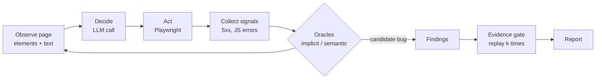
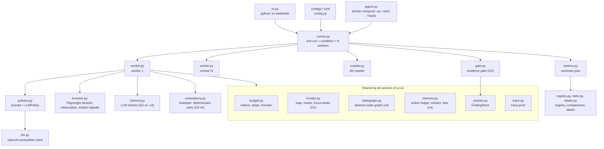
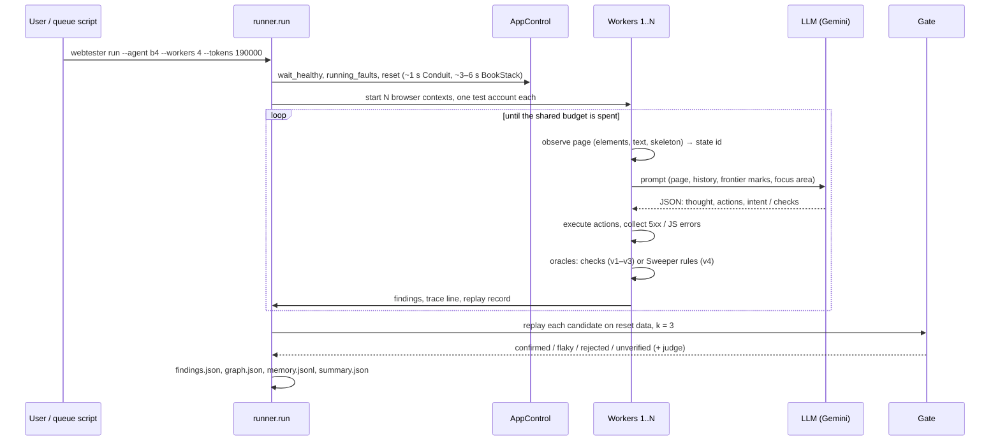
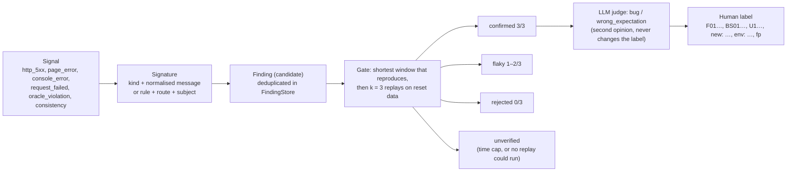
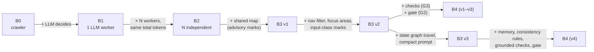
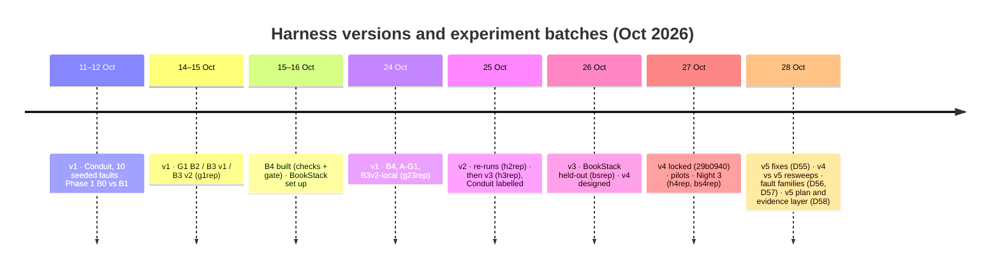

# Coordinated, Evidence-Gated LLM Exploration for Web Application Testing: Project Guide

| | |
|---|---|
| **Status as of** | 28 Oct 2026, evening PKT |
| **Harness version** | v4 locked at commit `29b0940` (branch `phase2-harness-v4`); **v5 in development** (D55-D58, not yet committed or locked, §7.5) |
| **Experiments done** | Phase 1 (B0 vs B1), G1 (B2, B3 v1, B3 v2), G2/G3 on Conduit (harness v1, v2, v3), BookStack held-out (v3), v4 development resweeps and pilots, Night 3 (v4 on Conduit and BookStack, labelled), v5 development resweeps of Night 3 (BookStack complete; Conduit 15 of 20 replays, interrupted, I52) |
| **Latest** | v5 resweep on BookStack (28 Oct): faults per run median 3 → 6 of 13 reachable, precision 51% → 95%, clean-app false alarms 4.0 → 0.6 per run (§11.8). Fault-family table (163 families, D56-D57) and a v5 plan by recall stage with an evidence layer (D58, `docs/v5_plan.md`) |
| **Next milestones** | Finish the Conduit resweep; v5.0 lock (target 2 Nov) and Night 4 (Conduit, BookStack, PrestaShop held-out); course paper 4 Nov; v5.1 lock (30 Nov); ISSTA 2027 (abstract 8 Jan, paper 11 Jan 2027) |
| **Course** | AI4015 Agentic AI, FAST-NUCES, Fall 2026 (seed G2, "Agentic AI and MCP for Intelligent Software Engineering") |

This is a living document. It explains the whole project, from the idea to the code to the results, for a reader who has not seen it before. New progress is added; earlier sections keep their numbers. Parts marked *generated* are refilled from the code and logs by `python scripts/guide_gen.py`.

## Changelog

| Date | Change | Sections |
|---|---|---|
| 28 Oct 2026 | v5 plan by recall stage (D58, `docs/v5_plan.md`): recall funnel, check outcomes, gaps by stage with verdicts, phases to the v5.0 (2 Nov) and v5.1 (30 Nov) locks; evidence layer built behind `capture_evidence` (response bodies, network timeline, transient messages, R57, R51). Guide brought up to v5: new §7.5 (v5 and the fault families), §8.3.5 (evidence layer), §11.8 (v5 resweeps); §7 renamed v1 to v5 | header, 0, 1, 7, 8.1-8.6, 10, 11.8-11.9, 12, 13, 14, 15, A, generated parts |
| 28 Oct 2026 | v5 BookStack resweep: precision 51% → 95%, clean false alarms 4.0 → 0.6 per run (D55); fault-family coverage table for generality, `docs/fault_families.md` (D56): 106 families over 13 workflow primitives and 13 app types; extended the same day from two reviewer chats (D57) to 163 families, 16 primitives, 16 app types and 14 check mechanisms | changelog only |
| 28 Oct 2026 | Night 3 labelled: final results and precision in §11.7 (corrects the provisional '5 of 6 semantic' to 4 of 6); §13, §14 updated | header, 11.7, 13, 14 |
| 28 Oct 2026 | Night 3 finished: provisional results in §11.7, header updated | header, 11.7 |
| 27 Oct 2026 | First version: idea, literature, research questions, system B0–B4, harness v1–v4, code reference (all 25 modules), how to run, results to Night 3, plan | all |

---

## Contents

**Part A: The idea**
- [0. How to read this guide](#0-how-to-read-this-guide)
- [1. One-page summary](#1-one-page-summary)
- [2. Background](#2-background)
- [3. Literature: where the field stands](#3-literature-where-the-field-stands)
- [4. Research questions, goals and hypotheses](#4-research-questions-goals-and-hypotheses)

**Part B: The system**
- [5. Architecture](#5-architecture)
- [6. The conditions B0 to B4](#6-the-conditions-b0-to-b4)
- [7. Harness versions v1 to v5](#7-harness-versions-v1-to-v5)

**Part C: The code**
- [8. Code reference](#8-code-reference)

**Part D: Running it**
- [9. How to run](#9-how-to-run)

**Part E: Evidence**
- [10. Experimental method](#10-experimental-method)
- [11. Results so far](#11-results-so-far)
- [12. Lessons, problems and threats to validity](#12-lessons-problems-and-threats-to-validity)

**Part F: The road ahead**
- [13. Current standing](#13-current-standing)
- [14. Plan to the end](#14-plan-to-the-end)
- [15. Questions for the supervisor](#15-questions-for-the-supervisor)

**Appendices**
- [A. Glossary](#appendix-a-glossary) · [B. Fault catalogues](#appendix-b-fault-catalogues) · [C. Decision index](#appendix-c-decision-index) · [D. Issue index](#appendix-d-issue-index) · [E. Run registry summary](#appendix-e-run-registry-summary) · [F. Literature list](#appendix-f-literature-list)

---

# Part A: The idea

## 0. How to read this guide

- **20 minutes:** §1 (summary), §13 (current standing), §15 (questions).
- **1 hour:** also §2–4 (idea and research questions), §6 (conditions) and §11 (results).
- **Full read:** everything, with §8 (code) as a reference to look things up in.

Four kinds of identifier appear throughout. Each points into the repository so any statement can be checked:

| Identifier | Meaning | Where |
|---|---|---|
| `D1`…`D58` | A design or method decision, with its reason and the alternatives considered | [logs/decisions.md](../logs/decisions.md) |
| `I1`…`I52` | An issue found and how it was handled | [logs/issues.md](../logs/issues.md) |
| `F01`…`F10`, `BS01`…`BS18` | A seeded fault (Conduit) or injected fault (BookStack) | [Appendix B](#appendix-b-fault-catalogues) |
| `DB5`, `FB1`, `RT5` … ; `R01`…`R75`; `M1`…`M14` | A fault family (what kind of bug), a consistency rule (built or proposed), a check mechanism | [docs/fault_families.md](fault_families.md) |
| `U1`…`U7` | Known upstream defects of Conduit, not seeded by us | [apps/realworld/README.md](../apps/realworld/README.md) |
| run labels (`g1rep`, `h3rep`, `bsrep`, `h4rep` …) | A batch of experiment runs | [run registry](../logs/experiments/run_registry.md) |

Every day's work is in [logs/progress/](../logs/progress/), and every number meant for the paper is collected with its source in [docs/paper_ledger.md](paper_ledger.md).

## 1. One-page summary

**The problem.** LLM agents can now drive a browser well enough to explore a web application on their own. That makes autonomous testing possible: give an agent a URL and let it find bugs. Three problems sit above the "which button to click" layer, and none is solved:

1. **G1, parallel agents repeat each other.** Running several LLM explorers at once mostly multiplies the same work, because each one discovers the same pages and forms.
2. **G2, agents report bugs that are not real.** An LLM tester flags passing behaviour as failing. In the ISSTA 2025 study of PinATA, specificity was 47–57%. PinATA's bug precision on WebTestPilot's benchmark was 0.26.
3. **G3, without a specification there is no semantic oracle.** Crash-style signals (HTTP 500, uncaught JS errors) are spec-free but miss most functional bugs. The strongest recent system, WebTestPilot (FSE 2026), reaches 0.96 precision and recall, but only because it is given a natural-language specification for every test.

**The idea.** We built a parallel LLM web tester with three mechanisms and measure each one under equal budgets:

- **A shared exploration frontier (G1):** workers see one shared map of the app, with what has been tried, what another worker is doing now, and a focus area per worker.
- **Spec-free oracles (G3):** the system decides what counts as a bug without a specification. Versions 1–3 used checks proposed by the LLM itself. Version 4 uses deterministic consistency rules built from the run's own memory: what the agents did, and whether the app agrees with itself.
- **An evidence gate (G2):** a candidate bug is only reported after it reproduces in fresh browser sessions on reset data (k = 3 replays, shortest reproducing trace).

**What is built.** A Python harness (`src/webtester`, about 6,800 lines, 26 modules, 106 tests) drives N isolated Chromium sessions through Playwright. It has a deterministic crawler baseline, the LLM explorer, the frontier, the oracles, the gate, offline metrics and statistics. It also includes two Dockerised subject apps:
- **Conduit**, a Medium clone with 10 faults we seeded;
- **BookStack**, from the base paper's benchmark, with 18 injected faults written by others.

**Headline results so far** (n = 5 per condition, 4 workers, 190k tokens per run, one model):

| Gap | Result | Status |
|---|---|---|
| G1 | The shared frontier cuts duplicate actions by 34–48% at equal tokens (p = 0.008), replicated on harness v1, v2 and v3. Sharing, not partitioning, drives it. It does not find more bugs. | Solid on Conduit, small |
| G3 | On Conduit, LLM-proposed checks found 4 of the 6 reachable semantic faults across runs; implicit oracles found none (p = 0.008). On held-out BookStack they found **0 of 13** reachable faults. | Positive on the development app only |
| G2 | The gate confirms reproducible findings, but a wrong expectation about deterministic behaviour reproduces perfectly. Gated precision was 74% on Conduit and 19% on BookStack, against a target of 90%. | Weak; a negative finding in itself |

The BookStack result shaped **harness v4** (locked 27 Oct). v4 stops asking the model to predict outcomes. Instead it checks the agents' stated intents and the app's internal consistency with deterministic rules. On replays of recorded runs on the fault-free apps, these rules raise 0.33 (Conduit) and 0.60 (BookStack) definite false alarms per run. Night 3 measured v4 on both apps (§11.7): 5 Conduit and 2 BookStack faults per run, against 1 and 0 for crash-style oracles.

**Harness v5** (in development, §7.5) fixes the causes of v4's false alarms and misses measured in Night 3. Replayed over the same recorded BookStack runs without any LLM call, it doubles the faults found per run (3 → 6 of 13) and raises precision from 51% to 95% (§11.8). Two further steps came with it:
- a **fault-family table** (163 families from published web-bug taxonomies), so the rules target kinds of bugs apps share, not our two apps;
- a **v5 plan organised by where recall is lost** (reaching the page, capturing evidence, the rule, the gate), with a new evidence layer that keeps response bodies and short-lived messages.

Night 4 will test the locked v5 on a third app it was not designed on (PrestaShop).

**Where it is going.** First the course submission (4 Nov), then a research paper. The primary target is ISSTA 2027 (abstract 8 Jan, paper 11 Jan 2027); the fallback is ICST 2027 NIER (13 Jan 2027). Which claim the paper makes depends on whether v4 holds up on PrestaShop (§14).

## 2. Background

### 2.1 End-to-end web testing
A web application is tested end to end by driving it through its user interface, as a user would: open pages, fill forms, click buttons, and check that what happens is right. This is hard to automate for three reasons:
- **State.** The same page can be in many states: logged in or out, empty or full lists, a form half filled.
- **Asynchrony.** Single-page apps update the page after network requests finish, so "after the click" is not a single moment.
- **Data.** Actions change data that later pages show, so one wrong save can show up as a wrong list somewhere else.

Classical automated explorers are crawlers such as Crawljax (Mesbah et al.). They build a state-flow graph by clicking every element and filling forms with random or rule-based values. They reach many pages but understand none of them. Reinforcement-learning explorers (WebRLED, WebCQ, MARG) learn which actions lead to new states.

### 2.2 The oracle problem
An **oracle** decides whether observed behaviour is correct. There are two kinds:
- **Implicit oracles** need no knowledge of the app: HTTP 5xx answers, uncaught JavaScript exceptions, console errors, failed requests. They are cheap and never wrong about *that something broke*, but they only see crashes.
- **Semantic oracles** know what the app should do. "After deleting this comment it must not appear on reload" and "the favourites list must contain what I just favourited" are semantic. Most real functional bugs are semantic: wrong data, missing items, actions that silently do nothing, access that should be refused.

Semantic oracles normally come from a **specification**: test cases, requirements or assertions written by a person. *Spec-free* semantic oracles are the open problem. They have to be inferred from the app itself.

### 2.3 LLM agents as testers
An LLM agent explores in a loop. It **observes** the page (as text: the interactive elements and visible text), **decides** what to do (one model call), **acts** through a browser driver, and repeats. Compared with a crawler it understands forms and flows ("this is a sign-up form", "now check the article appears"), and it can generate meaningful inputs. Its costs:
- **tokens**: every step is a model call;
- **rate limits**: free tiers allow a few hundred calls per day;
- **non-determinism**: the same page can lead to different decisions.



### 2.4 Parallel exploration
Running N agents at once should cover more of the app in the same wall-clock time. Without coordination, though, every agent starts at the home page, finds the same navigation bar and tries the same forms. Multi-agent LLM systems often gain little over a single agent. The MAST taxonomy (NeurIPS 2025) lists step repetition as the most common single failure mode (15.7%). The fair question is therefore not "do 4 agents beat 1?" but **"do 4 coordinated agents beat 4 independent agents with the same total budget?"**

### 2.5 False positives and reproduction
LLM testers hallucinate bugs. Reported causes:
- non-deterministic rendering or timing (RippleGUItester attributes about 61% of its false positives to these);
- wrong expectations about how the app is designed;
- actions that never actually ran.

A natural filter is **reproduce before report**: a real bug should happen again when the same steps are replayed in a fresh session on reset data. WebTestPilot retries a failed assertion once (n = 1) and never re-executes in a fresh session.

## 3. Literature: where the field stands

Twelve papers were read in full or from their abstracts. Their fact sheets (problem, method, data, results, limitations, relevance, with page references) are in [literature/summaries/](../literature/summaries/), and the full corpus of 66 papers is listed in [Appendix F](#appendix-f-literature-list).

### 3.1 The base paper: WebTestPilot (FSE 2026, CORE A*)
Teoh et al., *Proc. ACM Softw. Eng.* 3(FSE), 2026, doi 10.1145/3797115.
- **What it does:** it takes a natural-language test requirement and splits it into steps of (condition, action, expectation). It then infers pre- and postcondition assertions in a Python DSL over "symbolized" GUI elements (Pydantic schemas such as `Cart`, `Product`) and checks them while executing.
- **Benchmark:**
  - 4 open-source apps: BookStack, Indico, InvoiceNinja, PrestaShop;
  - 100 requirements, with one injected bug each;
  - the bugs are JavaScript mutations of the page, modelled on real GitHub issues;
  - crash and cosmetic bugs are excluded.
- **Results:**
  - precision and recall 0.96 for bug detection, against PinATA's 0.26 / 0.69;
  - flow completion 0.99;
  - about 10k tokens and 29 s per step, with GPT-4.1.
- **Limits we build on:**
  - it needs a complete specification for every test, and does no exploration;
  - it runs tests one at a time on purpose, to avoid shared-state interference;
  - it retries a failed assertion once, never in a fresh session;
  - no repeated runs or variance are reported.
- **Our relation to it:**
  - its benchmark is our held-out set (BookStack now, PrestaShop next);
  - its spec-given setting is our upper bound;
  - we remove the specification (G3), add fresh-session replay (G2) and parallel workers (G1).
- **Artifact:** public (github.com/code-philia/WebTestPilot). We inspected the code on 16 Oct. The benchmark was revised after the paper, and the bugs are client-side mutations armed after a scripted login.

### 3.2 The other papers, by theme

| Theme | Paper (venue) | What it shows | What it leaves open |
|---|---|---|---|
| LLM web testers | Are Autonomous Web Agents Good Testers? (ISSTA'25) | PinATA, 3 apps, 113 NL tests: specificity 0.47–0.57 | Needs test cases; flags passing tests as failing (**G2 evidence**) |
| | AutoE2E (ICSE'25) | Infers app *features* without a spec; E2EBench (includes Conduit) | Generates no oracles or assertions (stated future work) (**G3**) |
| | CATTest / CATJudge (EMNLP'26) | 102 AI-generated apps with annotated bugs; frontier models P ≤ 48.6 | Checklist-based; R ≤ 42.6 even with a project document |
| Multi-agent and parallel exploration | WebCQ (ASE'26) | Cooperative multi-agent RL: +27.1% states over independent agents | RL, not LLM; console-log oracle only (**G1**) |
| | GraphDroid (ASE'26) | Graph-guided LLM GUI testing, "asynchronous" reasoning | One device; multi-browser execution not studied |
| | MAdroid (ICSE'26) | Multi-device agents for multi-user features | Turn-taking on one task; ≤ 3 devices |
| | MAST (NeurIPS'25 D&B) | Taxonomy of multi-agent LLM failures | Gains often small; step repetition 15.7%; verification failures 17.3% |
| | ScenGen (TOSEM'26) | Scenario-guided mobile GUI testing | Needs scenarios; redundant exploration from a single prompted LLM |
| False positives and replay | RippleGUItester (PACMSE'26) | Precision 0.464; about 61% of FPs from non-determinism and replay | Proposes repeated execution as the fix (**G2 design support**) |
| State abstraction | Judge (TOSEM'26) | Tree-hash merge plus a learned classifier for web state identity | Single explorer; RL/model-based tools (**our state ID borrows its "merge" idea**) |
| Memory | MemoDroid (ASE'25) | Memory for LLM GUI agents | Single agent |
| Judging | Huang et al. (ICLR'24) | LLMs do not self-correct reasoning without outside feedback | Motivates v4: check facts, not the model's opinion (D49) |
| Older foundations | Crawljax/ATUSA (Mesbah et al.) | State-flow graph and generic invariants for Ajax apps | Not LLM; invariants hand-specified |
| | Genie (OOPSLA'21) | Independent-view property: the same data seen through different paths must agree | Android; our G2 reload rule borrows the idea (D50) |
| | BACScan (CCS'25), InputBlaster (ICSE'24) | Broken access control by replay; unusual inputs for text fields | Our R13 and R16/R17 rules borrow the ideas (D50) |
| | MARG (ASE'24) | Several cooperating RL agents test one website | Prior art for parallel web testing: **we do not claim to be first** |

### 3.3 Comparison along our three gaps

| Work | Parallel workers | Shared exploration state | Reproduce before report | Semantic oracle without a spec | Equal-budget evaluation |
|---|---|---|---|---|---|
| WebTestPilot (FSE'26) | no (sequential on purpose) | – | retry once, same session | no (needs a spec) | – |
| PinATA (ISSTA'25) | no | – | no | no (needs test cases) | – |
| AutoE2E (ICSE'25) | no | – | – | no oracles | – |
| WebCQ (ASE'26) | yes (RL) | yes (cooperative RL) | no | no (console errors) | same agent count |
| MARG (ASE'24) | yes (RL) | yes | no | no | – |
| RippleGUItester (PACMSE'26) | no | – | proposes repetition | partial | – |
| CATTest (EMNLP'26) | no | – | no | checklist | – |
| **This project** | **yes (LLM)** | **yes (shared frontier, state graph)** | **yes (k = 3, fresh sessions, reset data)** | **yes (v1–v3 LLM checks; v4 consistency rules)** | **yes (tokens, workers, model)** |

### 3.4 The gap
No peer-reviewed work combines parallel LLM exploration with explicit coordination, spec-free semantic oracles and a reproduce-before-report gate, or measures each one under equal budgets. The project does not claim to be the first parallel web tester (MARG), to test "every input of any website", or to use hundreds of browsers. Its contribution is measured, equal-budget evidence for each mechanism, including where they fail.

## 4. Research questions, goals and hypotheses

Each gap maps to one component, one ablation, one research question and one success criterion (D2, [research plan §3](00_research_plan.md)). The KPI targets below were set before any results were seen.

| | G1: parallel duplication | G2: unreal bugs | G3: no semantic oracle |
|---|---|---|---|
| **Research question** | RQ1: at equal total tokens, does a shared frontier with N workers reach more unique states, and repeat fewer actions, than N independent workers? | RQ2: does the evidence gate raise the precision of reported findings without a large loss of real ones? | RQ3: do spec-free oracles find seeded *semantic* faults that implicit oracles miss? |
| **Hypothesis** | Yes for N ≥ 4; duplicates fall substantially | Precision rises sharply, recall drops slightly | They find a substantial share, and the gate filters their false alarms |
| **Component** | Shared frontier (`frontier.py`), state graph (`stategraph.py`) | Evidence gate (`gate.py`) | LLM checks (`inferred.py`), consistency oracles (`consistency.py`, `memory.py`) |
| **Ablation** | A-G1 = B4 without the frontier; B3 v2-local = the same frontier per worker, not shared | A-G2 = B4's raw candidates against its gated ones (paired, no extra runs) | A-G3 = B4 without semantic oracles |
| **KPI** | ≥ 15% more unique states and ≥ 30% fewer duplicate actions (p < 0.05, large Â12) | Precision ≥ 0.90; recall loss ≤ 10 points; gate cost ≤ 25% of tokens | ≥ 40% of the semantic faults that implicit oracles miss |

**Goal for the paper** ([ISSTA plan §4](issta2027_plan.md)). A "go" on 5 Jan 2027 needs four of the eight KPIs:
- **K1:** held-out detection, ≥ 30% of reachable injected faults on each held-out app;
- **K2:** gated precision ≥ 0.80;
- **K3:** ≥ 5 real previously unknown bugs, ≥ 2 acknowledged by maintainers;
- **K7:** beating an external spec-free baseline at equal budget.

**Out of scope:** security testing (an optional slice only, D1), spec-based testing, and claims about hundreds of browsers.

# Part B: The system

## 5. Architecture

### 5.1 Components



Design choices behind this layout:
- **One process, asyncio.** All N workers run as coroutines in one Python process, each with its own Playwright browser *context*: separate cookies and storage, so separate logged-in users. Shared structures (frontier, graph, memory, budget, findings) are ordinary Python objects with no database or locks (D23).
- **Stateless prompts.** Each step's prompt holds the current page plus the last 10 steps, not a growing chat. This keeps a step at about 1.4–2.7k tokens (D15).
- **Code checks, not the LLM.** Every oracle is a predicate evaluated by code, so every finding can be replayed by the gate (D27, D49).
- **Offline metrics.** Every metric is recomputed from the trace file, never from in-memory state. All conditions are measured by the same code (`metrics.py`).

### 5.2 One run, start to finish



A run folder (`runs/<timestamp>_<app>_<agent>_n<workers>_<label>/`) holds:

| File | Content |
|---|---|
| `config.json` | The complete configuration of the run, including which API key variable was used |
| `trace.jsonl` | One JSON line per event: run start, every step (actions, thought, tokens, signals, checks), findings, gate replays, run end |
| `replay.jsonl` | Per worker and step: start URL, session storage, actions by element key; what the gate replays |
| `findings.json` | Every deduplicated candidate with its gate label, replays and judge verdict |
| `graph.json` | The abstract state graph (v4) |
| `memory.jsonl` | The action ledger of the run memory (v4, B4 family) |
| `summary.json` | All metrics, recomputed from the trace, plus fault detection and reach |

### 5.3 What a "state" is
State identity decides what counts as "new" and what counts as a duplicate. It is defined once and used for every condition (D13, `state.py`):
- **Route shape:** path segments that look like values become `*`, and query values are dropped. So `/article/how-to-x-3` becomes `/article/*`, and `/search?q=abc` becomes `/search?q`.
- **Skeleton:** the visible DOM structure with all text and attributes removed, and identical sibling subtrees merged. This is Judge's "merge" idea: a list of 3 or 30 items gives the same skeleton.
- **State id** = hash(route shape, skeleton). Logged-in and logged-out pages differ in their navigation bar, so the session role is part of the state without any app knowledge.
- **Action identity:** a fill is identified by the *class* of value typed (empty, whitespace, email, number, special, long, text), not the exact text. Typing two different words into one field is a duplicate action.

Known limit (I11): alphabetic value segments stay distinct, so `/profile/alice` and `/profile/bob` are different routes. The frontier works around it with focus areas that merge sibling routes.

### 5.4 What a finding is



The gate decides whether a finding is reported. Labels decide whether it was right. Precision is measured on labelled runs at three points: raw candidates, gate-confirmed, and confirmed minus the judge's `wrong_expectation` verdicts (D42).

## 6. The conditions B0 to B4

A **condition** is a configuration of the tester (`--agent` on the command line). Conditions differ in exactly one mechanism from their neighbour, so each comparison isolates one effect.

### 6.1 All conditions

| Agent | Paper name | What it is | Gap it tests | Main files | Defined in | Used in counted runs |
|---|---|---|---|---|---|---|
| `b0` | B0 | Breadth-first crawler with a random form filler, no LLM | Value of an LLM at all | `crawler.py` | plan §6, D18 | Phase 1; BookStack |
| `random` | – | Uniform random actions | Sanity floor and offline smoke test | `policies.RandomPolicy` | – | no |
| `b1`, N = 1 | B1 | One LLM explorer, implicit oracles only | Phase 1 baseline | `policies.LLMPolicy`, `llm.py`, `worker.py` | D15, D16 | Phase 1 |
| `b1`, N = 4 | B2 | Four independent LLM explorers (same prompt as B1) | Parallelism without coordination | as B1 | D23, D24 | G1 |
| `b3` | B3 v1 | LLM explorers with an advisory shared frontier: `[done xN]`, `[taken]`, least-explored suggestion | G1 | `frontier.Frontier` | D23 | G1 (null result) |
| `b3local` | B3-local | B3 v1 with a private frontier per worker | Map vs sharing it | as B3 | D23 | no |
| `b3v2` | B3 v2 | Shared frontier v2: navigation filtering, a focus area per worker, input-class marks | G1 | `frontier.FrontierV2` | D25 | G1; v2/v3 Conduit; BookStack |
| `b3v2local` | B3 v2-local | B3 v2 with a private frontier per worker | Sharing vs partitioning | as B3 v2 | D25 | G1 ablation |
| `b4` (harness v1–v3) | B4 | B3 v2 + LLM-proposed checks (G3) + evidence gate (G2) | All three | `inferred.py`, `gate.py` | D27–D29, D46 | Conduit v1–v3; BookStack |
| `b4nog1` (v1–v3) | A-G1 | B4 without the frontier | G1 inside B4 | as B4 | D29 | Conduit v1–v3 |
| `b4nog3` (v1–v3) | A-G3 | B4 without checks (implicit oracles + gate) | G3 | as B4 | D29 | Conduit v2–v3 |
| `b3v3` | B3 v3 | B3 v2 + state-graph travel by URL + compact prompt, implicit oracles only | G1 baseline for v4 | `frontier.FrontierV3`, `stategraph.py` | D49 | Night 3 |
| `b4` (v4) | B4 v4 | B3 v3 + run memory + intent-verified and consistency oracles + grounded LLM checks + gate | All three | `memory.py`, `consistency.py`, `inferred.py`, `gate.py` | D49, D50 | Night 3 |
| `b4det` (v4) | B4-det | B4 v4 without any LLM-based oracle (no checks, no cited contradictions) | Deterministic rules alone | as B4 v4 | D49 | planned |
| `b4nog1` (v4) | A-G1 | B4 v4 without the frontier | G1 | as B4 v4 | D49 | planned |
| `b4nog3` (v4) | A-G3 | B4 v4 without G3 (B3 v3 exploration + gate) | G3 | as B4 v4 | D49 | planned |

The names `b4`, `b4nog1` and `b4nog3` kept their roles across harness versions, but their contents changed with v4. Every run records its harness commit in its trace, and run labels (`g23rep`, `h2rep`, `h3rep`, `h4rep` …) keep the versions apart.

The condition sets are defined in [runner.py](../src/webtester/runner.py), lines 33–55:

```python
FRONTIERS = {"b3": (Frontier, True), "b3local": (Frontier, False), "b3v2": (FrontierV2, True),
             "b3v2local": (FrontierV2, False), "b3v3": (FrontierV3, True), "b4": (FrontierV3, True),
             "b4det": (FrontierV3, True), "b4nog3": (FrontierV3, True)}
INFERRED = {"b4", "b4nog1"}              # explorer proposes checks and cited contradictions (LLM-based)
CONSISTENCY = {"b4", "b4det", "b4nog1"}  # memory + intent-verified + consistency oracles (G3 v4)
GATED = {"b4", "b4det", "b4nog1", "b4nog3"}  # evidence gate after exploration (G2)
```

### 6.2 What changes from one condition to the next



- **B0 → B1:** the crawler logs in with a recipe, then systematically clicks each element and submits each form once per abstract state, with random values. B1 gets the same observation, but an LLM picks up to 6 actions per step from a prompt (below).
- **B1 → B2:** four B1 workers, each with its own account, share one token budget of 190k (D24), so B2 has the same total budget as one B1 run.
- **B2 → B3 v1:** the prompt shows a shared map. Each element is marked `[done x3]` (the team already did it 3 times here) or `[taken]` (another worker leased it in the last 90 s), and a suggestion to go to the least-explored state is added. It had **no measurable effect** (I16): navigation links kept every page "unexplored", so the suggestion never fired.
- **B3 v1 → B3 v2** (D25):
  1. elements present on at least half of the states (the nav bar) stop counting as work and are marked `[nav]`;
  2. each worker owns a **focus area**: a route, or sibling routes merged as `/profile/*`, or a linked route nobody visited. It is reassigned when dry or after 15 steps;
  3. text fields show which input classes were already typed, e.g. `[tried: empty, text]`.
- **B3 v2 → B4 (v1–v3):** the explorer may attach up to 2–3 executable checks per reply in the same call: `shows`, `not_shows` (now, after reload in a fresh tab, or on another path), `count`, `changes`, `route`. A failed check is a finding, and every finding goes through the gate.
- **B3 v2 → B3 v3 (v4):** when a worker is assigned a new focus area, the harness travels there by URL with no LLM step (22–28% of B4 tokens had gone to walking to known pages). The prompt collapses explored navigation into one line.
- **B3 v3 → B4 (v4):** the model states its **intent** (verb, object, type) instead of predicting outcomes. A per-worker `Sweeper` then checks the effect and the app's consistency with deterministic rules (§7.4). LLM checks are kept only when grounded in facts.

**The explorer's instructions** (`policies.SYSTEM_PROMPT`, shared by every LLM condition):

```text
You are an autonomous software tester exploring a web application to find bugs. There is no
specification: work out what the app is for from what you see.
How to explore:
- Cover the app broadly: visit pages and features you have not seen yet (routes visited are listed).
- Exercise every form: valid input first, then invalid, empty, boundary, very long and special-character input.
- Complete whole user flows (create, view, edit, delete; follow, favorite; settings) and check the results look right.
- Use the given account to log in, or register new accounts. Stay inside this app.
- Do not repeat an action that already happened in the same state unless you are checking something specific.
Reply with ONE JSON object and nothing else:
{"thought": "...", "actions": [{"do": "<action>", "id": "<element id>", "value": "<text>"}]}
```

The B4 family adds `ORACLE_PROMPT` (v1–v3 checks) or `INTENT_PROMPT` and `CHECKS_PROMPT` (v4). The full text is in [policies.py](../src/webtester/policies.py).

### 6.3 The ablation logic
- **Map vs sharing:** B3 v2-local (each worker has its own frontier) against B3 v2 (one shared frontier). If B3 v2 wins, the gain comes from sharing, not just from having a map or focus areas.
- **A-G1** (`b4nog1`): the full system without the frontier. This tests G1 inside the full system.
- **A-G2** needs no runs. The gate runs after exploration and never changes it, so B4's raw candidates are the gate-off condition. They are compared with the gated ones on the same runs (paired, `webtester gate-report b4`, D29).
- **A-G3** (`b4nog3`): the full system without semantic oracles (implicit oracles and gate only). This tests G3.
- **B4-det** (`b4det`, v4): v4 without any LLM-based oracle. This tests whether the deterministic rules alone carry the result.

## 7. Harness versions v1 to v5

The harness was improved between experiment batches. Each version was **frozen before its runs**, and its changes were decided from measured weaknesses, never tuned on the held-out app. v5 is still in development (§7.5).



### 7.1 v1 (11–24 Oct): the first complete system
- **Base harness (11 Oct):**
  - Playwright Chromium, one context per worker;
  - an observation of up to 80 interactive elements plus a text-free skeleton;
  - state id v0 (D13); stateless prompts (D15); JSONL traces;
  - implicit oracles, ignoring Chrome's "Failed to load resource" lines (D14).
- **Model:** `gemini-3.5-flash-lite`, temperature 0.2, ≤ 800 output tokens, JSON mode, calls 6.5 s apart (D16).
- **Frontier v1** (D23, 12 Oct) and **v2** (D25, 14 Oct).
- **B4 (15 Oct):** inferred checks (D27) and gate v1 (D28), frozen after its pilot (D40).
- **Run batches:** Phase 1 (12 Oct), G1 (`g1rep`, 14–15 Oct), G2/G3 (`g23rep`, 24 Oct).

### 7.2 v2 (25 Oct, commit `a1795ff`, label `h2rep`)
Fixes from the v1 results:
- **Observation v2** (D43): elements with a computed `cursor: pointer` are also extracted. Angular click handlers had left `<a>` without `href` and icon buttons invisible, so faults F06, F08 and F10 could never be reached in 40 runs (I33).
- **Gate v2** (D42): a full-prefix window (replay the worker's whole log) rebuilds data the worker created earlier, which a reset wipes (I32). The replay log is saved, so `webtester regate` can re-run the gate offline.
- **Exposure markers** (D44): each seeded fault logs when it fires, so "never reached" and "reached but not noticed" can be told apart.

### 7.3 v3 (25 Oct, commits `7784d6c`, `d6094ef`, labels `h3rep`, `bsrep`)
Fixes from the labelled v2 results (D46):
1. `settle()` waits until no request has been in flight for 300 ms. In a single-page app, "network idle" returned at once, so checks ran before the app answered.
2. Already-selected controls are marked `active`, and a "no change" check on them is inconclusive.
3. On freshly loaded pages, text-field values count as page text.
4. The prompt says when the worker appears logged out.
5. Checks prompt v3: up to 3 checks, from three angles (immediate effect, after reload, numbers), and route checks only for navigation the model asked for.
6. An automatic **persistence twin**: a passed "now" check is re-run after a reload when the click could change data.
7. The gate labels a finding `unverified`, not `rejected`, when no replay could run.
8. An implicit fault match counts only if the fault's marker fired (I36).

A rule fixed before the runs (D47) decided whether the check changes stay for BookStack. They did.

### 7.4 v4 (26–27 Oct, locked at `29b0940`, labels `h4rep`, `bs4rep`)
v4 is a change of approach, motivated by BookStack. All 32 BookStack false alarms were wrong guesses about design: where Save leads, what a heading says (I43). And the LLM checks found none of BookStack's faults, which are wrong content *on arrival*, not wrong effects of the agent's own action. v4 therefore separates **what the agent meant to do** (its intent, which it knows) from **how the app shows the result** (which it can only guess). It checks the effect with facts the harness reads from the pages (D49). New parts:

- **Abstract state graph** (`stategraph.py`):
  - pages (route shapes) and states (state ids);
  - transitions (state, action) → next states, with who took them and whether data changed;
  - recorded in every condition, saved as `graph.json`, exportable to Mermaid.
- **Run memory** (`memory.py`, shared):
  - **M1** action ledger: verb, object, fields, write accepted, status pending/verified/conflict/unknown;
  - **M2** entities: names, saved fields, toggles, ages per page;
  - **M3** list snapshots per worker and page;
  - **M5** notes in the prompt.
- **Consistency oracles** (`consistency.py`): deterministic, no LLM tokens, in three tiers (rule catalogue below).
- **Grounded LLM checks:**
  - route checks take the clicked link's `href`;
  - text checks must use text that was typed or seen;
  - a `*` the model writes is a wildcard (fixes I41).
- **FrontierV3:** travel by URL to a new focus area, a compact prompt, page naming.
- **Gate for consistency findings:** a fresh Sweeper is fed the replayed steps, and the finding is reproduced when the same rule fires on the same subject. The judge is used only on T2/T3 rules.
- **`webtester resweep`** replays a recorded run with the v4 rules and no LLM. It made v4 development possible without spending API quota.

**The v4 rule catalogue** (from the `consistency.py` docstring and D49/D50):

| Tier | Rule | Fires when | Example fault it targets |
|---|---|---|---|
| T1 (definite) | R01 junk | `NaN`, `undefined`, `[object Object]`, unfilled templates, escaped entities, stack traces in visible text | rendering bugs |
| | R02 broken link | a list item's link answers 404/5xx | dead links |
| | R03 dead item | one list item has no real link while its siblings do | phantom entries (BS05–BS08) |
| | R04 count below list | a shown count of items is lower than the items listed | count bugs (F05, BS05–07) |
| | R05 phantom result | a search for a made-up word returns results | phantom search result (BS08) |
| | R06 arithmetic | qty × price ≠ line total, or total ≠ sum | shop apps |
| | R07 own toggle missing | what this worker favourited/followed is missing from that list | BS01 (favourited shelf missing) |
| | I-create / I-edit / I-delete / I-toggle / I-logout | the app accepted the write, but the created/edited item is not shown, the deleted one is still there in a fresh tab, a toggle count moved wrongly, the account still shows after logout | F06 (deleted comment still shown) |
| | R16 boundary input | an accepted create form re-submitted with empty, spaces-only or over-long values gives 5xx or a page error | F01 (comment > 280 chars → 500) |
| T2 (likely; judged) | R04b, R07b | "showing a–b of N" inconsistent; an observed toggle missing from its list | |
| | R08 ages | the same item shows different ages on two pages, or something just touched reads "days ago" | BS09–BS11 |
| | R09 revisit diff | a list changed on a revisit with no recorded action to explain it | BS02–04, F09 |
| | R10 link vs destination | a link's text and the heading of the page it opens disagree | BS12 |
| | R11 pagination | a page control leaves the list unchanged | F09 (pagination does nothing) |
| | R12 echo | typed markup rendered as HTML | XSS-like rendering |
| | R13 access | Edit offered but refused for this session, or Edit hidden but its address opens the filled form | F07 (Edit/Delete offered to a non-author) |
| | R17 validation | an empty name accepted, or empty rejected but spaces accepted | whitespace-only values (Conduit) |
| | I-filter | a filter or search result does not contain the term | F10 (tag filter lists untagged articles) |
| | I-submit, I-error | a valid form sent nothing and nothing changed; a system error after a save | no-op UI |
| | G1 back, G2 reload | back does not return to the previous page; the same URL in a fresh tab shows other content | |
| T3 (LLM) | R15 cited contradiction | the model cites two texts that cannot both be true; kept only if both quotes are on pages it saw | |

**Pre-lock development (26–27 Oct).** The v4 rules were run over the recorded `h3rep` (Conduit) and `bsrep` (BookStack) runs, both with faults on and on the clean app, and every false-alarm pattern on the clean app was traced and fixed (D53, D54):
- counts must be standalone tokens ("Follow worker04" is not a count of 4);
- revisits across a login are skipped;
- tab bars are navigation, not lists;
- a deleted item is identified by its whole card, not its footer;
- the page text before a delete is read in full.

The lock bar was at most 1 definite (T1) false alarm per clean run. The final numbers were 0.33 on Conduit and 0.60 on BookStack.

### 7.5 v5 (from 28 Oct, in development, not yet locked)
v5 has three layers of work. The first is done in code; the second is a design document; the third is a plan with dates.

**1. Fixes for what Night 3 measured (D55).** Night 3's labels (I49) and a live audit of the faulty BookStack pages named the causes of v4's false alarms and misses. The goal set by the author: precision ≥ 0.90 and recall as high as reachable.
- **Precision fixes P1-P9:**
  - I-create/I-edit name the object by the typed values, not the model's intent words, and forms with a password field (login, sign-up) set no expectation. This was the largest false-alarm source: login intents read as "create 'session'".
  - R02 and R03 ignore hidden elements.
  - R09 treats activity feeds as volatile and accepts any worker's rename or delete as an explanation.
  - R11 only fires on real pagination controls.
  - Relative times are normalised before the reload check.
  - R10 skips links to search pages.
  - I-filter checks only typed terms and clicked filter links.
  - R12 skips Markdown body fields.
  - I-toggle reads the number inside the clicked control only.
- **Recall fixes A1-A10:**
  - List items are grouped by tag and shared class, which catches BookStack's phantom search result.
  - Headings inside links are not list headings.
  - R03 also covers 2-item lists.
  - R04 reads a count in the list's own heading.
  - Time invariants per entity: nothing about an item is older than its creation (BS09-BS11).
  - Toggle verbs come from icon classes (Conduit's heart button, F05).
  - **R07c**: a "Your Feed" list must only hold followed authors (F08).
  - **R19**: a toggle probe expects a like or favourite count to rise by one, then undoes the click (F05).
- **Measured by resweep** (§11.8): the same Night 3 runs replayed with the v4 and the v5 rules, no LLM, on the faulty and the clean app. Only `consistency.py` differs between the two (`scripts/webtester_v4oracles.py` loads the locked v4 file).
- **Exploration fixes E1-E3** (revisit budget, shorter memory notes, unvisited entity pages) need live pilots and are not yet built.

**2. Fault families, so the rules generalise (D56, D57).** Rules written for two apps would not transfer. So `docs/fault_families.md` lists every web fault family named in published taxonomies:
- Marchetto, Ricca and Tonella: 57 classes over 676 real bugs;
- Mesbah et al.: generic DOM invariants;
- Vijayaraghavan and Kaner: e-commerce bugs;
- Genie, metamorphic security and query relations, game bugs, date and time bugs, financial systems, health records.

It also includes families from the workflows of 16 app types (banking, invoicing, HR, booking, boards, dashboards, streaming, multi-tenant admin, …), built from 16 **workflow primitives** (create-read-update-delete, collections, ledgers, lifecycles, capacity, scheduling, hierarchies, queries, aggregates, identity, sharing, files, rich clients, many-to-many relations, contexts, media) plus navigation, which every app has.
- Each family records the evidence a tester without a specification can use against it. There are eight kinds: implicit, in-page, cross-view, intent-effect, metamorphic, probe, norm, and declared (the page's own constraints).
- Each family also has a status: 26 covered, 20 partial, 106 checkable without a spec but not yet built, 3 needing a specification, 8 out of scope (163 in all).
- The 106 checkable families need 14 check mechanisms, not 106 rules: a cross-view registry, in-page arithmetic, write effects, input probes, query relations, round trips, other sessions, resubmission, page norms, environment replay, network fault injection, payload checks, declared constraints, and DOM geometry and media state.
- 57 of the families came from two reviews of the table by ChatGPT and Claude. Their cited papers were checked before use, and families they alone back are marked "our analysis". What was not taken from them is listed with reasons (section 10 of the table).
- PrestaShop's fault list was never read, so it stays a held-out test (I50).

**3. The v5 plan, by recall stage (D58, [`docs/v5_plan.md`](v5_plan.md)).** A second round of reviews made the point that most missed bugs are lost before any rule runs:
- the agent never reaches the page;
- its form input is rejected, so no write happens;
- the page facts are not extracted;
- the gate fails to reproduce the finding (21% recall loss in v3).

The plan therefore works stage by stage:
- **Claim:** high recall over a defined population of faults a browser can observe, reported both over the checkable families and over all faults, with precision per distinct issue. Not "every error".
- **Measure first:** a **recall funnel** gives each seeded fault the first stage it failed: reached, triggered, observed, rule armed, flagged, confirmed, matched. A **check-outcome log** records what each rule did on each page (detected, ran clean, unarmed, suppressed by a guard, capped, unobservable), so a check that never ran is not counted as a pass.
- **About 70 gaps** across reach, observation, judgement, the gate, evaluation, safety and scope, each with a verdict, a fix, a metric and a phase. Examples:
  - generating valid form input from the page's own field constraints;
  - seeding data so list rules have something to check;
  - one account per role, with a second session in the gate;
  - session storage in gate replays;
  - a harness-health check (rate limits, expired CSRF tokens);
  - a clean corpus of 10-12 apps for false alarms;
  - real historical bugs and second-variant faults beside our own;
  - a rebranded-app control for LLM contamination;
  - read-only, reversible and controlled execution modes.
- **Phases:** instrumentation (28-30 Oct); **v5.0 lock** (target 2 Nov), then Night 4 and the course paper; reach fixes; evaluation set; remaining mechanisms; **v5.1 lock** (30 Nov) with all thresholds frozen before the December held-out runs.

**First code of the plan: the evidence layer (D58, §8.3.5).** v4 kept only the status codes of write requests. v5 can also keep:
- a network timeline with the JSON body of every same-origin response and what each write sent;
- short-lived messages (toasts, flash banners), which are gone before the harness reads the page.

Two rules use them, both at tier T2 until measured:

| Rule | Fires when | Family |
|---|---|---|
| R57 payload | a request answered 2xx carries an error body (GraphQL `errors`, an `error` field, a validation `errors` object) | RT5 |
| R51 message fidelity | a success message and an error message appear within 3 s in one step | FB2 |

The layer is off unless `[run] capture_evidence = true`, so the Night 3 resweep comparison still running is not affected.

# Part C: The code

## 8. Code reference

### 8.1 Repository map

| Path | What lives there |
|---|---|
| [`src/webtester/`](../src/webtester/) | The harness: 26 modules, about 6,800 lines of Python (§8.2) |
| [`apps/realworld/`](../apps/realworld/) | Conduit (RealWorld): Postgres + Express/Prisma backend + AutoE2E-instrumented Angular frontend in Docker Compose. 10 seeded faults switched by the `FAULTS` variable, `agentic_reset()` snapshot reset in about 1 s, 16 worker accounts. [README](../apps/realworld/README.md) |
| [`apps/bookstack/`](../apps/bookstack/) | BookStack 25.2.1 from the WebTestPilot benchmark: MySQL + `solidnerd/bookstack` + a seed-loader. 18 client-side injected faults (`faults/injected.js`, built by `build_injected.py`), reset by MySQL snapshot. 30 vendored files are checksummed (`VENDORED.sha256`, CC BY 4.0). [README](../apps/bookstack/README.md) |
| [`configs/`](../configs/) | One TOML file per app: `realworld.toml`, `bookstack.toml` (§8.6) |
| [`scripts/`](../scripts/) | Batch and queue scripts, keep-awake wrapper, resweep and pilot chains, the guide generator, the literature downloader (§8.4) |
| [`tests/`](../tests/) | 106 tests: offline unit and browser-fixture tests, and 4 live tests against Conduit (§8.5) |
| [`logs/`](../logs/) | Daily progress, decisions D1–D58, issues I1–I52, the run registry, run notes (valid/invalid), finding labels, results tables, queue logs; `logs/experiments/v5dev/` holds the v4-vs-v5 resweep outputs and their labels |
| [`docs/`](.) | Research plan, ISSTA plan, runbook, paper ledger, **fault-family table** ([`fault_families.md`](fault_families.md)), **v5 plan** ([`v5_plan.md`](v5_plan.md)), this guide and its notes |
| [`literature/`](../literature/) | 66-paper corpus (`papers.json`), PDFs, 12 fact sheets |
| `runs/` | Full run outputs (gitignored, large); small summaries are archived in `logs/experiments/runs/` |

### 8.2 Modules

Modules in reading order, by role:

| Group | Modules | Read it to understand |
|---|---|---|
| Entry and orchestration | `cli`, `config`, `runner`, `budget`, `trace` | How a run is configured, started, budgeted and logged |
| Browser and app | `browser`, `appctl`, `state` | What the agent sees, how actions run, how the app is reset, what a state is |
| Deciding what to do | `policies`, `llm`, `worker`, `crawler`, `frontier` | The explorer loop, the prompts, the crawler baseline, G1 coordination |
| v4 knowledge | `stategraph`, `memory` | The shared state graph and run memory |
| Oracles | `oracles` (implicit), `inferred` (G3 v1–v3), `consistency` (G3 v4/v5), `evidence` (v5: network timeline, messages, R51, R57) | How candidate bugs arise |
| Evidence | `gate` (G2) | How candidates are confirmed or rejected |
| Analysis | `metrics`, `stats`, `labels`, `registry` | How runs are measured, compared, labelled and archived |

*Generated: module sizes and purposes.*

<!-- gen:start modules -->
| Module | Lines | Purpose |
|---|---:|---|
| [`appctl.py`](../src/webtester/appctl.py) | 120 | Control of the app under test: start with a fault set, reset data, health check. |
| [`browser.py`](../src/webtester/browser.py) | 569 | Browser layer: one isolated Playwright context per worker. |
| [`budget.py`](../src/webtester/budget.py) | 44 | Shared run budget. All workers of a run draw from one budget, which is what makes "equal total budget" comparisons across conditions possible. |
| [`cli.py`](../src/webtester/cli.py) | 207 | Command line. |
| [`config.py`](../src/webtester/config.py) | 179 | Run configuration: one TOML file per app, overridable from the CLI. |
| [`consistency.py`](../src/webtester/consistency.py) | 1954 | Consistency oracles (harness v4, G3 v4, D49): does the app agree with itself and with what the agents did? |
| [`crawler.py`](../src/webtester/crawler.py) | 199 | B0: deterministic breadth-first crawler with a random form filler (no LLM). |
| [`evidence.py`](../src/webtester/evidence.py) | 128 | Evidence layer v5 (D58): what the browser layer records beyond statuses, and the rules that read it. |
| [`frontier.py`](../src/webtester/frontier.py) | 267 | Exploration frontier (G1): a map of abstract states and the element actions tried in each, used to steer LLM workers away from duplicated work. |
| [`gate.py`](../src/webtester/gate.py) | 252 | Evidence gate (G2): reproduce before report. |
| [`inferred.py`](../src/webtester/inferred.py) | 303 | Inferred oracles (G3): spec-free expectations proposed by the explorer itself. |
| [`labels.py`](../src/webtester/labels.py) | 140 | Finding labels: the human ground truth behind precision (G2) and semantic-fault recall (G3). |
| [`llm.py`](../src/webtester/llm.py) | 236 | Provider-agnostic LLM client over the OpenAI-compatible chat API. |
| [`memory.py`](../src/webtester/memory.py) | 304 | Structured run memory (harness v4, D49), shared by all workers of a run. |
| [`metrics.py`](../src/webtester/metrics.py) | 234 | Metrics computed offline from a run's trace (never from in-memory state), so every condition is measured by the same code. |
| [`oracles.py`](../src/webtester/oracles.py) | 83 | Implicit oracles: turn raw browser signals into deduplicated candidate findings. |
| [`policies.py`](../src/webtester/policies.py) | 343 | Action-selection policies. |
| [`registry.py`](../src/webtester/registry.py) | 129 | Run registry: one tracked record of every experiment run. |
| [`runner.py`](../src/webtester/runner.py) | 309 | Run orchestration: one run = one agent condition x N workers on one app state. |
| [`state.py`](../src/webtester/state.py) | 78 | Canonical abstract-state identity (v0). |
| [`stategraph.py`](../src/webtester/stategraph.py) | 247 | Abstract state graph (harness v4, D49): states, actions and transitions seen while exploring. |
| [`stats.py`](../src/webtester/stats.py) | 183 | Condition comparison over repeated runs: median [IQR], exact Mann-Whitney U (two-sided) and the Vargha-Delaney A12 effect size, as fixed in the research plan (section 6). No SciPy: with 5-10 runs per condition the exact permutation distribution is cheap and better than the normal approximation. |
| [`trace.py`](../src/webtester/trace.py) | 39 | Append-only JSONL trace. Every step, LLM call and finding of a run is one line, so any metric can be recomputed offline from the trace alone. |
| [`worker.py`](../src/webtester/worker.py) | 269 | The exploring worker loop: observe -> decide -> act -> collect signals -> log. |
<!-- gen:end -->

### 8.3 Deep dives

#### 8.3.1 The worker loop (`worker.run_worker`)
Each LLM worker repeats this loop until the shared budget is spent:
1. **Budget check:** `Budget.exhausted()` returns `max_tokens`, `max_steps` or `max_minutes`, and the worker stops.
2. **Observe:** `BrowserSession.observe()` runs `OBSERVE_JS` in the page. It returns up to 80 interactive elements (with ids the model refers to), the visible text and the skeleton. `state_id(url, skeleton)` gives the abstract state.
3. **Graph and travel (v4):** the visit is added to the state graph, and the previous step's actions become an edge. If the frontier just assigned this worker a new focus area elsewhere, the harness navigates there directly and records a `travel` event, with no LLM call.
4. **Decide:** `LLMPolicy.decide()` builds the prompt and calls the model. The prompt holds the page, the last 10 steps, routes seen, frontier marks, the focus area and memory notes. The model answers with JSON: `thought`, up to 6 `actions`, optional `intent`, `expect` and `suspect`. A malformed reply costs a step and a note in the history. Five unreachable-LLM errors in a row stop the worker.
5. **Act:** each action runs through `BrowserSession.execute()`, which settles after each one (network quiet, D46). Execution stops after a click, press or navigation, because element ids may be stale on the new page. The frontier records what was exercised.
6. **Oracles:**
   - implicit signals (5xx, JS errors, failed requests) are drained from the session's listeners;
   - LLM checks (B4) are grounded (v4) and evaluated by `inferred.check()`, with persistence twins (v3);
   - the v4 `Sweeper.after()` runs every consistency rule.
7. **Record:** signals become findings in the shared `FindingStore` (deduplicated by signature), and the step is charged to the budget. One `step` line goes to the trace, and a `StepRecord` (URL, session storage, actions by element key and ordinal) goes to the replay log.

#### 8.3.2 The shared frontier (`frontier.py`)
- **v1 `Frontier`:**
  - counts, per (state, element key), how often the team exercised it;
  - holds 90-second leases on elements a worker is about to use;
  - the prompt marks elements `[done xN]` / `[taken]`;
  - `suggest()` points a worker at the least-explored state when its page has ≤ 2 untouched elements.
- **v2 `FrontierV2`:**
  - `is_global()`: an element on ≥ half of the states is navigation (`[nav]`) and is ignored as work;
  - `area()` merges sibling routes (`/profile/alice`, `/profile/bob` → `/profile/*`);
  - `focus()` gives each worker the area with the most untouched work that no other worker owns, reassigned when it runs dry (≤ 2 untouched) or after 15 steps;
  - `mark()` shows typed input classes on fields.
- **v3 `FrontierV3`:** links the frontier to the state graph, so `worker.py` can travel by URL, and asks the model to name new pages for the team.

The frontier is advisory: the LLM still decides. That keeps the model in charge and the ablations clean (D23, D25).

#### 8.3.3 The evidence gate (`gate.run_gate`)
After exploration, for each candidate in order of first appearance:
1. **Windows:** `windows_for()` cuts the worker's step log into suffixes ending at the finding's step: the last 1 step, the last 4, and the full prefix (0). The full prefix rebuilds data the worker created earlier.
2. **Minimise:** each window is replayed with `replay()`:
   - the app's data is reset (`AppControl.reset`);
   - a fresh browser context starts with the worker's session storage from the window's first step;
   - every recorded action is located again by element key and ordinal (`locate`), and executed.

   The first window that reproduces the finding is its minimal trace.
3. **Reproduced** means the same signature again:
   - an implicit signal anywhere in the replay;
   - the same LLM check failing again (`_violated_again`);
   - for v4 consistency findings, a fresh `Sweeper` fed the replayed steps (and recorded intents) raising the same rule on the same subject.
4. **Confirm:** the minimal window is replayed until k = 3 replays in total.
5. **Label:** `confirmed` (3/3), `flaky` (1–2), `rejected` (0, with every replay run to the end), `unverified` (no replay could run its actions, or the 20-minute cap was hit).
6. **Judge:** for reproduced LLM-check findings, and in v4 for T2/T3 consistency findings, `_judge()` asks the model for `bug` or `wrong_expectation`. This is a second opinion, reported but never changing the label (D28).

The gate runs outside the exploration budget, and its own cost (replays, minutes, judge tokens) is reported separately. `webtester regate <run>` reruns it on a finished run from `replay.jsonl`.

#### 8.3.4 The consistency sweep (`consistency.Sweeper`, v4)
One `Sweeper` per worker, sharing a `SweepState` (memory, graph, probe caches) with the others:
- **`before()`** marks the control about to be clicked and reads, in the page (`PRE_JS`):
  - its text and the number in it;
  - the list item it sits in (D54: climbs out of `-footer`/`-header` parts);
  - form validity and prefill;
  - the full page text.
- **`actions_done()`** reads the control again (`POST_JS`) and takes the step's write requests from the session (method, path, status).
- **`after()`** audits the page (`AUDIT_JS`: headings, lists with their headings, counts, times, tables, links), records an event in the ledger (`_event`), then runs, in order:
  - the page rules: R01, R03, R04, R06, R12;
  - immediate effects: I-submit, I-error, toggles;
  - pending verifications: I-create, I-edit, I-delete, I-filter, I-logout;
  - list rules: R07, R09;
  - ages R08, link vs destination R10, pagination R11, back G1, cited contradictions R15;
  - link probes R02, the search probe R05, boundary-input mutation R16/R17, access R13, reload invariance G2;
  - v5: the follow-feed check R07c and the toggle probe R19 (D55); with `capture_evidence`, `_evidence()` runs R57 and R51 on the step's network window and messages (§8.3.5).

  Probes open fresh tabs in the worker's session. Their requests are watched by their own listeners (`_ProbeNet`), so a probe's error becomes a rule violation, not an implicit finding. Each step has a probe budget (`MAX_PROBES`), and caps per run keep the browser cost bounded.
- Each violation becomes a `consistency` signal with signature `consistency|<rule>|<route shape>|<subject>`. That is how the store deduplicates it and how the gate matches it (I45).

#### 8.3.5 The evidence layer (`evidence.py`, v5, D58)
Off unless the config says `[run] capture_evidence = true`. When on:
- **Network timeline** (`BrowserSession._record`): every same-origin xhr, fetch and document response becomes a record with sequence number, time, method, URL, status, resource type, content type and the page it came from. Writes also keep the data they sent (2,000 characters). The last 300 records are kept.
- **Bodies** (`_grab_body`): the JSON body of xhr/fetch answers is read in a background task (at most 200 KB; larger, non-JSON or unavailable bodies are marked, not kept). `flush_bodies()` waits for pending reads, at most 2 s.
- **Transient messages** (`MSG_JS`, an init script): a MutationObserver installed before the page's own scripts records text that appears in alert, status, live-region and toast-like elements, up to 50, with a timestamp. `drain_messages()` reads and clears them.
- **Per step** (the Sweeper): `before()` marks the timeline position and clears old messages. `after()` calls `_evidence()`, which waits for the bodies and runs:
  - `rule_payload` (R57) on the step's records;
  - `rule_messages` (R51) on its messages.

  Both rules are pure functions, unit-tested without a browser.
- **Known limits:**
  - Messages shown on a page the browser has already left are lost.
  - Matching a shown value to a response field (DB11) needs identifiers, not field names, and is planned for wave W2.

### 8.4 Scripts

| Script | What it does | When to use it |
|---|---|---|
| [`run_batch.py`](../scripts/run_batch.py) | Runs repeated runs, alternating conditions per rep (`--agents b4,b4nog1 --reps 5 --start 1 --label X --stop-on-unhealthy`) | Any counted batch |
| [`run_queue.sh`](../scripts/run_queue.sh) | A fixed queue of `"<agent> <rep> <label>"` items. Skips items that already have a healthy run, runs the rest in the current quota window, and waits for the next reset when the quota is out (`CONFIG`, `FAULTS`, `FIRST_WINDOW_NOW`, `MAX_DAYS`) | Overnight queues |
| [`after_reset.sh`](../scripts/after_reset.sh) | Waits for the daily quota reset (12:05 PKT) if needed, probes the API key, starts the app, refuses to run alongside another run, then runs the batches | Called by `run_queue.sh` |
| [`queue_keepawake.ps1`](../scripts/queue_keepawake.ps1) | Runs a queue command under Git Bash while blocking Windows idle sleep (`SetThreadExecutionState`; fixed in I46) | Launch every long queue through it |
| [`night3.sh`](../scripts/night3.sh) | Night 3: `b3v3`/`b4` × 5 on Conduit (`h4rep`), then on BookStack (`bs4rep`), one app at a time | 27 Oct |
| [`pilots_v4.sh`](../scripts/pilots_v4.sh) | The 4 v4 pilots (2 workers, 5 min) | Before a lock |
| [`resweep_dev.sh`](../scripts/resweep_dev.sh) | Resweeps every valid run of a label with faults on and on the clean app; resumable | v4 development |
| `resweep_both.sh`, `resweep_d54.sh`, `resweep_d54b.sh` | The exact resweep chains used before the lock | Record of 26–27 Oct |
| [`resweep_v5.sh`](../scripts/resweep_v5.sh) | D55: replays Night 3's b4 runs with the v4 and the v5 rules, faulty and clean app; resumable (a result with `by_rule` is kept); `SKIP_BS=1` / `SKIP_CONDUIT=1` | v5 development |
| [`webtester_v4oracles.py`](../scripts/webtester_v4oracles.py) | Runs the CLI with the locked v4 `consistency.py` in place of the current one | Called by `resweep_v5.sh` |
| [`v5dev_compare.py`](../scripts/v5dev_compare.py) | v4 vs v5 per rule, faults per run, precision and clean false alarms from the resweep outputs and `resweep_labels.toml`; lists unlabelled signatures | After a resweep |
| [`night3_precision.py`](../scripts/night3_precision.py) | Night 3 labelled metrics: faults found, precision raw / gated / minus judge, per rule | Record of 28 Oct |
| [`guide_gen.py`](../scripts/guide_gen.py) | Refills the generated parts of this guide | After code or log changes |
| `scripts/literature/` | Builds the literature corpus (`catalog.py`) | Literature updates |

### 8.5 Tests

| File | Tests | Covers |
|---|---:|---|
| [`test_core.py`](../tests/test_core.py) | 21 | Route shapes, state ids, action keys; JSON reply parsing, action sanitising, API key names and quota errors; finding signatures; fault catalogue, detect and reach rules; config loading; exact Mann-Whitney and Â12; frontier v1/v2 marks, claims, focus areas, merged sibling routes; prompt invariants (the B1 prompt is unchanged without a frontier) |
| [`test_g2_g3.py`](../tests/test_g2_g3.py) | 22 | Check sanitising and evaluation, check signatures, only B4 sees the oracle prompt; gate labels, windows, locate, minimise-confirm-judge, time cap; replay log round-trip; summary of checks, gate and exposure; label metrics and triage; `compare` rows; the v3 fixes (active controls, twins, unverified, session line, settle, typed field values, marker rule) |
| [`test_bookstack.py`](../tests/test_bookstack.py) | 5 | The injector is current and adapted (A1–A5); BookStack config mirrors Conduit's LLM settings; `--faults all`; an injected fault fires, shows its effect and reports exposure (Chromium, offline) |
| [`test_v4.py`](../tests/test_v4.py) | 24 | Memory, verbs, every consistency rule on hand-made page facts, list rules (R07, R09, tabs), ages, grounding of checks, `AUDIT_JS` and `PRE_JS` on fixture HTML in a browser |
| [`test_v4_lock.py`](../tests/test_v4_lock.py) | 4 | Edit-address templates (R13), reload diff and volatile lists (G2), mutation plans skip password and search forms, and all three probes on a fake app served through Playwright routing |
| [`test_v5.py`](../tests/test_v5.py) | 17 | The D55 fixes on snapshots of BookStack's faulty pages and the same pages with each fault's effect removed (`tests/fixtures/`): phantom and dead items (BS05-BS08), ages (BS09-BS11), intent-free create/edit objects, filter terms, icon toggles (F05), 5xx wording, feed explanations, 2-item lists, tag links, the toggle probe |
| [`test_d58_evidence.py`](../tests/test_d58_evidence.py) | 9 | R57 and R51 on hand-made records; a real `BrowserSession` with `capture_evidence` on (bodies, sent data, a toast gone before the read, `_evidence` raising R51 and R57) and off (nothing recorded, no observer installed) |
| [`test_live.py`](../tests/test_live.py) | 4 | Against the running Conduit, with a scripted LLM (no API calls): the B1 loop, two random workers sharing one budget, B3 v2 focus areas, the B4 pipeline (check → gate → judge) |

```bash
.venv/Scripts/python -m pytest -m "not live" -q     # offline, about 70 s
.venv/Scripts/python -m pytest -m live -q           # needs Conduit up on port 4100
```

Last full run (28 Oct, Conduit down): **102 passed, 4 skipped** (the live tests). The last run with Conduit up was 27 Oct (80 passed, before the v5 tests).

### 8.6 Configuration

Each app has one TOML file. The Conduit one ([`configs/realworld.toml`](../configs/realworld.toml)):

| Section | Key | Value | Meaning |
|---|---|---|---|
| `[app]` | `base_url` | `http://127.0.0.1:4100` | Where the app runs (localhost only) |
| | `compose_dir` | `apps/realworld` | Docker Compose folder |
| | `health_path` | `/api/tags` | URL that must answer 200 |
| | `reset_compose_args` | `exec -T db psql … SELECT agentic_reset()` | Restore the seeded snapshot |
| | `blocked_text`, `crawler_avoid_text` | `[]`, `["logout", "log out"]` | Elements never offered / avoided by the crawler |
| | `account_template` | `worker{i:02d}`, `worker{i:02d}@conduit.test` | One account per worker |
| `[app.login]` | `path`, `fields`, `submit` | `/login`, Email/Password, "Sign in" | Scripted login for the crawler |
| `[llm]` | `provider`, `model` | `gemini`, `gemini-3.5-flash-lite` | Same model in every condition |
| | `temperature`, `max_output_tokens`, `json_mode` | 0.2, 800, true | |
| | `min_interval_s` | 6.5 | Free-tier pacing |
| | `api_key_env` | e.g. `GEMINI_API_KEY_9` | Which key the run uses, pinned per night (D41) |
| `[budget]` | `max_steps`, `max_minutes`, `max_tokens` | Overridden per run: `--tokens 190000 --minutes 30` | The shared run budget |
| `[run]` | `seed`, `headless`, `out_dir` | 1, true, `runs` | |
| | `capture_evidence` | false (not set) | v5 evidence layer (§8.3.5): network timeline with JSON bodies, transient messages, R51 and R57. To be set to true once the D55 resweep is finished (D58) |

BookStack ([`configs/bookstack.toml`](../configs/bookstack.toml)) adds:
- `fault_script` (the injector);
- `setup_service = "seed-loader"`;
- `blocked_text = ["Delete User", "Create Webhook"]` (D35).

Gate settings (`GateConfig`: k = 3, windows 1/4/0, 20-minute cap, judge on) come from the command line (`--gate-k`, `--gate-minutes`, `--no-judge`, `--no-gate`). API keys never live in the TOML; they are read from a gitignored `.env`.

### 8.7 Every class and function

*Generated from the code. "What it does" is the docstring, or the note in [`docs/code_notes.toml`](code_notes.toml). "Used in" lists the other modules that mention the name. Line numbers link to the source.*

<!-- gen:start code -->
#### `appctl.py`

Control of the app under test: start with a fault set, reset data, health check.

| Name | Line | What it does | Used in |
|---|---:|---|---|
| `class AppControlError` | [17](../src/webtester/appctl.py#L17) | Raised when a docker compose command fails or the app does not become healthy. | - |
| `class AppControl` | [21](../src/webtester/appctl.py#L21) | Starts, stops, resets and health-checks the app under test (Conduit or BookStack) through docker compose. | cli, config, runner |
| `AppControl.__init__(app)` | [22](../src/webtester/appctl.py#L22) | Binds the controller to one app's compose folder from its config. | - |
| `AppControl._compose(*args, env, timeout)` | [28](../src/webtester/appctl.py#L28) | Runs one `docker compose` command in the app's folder and returns its output; raises AppControlError on failure. | cli |
| `AppControl._client_faults_file()` | [38](../src/webtester/appctl.py#L38) | Path of the file that records which client-side (injected) faults are switched on for BookStack. | - |
| `AppControl.running_faults()` | [41](../src/webtester/appctl.py#L41) | The run's ground truth: faults the backend container was started with, or for apps with client-side injected faults, the set chosen at the last `app up --faults`. | cli, runner |
| `AppControl.fired_faults(since, until)` | [51](../src/webtester/appctl.py#L51) | Server-side exposure markers (`[wt-fault] Fxx`) the backend logged between two unix times: which seeded faults actually took effect during exploration (I33, D36). | metrics, runner |
| `AppControl._backend_up()` | [60](../src/webtester/appctl.py#L60) | Whether the backend container is running (Conduit's faults are read from it). | - |
| `AppControl.up(faults, build)` | [64](../src/webtester/appctl.py#L64) | Starts the app with a given fault set (FAULTS env for Conduit, the enabled-faults file for BookStack), waits until healthy and, for BookStack, waits for the seed-loader to finish. | cli, config, consistency, frontier, gate, inferred, memory, oracles, policies |
| `AppControl._expand(faults)` | [81](../src/webtester/appctl.py#L81) | `ALL` means every fault in the app's catalog. | - |
| `AppControl.reset()` | [90](../src/webtester/appctl.py#L90) | Restore the seeded snapshot. Returns seconds taken. | browser, cli, consistency, crawler, frontier, gate, runner |
| `AppControl.wait_healthy(timeout_s)` | [106](../src/webtester/appctl.py#L106) | Polls the app's health URL until it answers 200 or the timeout passes. | cli, runner |

#### `browser.py`

Browser layer: one isolated Playwright context per worker.

| Name | Line | What it does | Used in |
|---|---:|---|---|
| `class Element` | [145](../src/webtester/browser.py#L145) | One interactive element the agent can act on: id, tag, type, role, visible text, label, href, value, options, disabled/active flags. | consistency, crawler, frontier, inferred |
| `Element.key()` | [161](../src/webtester/browser.py#L161) | Position-independent identity, used to recognise 'the same action' across visits. | cli, config, consistency, crawler, evidence, frontier, gate, inferred, llm, memory, metrics, oracles, policies, runner, stategraph, stats, worker |
| `Element.describe()` | [165](../src/webtester/browser.py#L165) | One-line description of the element for the LLM prompt, e.g. `[12] button "Post Comment"`. | crawler, frontier, gate, inferred, metrics, policies, runner, worker |
| `class Observation` | [192](../src/webtester/browser.py#L192) | What a worker sees at one step: URL, title, interactive elements (up to 80), the text-free DOM skeleton and the visible text. | consistency, crawler, frontier, gate, inferred, policies |
| `Observation.element(eid)` | [200](../src/webtester/browser.py#L200) | Looks up an element of this observation by its id. | consistency, crawler, frontier, gate, inferred, metrics, policies, runner, stategraph, worker |
| `class Signal` | [205](../src/webtester/browser.py#L205) | A raw implicit-oracle observation (not yet a finding). | consistency, inferred, oracles |
| `class ActionResult` | [216](../src/webtester/browser.py#L216) | Outcome of one executed action: ok/error, URL before and after, and whether it tried to leave the app. | - |
| `class BrowserSession` | [224](../src/webtester/browser.py#L224) | One worker's isolated browser context (own cookies and storage). | consistency, crawler, evidence, gate, runner, worker |
| `BrowserSession.__init__(browser, cfg, worker)` | [227](../src/webtester/browser.py#L227) | Sets up one worker's session object (browser, config, worker number, signal buffers); the context starts in start(). | - |
| `BrowserSession.async start(storage_state)` | [249](../src/webtester/browser.py#L249) | `storage_state` (cookies + localStorage) restores a session: used by the evidence gate's replays. | appctl, cli, config, consistency, crawler, evidence, gate, llm, metrics, runner |
| `BrowserSession.async close()` | [263](../src/webtester/browser.py#L263) | Closes the worker's browser context. | consistency, gate, runner, trace |
| `BrowserSession.in_scope(url)` | [267](../src/webtester/browser.py#L267) | Whether a URL belongs to the app under test (allowed origins); everything else is blocked. | consistency, inferred |
| `BrowserSession.async _route(route)` | [273](../src/webtester/browser.py#L273) | Network router: lets in-scope requests through and aborts the rest, so agents never reach the internet. | - |
| `BrowserSession._wire(page)` | [279](../src/webtester/browser.py#L279) | Attaches the implicit-oracle listeners (page errors, console, responses, failed requests, request tracking) to a page. | - |
| `BrowserSession._on_request(req)` | [289](../src/webtester/browser.py#L289) | Tracks an in-flight xhr/fetch/document request (used to wait until the app is quiet). | - |
| `BrowserSession._on_request_done(req)` | [294](../src/webtester/browser.py#L294) | Marks a tracked request as finished. | - |
| `BrowserSession._on_console(msg)` | [299](../src/webtester/browser.py#L299) | Console listener: fault-exposure markers become ground-truth records, console errors become `console_error` signals. | - |
| `BrowserSession._on_response(resp)` | [324](../src/webtester/browser.py#L324) | Response listener: records the step's write requests (method, path, status) and turns any in-scope HTTP 5xx into an `http_5xx` signal. | - |
| `BrowserSession._on_request_failed(req)` | [339](../src/webtester/browser.py#L339) | Turns an in-scope request that failed (not one cancelled by navigation) into a `request_failed` signal. | - |
| `BrowserSession._record(resp)` | [349](../src/webtester/browser.py#L349) | v5 evidence layer (D58): adds one same-origin response to the network timeline (method, URL, status, type, content type, page; what a write sent) and starts reading its JSON body. | - |
| `BrowserSession.async _grab_body(resp, rec)` | [366](../src/webtester/browser.py#L366) | v5 evidence layer: reads a response's body in the background and stores the parsed JSON on its timeline record (at most 200 KB; otherwise marks why not). | - |
| `BrowserSession.async flush_bodies(timeout_s)` | [380](../src/webtester/browser.py#L380) | Wait (bounded) for the bodies of responses already seen to be read. | consistency |
| `BrowserSession.net_mark()` | [385](../src/webtester/browser.py#L385) | v5 evidence layer: the timeline's current sequence number, taken when a step begins. | consistency |
| `BrowserSession.net_since(mark)` | [388](../src/webtester/browser.py#L388) | v5 evidence layer: the timeline records after a mark, i.e. one step's responses. | consistency |
| `BrowserSession.async drain_messages(page)` | [391](../src/webtester/browser.py#L391) | Transient messages (toasts, flashes, alerts) caught since the last drain, oldest first. | consistency |
| `BrowserSession.drain_signals()` | [400](../src/webtester/browser.py#L400) | Returns and clears the implicit-oracle signals collected since the last call. | crawler, gate, worker |
| `BrowserSession.drain_exposures()` | [404](../src/webtester/browser.py#L404) | Injected faults that fired since the last call (exposure, for analysis only). | crawler, worker |
| `BrowserSession.async settle()` | [410](../src/webtester/browser.py#L410) | Waits after an action: network idle, then no request in flight for 300 ms (v3, D46), then a short pause. | - |
| `BrowserSession.async wait_quiet(quiet_s, max_s)` | [418](../src/webtester/browser.py#L418) | In a single-page app `networkidle` is reached once at load and returns at once after a click, so wait until no xhr/fetch/document request has been in flight for `quiet_s` (at most `max_s`). Without this, checks ran before the app answered (D46). | consistency |
| `BrowserSession.async observe()` | [429](../src/webtester/browser.py#L429) | Runs the in-page observation script and returns an Observation (retries if the page navigated mid-way). | crawler, evidence, gate, runner, worker |
| `BrowserSession.async storage_state()` | [444](../src/webtester/browser.py#L444) | Cookies and localStorage of the worker's context: saved per step so the gate can replay from that session. | gate, runner, worker |
| `BrowserSession.async fresh_text(url)` | [447](../src/webtester/browser.py#L447) | Visible text of `url` opened in a new tab of this context (same session), for inferred-oracle checks: the worker's own page is left untouched. None if it fails. | consistency, inferred |
| `BrowserSession.async goto(url_or_path)` | [465](../src/webtester/browser.py#L465) | Opens a URL or app path, refusing out-of-scope addresses. | consistency, crawler, gate, policies, runner, state, worker |
| `BrowserSession.async execute(do, eid, value)` | [477](../src/webtester/browser.py#L477) | Performs one action (click, fill, clear, select, check, press, hover, navigate, back, reload) on an element id and settles. | crawler, gate, runner, worker |
| `BrowserSession.async _after(before)` | [531](../src/webtester/browser.py#L531) | After an action: if the page left the app, goes back to the last in-scope page; returns the ActionResult. | - |
| `BrowserSession.async login(account)` | [545](../src/webtester/browser.py#L545) | Scripted login for the non-LLM crawler (B0) from the app's login recipe; retries once (I40). | config, consistency, crawler, memory, policies, stategraph |
| `_short(e)` | [567](../src/webtester/browser.py#L567) | First line of an exception message, trimmed, for traces. | - |

#### `budget.py`

Shared run budget. All workers of a run draw from one budget, which is what makes "equal total budget" comparisons across conditions possible.

| Name | Line | What it does | Used in |
|---|---:|---|---|
| `class Budget` | [13](../src/webtester/budget.py#L13) | The run's shared budget (steps, tokens, browser time): all workers draw from it, which makes equal-budget comparisons possible. | runner, worker |
| `Budget.elapsed_min()` | [20](../src/webtester/budget.py#L20) | Minutes since the run started. | - |
| `Budget.charge(steps, tokens, browser_seconds)` | [23](../src/webtester/budget.py#L23) | Adds a step's steps, tokens and browser seconds to the shared budget. | crawler, worker |
| `Budget.exhausted()` | [28](../src/webtester/budget.py#L28) | Returns which limit is used up (max_steps, max_tokens, max_minutes) or None; every worker checks it before each step. | crawler, frontier, llm, worker |
| `Budget.snapshot()` | [37](../src/webtester/budget.py#L37) | The budget totals for the run_end trace event. | appctl, config, consistency, memory, runner |

#### `cli.py`

Command line.

| Name | Line | What it does | Used in |
|---|---:|---|---|
| `main(argv)` | [32](../src/webtester/cli.py#L32) | Entry point of `python -m webtester`: parses the subcommand (app, run, report, registry, compare, triage, gate-report, regate, resweep, graph) and dispatches it. | __main__, consistency |
| `_print_summary(s)` | [196](../src/webtester/cli.py#L196) | Prints the key fields of a run's summary.json (used by `run` and `report`). | - |

#### `config.py`

Run configuration: one TOML file per app, overridable from the CLI.

| Name | Line | What it does | Used in |
|---|---:|---|---|
| `class Account` | [29](../src/webtester/config.py#L29) | One worker's test account (username, email, password). | browser, policies |
| `class LoginRecipe` | [36](../src/webtester/config.py#L36) | How a non-LLM agent logs in: field label -> value template, then a submit button. | - |
| `class AppConfig` | [45](../src/webtester/config.py#L45) | Everything about the app under test: base URL, compose folder, health path, reset command, scope, blocked texts, account template, login recipe, fault script, setup service. | appctl |
| `AppConfig.account(worker)` | [66](../src/webtester/config.py#L66) | Credentials for worker number `worker` (1-based), from the template. | browser, consistency, crawler, gate, memory, policies, runner |
| `AppConfig.origins()` | [76](../src/webtester/config.py#L76) | Origins the agents may visit (default: the base URL's origin). | browser |
| `class LLMConfig` | [84](../src/webtester/config.py#L84) | LLM settings: provider, model, base URL, key variable, temperature, output limit, JSON mode, pacing, retries, key fallback, timeout, prices. | llm |
| `LLMConfig.resolved_base_url()` | [104](../src/webtester/config.py#L104) | The API endpoint: the configured one, else the provider preset. | llm |
| `LLMConfig.resolved_key_env()` | [109](../src/webtester/config.py#L109) | Name of the environment variable that holds the API key (configured `api_key_env`, else the provider default). | llm |
| `class BudgetConfig` | [116](../src/webtester/config.py#L116) | Per-run limits: max steps, max minutes, max tokens. | budget |
| `class RunConfig` | [123](../src/webtester/config.py#L123) | The complete configuration of a run: app, LLM, budget, seed, headless flag, output folder, observation and timing settings. | browser, crawler, runner |
| `RunConfig.with_overrides(**kw)` | [138](../src/webtester/config.py#L138) | Returns a copy with CLI overrides applied (prefix app_/llm_/budget_ selects the section). | cli |
| `RunConfig.to_dict()` | [151](../src/webtester/config.py#L151) | The configuration as a plain dict (saved as config.json in every run folder). | crawler, oracles, runner, stategraph, worker |
| `load_dotenv(path)` | [155](../src/webtester/config.py#L155) | Minimal .env loader: KEY=VALUE lines, existing environment wins. | cli |
| `load_config(path)` | [168](../src/webtester/config.py#L168) | Reads an app's TOML file (configs/realworld.toml, configs/bookstack.toml) into a RunConfig. | cli |

#### `consistency.py`

Consistency oracles (harness v4, G3 v4, D49): does the app agree with itself and with what the agents did?

| Name | Line | What it does | Used in |
|---|---:|---|---|
| `class Facts` | [397](../src/webtester/consistency.py#L397) | What the audit script read from a page: URL, h1, title, visible and plain text, lists (heading, items, nav flag), counts, times, tables, links, form state. | - |
| `Facts.of(raw, url)` | [417](../src/webtester/consistency.py#L417) | Builds Facts from the audit script's raw result. | appctl, browser, budget, cli, config, crawler, evidence, frontier, gate, inferred, labels, memory, policies, registry, runner, state, stategraph, stats, trace, worker |
| `Facts.content_lists()` | [422](../src/webtester/consistency.py#L422) | Lists that are content, not navigation (menus, tab bars, pagination excluded, D54). | - |
| `Facts.main_list()` | [425](../src/webtester/consistency.py#L425) | The largest content list on the page (search results, feeds). | - |
| `async audit(session, typed, page)` | [430](../src/webtester/consistency.py#L430) | Runs the page-audit script (AUDIT_JS) on the worker's page or a probe tab and returns its Facts. | evidence, memory |
| `class Violation` | [443](../src/webtester/consistency.py#L443) | One rule violation: rule id, subject (what it is about), message and evidence. | evidence |
| `Violation.tier()` | [450](../src/webtester/consistency.py#L450) | The rule's tier: T1 definite, T2 likely, T3 LLM-cited. | gate, metrics |
| `signal_of(v, url)` | [454](../src/webtester/consistency.py#L454) | Turns a Violation into a `consistency` Signal whose signature is rule + route shape + subject (I45), so the store deduplicates it and the gate can match it. | - |
| `rule_junk(plain, typed)` | [479](../src/webtester/consistency.py#L479) | R01: rendering junk in visible text outside code blocks; text the agents typed is removed first. | - |
| `rule_dead_items(facts)` | [503](../src/webtester/consistency.py#L503) | R03: a list item without a real link while (nearly) all its siblings have one. A 2-item list counts too (BookStack's 'Recently Created Shelves' with one shelf and a phantom, BS07, D55 A3): the items share their tag and class, so the dead one has its sibling's structure. | - |
| `_unit(s)` | [526](../src/webtester/consistency.py#L526) | Normalised unit of a count ('Books' -> 'book') so counts and lists can be matched. | - |
| `rule_counts(facts)` | [531](../src/webtester/consistency.py#L531) | R04: a count shown for a kind of item is below the number of those items listed (one-sided, so preview lists and pagination are fine). R04b: 'showing a-b of N'. | - |
| `parse_money(s)` | [572](../src/webtester/consistency.py#L572) | '$1,234.56', '1.234,56 €', '(12.00)', '-3' -> float; None if no number. | - |
| `_close(a, b)` | [596](../src/webtester/consistency.py#L596) | Whether two money amounts are equal within rounding. | - |
| `rule_arithmetic(facts)` | [600](../src/webtester/consistency.py#L600) | R06: qty x unit price = line total in tables; total = subtotal + tax + shipping + fees - discount. | - |
| `rule_echo(facts)` | [658](../src/webtester/consistency.py#L658) | R12: markup the agent typed is rendered as HTML (not escaped); garbled accents. | - |
| `same_name(a, b)` | [669](../src/webtester/consistency.py#L669) | Two names of the same thing: equal, one contains the other (when the shorter is specific: 2+ words or 8+ characters, so 'Book' is not 'Atlas Book Q7'), or half their words shared. | - |
| `shown(obj, text)` | [684](../src/webtester/consistency.py#L684) | The typed value is on the page: as typed, or with its markup rendered ('<b>Name</b>' shows as 'Name'). | browser, evidence, inferred, labels, memory, policies, stats |
| `item_matches(item, name, key)` | [693](../src/webtester/consistency.py#L693) | Whether a list item is a given object (same link target, same name, or the name inside its text). | - |
| `diff_lists(prev, now)` | [698](../src/webtester/consistency.py#L698) | Items added and removed between two snapshots of one list. | - |
| `explained(events, name, href)` | [709](../src/webtester/consistency.py#L709) | Whether some recorded action (create, delete, toggle ...) on that item explains why a list changed. | - |
| `age_conflict(a, b, dt_min)` | [724](../src/webtester/consistency.py#L724) | Two ages of the same thing disagree: ratio over 3 and the gap beyond what time passing explains. | - |
| `id_segments(url)` | [744](../src/webtester/consistency.py#L744) | The path segments route_shape turns into '*' (the item's ids or slugs), in order. | - |
| `edit_template(page_url, edit_url)` | [751](../src/webtester/consistency.py#L751) | How an item's edit address is made from its page address: the edit path with the page's id segments as {0}, {1}, ... ('/article/how-to-x' + '/editor/how-to-x' -> '/editor/{0}'), and the edit page's route shape. None when the edit link uses none of the page's ids (it edits something else, e.g. a comment). | - |
| `apply_template(template, page_url)` | [767](../src/webtester/consistency.py#L767) | Builds an item's edit address from its page address using a learned template (R13). | - |
| `view_diff(a, b, events, volatile)` | [782](../src/webtester/consistency.py#L782) | G2: page `a` as the worker saw it vs `b`, the same URL opened again in a fresh tab right after, with no write by this worker in between. Compares the heading, the items of lists with the same heading (as sets: order may change) and counts with a unit shown once on both. `events`: what any worker did meanwhile (explains changes). A list that changes by more than half is marked volatile in `volatile` (rotating content) and skipped from then on. | - |
| `field_label(d)` | [832](../src/webtester/consistency.py#L832) | A filled field's name, from its element key (tag/type/role/text/label/href). | - |
| `long_value(base, n)` | [838](../src/webtester/consistency.py#L838) | `n` characters starting with the agent's own value (so the item stays recognisable). | - |
| `mutation_plan(done, obj)` | [844](../src/webtester/consistency.py#L844) | For a one-step create form: (field that names the new item, field for the long value), or None when the step is not a form the harness may submit again: no fills, no final click/press, a password field (registration, login: a second submit could switch the worker's account) or a search box. | - |
| `class SweepState` | [863](../src/webtester/consistency.py#L863) | Shared by all workers of a run (or of one replay): memory, graph, probe caches. | gate, runner, worker |
| `SweepState.__init__(graph)` | [866](../src/webtester/consistency.py#L866) | Creates the shared memory and the per-run caches and counters (link statuses, probes, access evidence, mutation forms, reload pages). | - |
| `class Sweeper` | [908](../src/webtester/consistency.py#L908) | One worker's view: hooks before and after each step's actions. | gate, runner, worker |
| `Sweeper.__init__(state, worker, account, llm_rules)` | [911](../src/webtester/consistency.py#L911) | Creates one worker's sweeper over the shared state; `llm_rules` turns on the rule that uses the model's cited contradictions (R15). | - |
| `Sweeper.async before(session, obs, actions)` | [930](../src/webtester/consistency.py#L930) | Before a step's actions: marks the control about to be clicked and reads its text, number, the item it sits in, form validity and the page text (PRE_JS). | browser, config, evidence, gate, inferred, memory, metrics, oracles, registry, runner, worker |
| `Sweeper.async actions_done(session)` | [946](../src/webtester/consistency.py#L946) | Read the marked control again and take the step's write requests. | gate, runner, worker |
| `Sweeper.async after(session, obs, done, step, intent, suspect)` | [957](../src/webtester/consistency.py#L957) | After a step's actions: audits the page, records a memory event, and runs every rule (junk, links, counts, arithmetic, echo, effects, pending checks, lists, ages, link vs destination, pagination, back, probes, mutation, access, reload); returns the violations as signals. | appctl, browser, config, crawler, frontier, gate, inferred, llm, memory, metrics, policies, runner, worker |
| `Sweeper.async _evidence(session)` | [1006](../src/webtester/consistency.py#L1006) | D58: R57 (2xx answers with an error body) and R51 (success and error messages together). | - |
| `Sweeper._event(obs, done, step, intent, facts, url)` | [1012](../src/webtester/consistency.py#L1012) | Works out what the step did (verb from the model's intent or from word lists over the clicked control; object; fields; whether the app accepted a write) and records it in the action ledger. | - |
| `Sweeper._effects(e, facts, done, obs)` | [1106](../src/webtester/consistency.py#L1106) | Immediate-effect rules: I-submit (a valid form sent nothing and nothing changed), I-error (a system error after a save), toggle counts that move the wrong way. | - |
| `Sweeper.async _verify_pending(session, facts, step)` | [1160](../src/webtester/consistency.py#L1160) | Deferred checks of earlier intents: I-create/I-edit (the object is shown where the flow landed or started), I-delete (gone when its address is opened in a fresh tab), search/filter and logout checks. | - |
| `Sweeper.async _filter_check(session, e, facts)` | [1231](../src/webtester/consistency.py#L1231) | I-filter: every result of a filter or search for T must contain T, on the list or on its own page. | - |
| `Sweeper.async _logout_check(session, e)` | [1258](../src/webtester/consistency.py#L1258) | I-logout: after logging out, a page that showed the account name must no longer show it. | - |
| `Sweeper._lists(facts, step)` | [1272](../src/webtester/consistency.py#L1272) | List rules: R07/R07b (what this worker favourited or followed must be in that list) and R09 (a list changed on a revisit with no recorded action to explain it). | - |
| `Sweeper._ages(facts, step)` | [1345](../src/webtester/consistency.py#L1345) | R08: ages of the same item across pages, and of items an agent just touched. R18: time order of one item: nothing about it is older than its creation, and its 'updated' age is not older than an update entry in an activity feed (D55 A6; BookStack BS09-BS11). An activity entry ('Admin created page Page 1 15 hours ago') is about its object link, not its author (A5). | - |
| `Sweeper._link_vs_dest(obs, done, facts)` | [1421](../src/webtester/consistency.py#L1421) | R10: a list item's name against the heading of the page its link opened. | - |
| `Sweeper._pagination(done, facts)` | [1441](../src/webtester/consistency.py#L1441) | R11: a page-number / next control that leaves the main list unchanged. | - |
| `Sweeper._back(done, facts)` | [1460](../src/webtester/consistency.py#L1460) | G1: back returns to the page before the last move (not after a form submit). | - |
| `Sweeper._suspect(s, facts)` | [1472](../src/webtester/consistency.py#L1472) | R15: a contradiction the model cites, kept only when both quotes are really on pages it saw. | - |
| `Sweeper.async _probes(session, facts)` | [1484](../src/webtester/consistency.py#L1484) | R02 broken link: checks the status of a few list-item links (404/5xx is a violation); runs the R05 search probe. | - |
| `Sweeper.async _search_probe(session, facts)` | [1513](../src/webtester/consistency.py#L1513) | R05: search for a made-up token; any result not on the page before is a phantom. | - |
| `Sweeper.async _feed_check(session)` | [1553](../src/webtester/consistency.py#L1553) | 'Your Feed' lists what this account follows: an item whose author's page offers 'Follow' (not 'Unfollow') to this session contradicts the feed (Conduit F08). One author page per feed list. | - |
| `Sweeper.async _toggle_probe(session, facts)` | [1586](../src/webtester/consistency.py#L1586) | A favourite/like control showing a count must change it by one when clicked and the app accepts the write; the probe clicks it once more to undo (Conduit F05). One page kind per run. | - |
| `Sweeper.async _access(session, facts)` | [1632](../src/webtester/consistency.py#L1632) | R13 access: an item page's Edit link refused for this session while the same kind of edit address worked, or a hidden Edit whose address still opens the filled form. | - |
| `Sweeper.async _probe_form(session, url)` | [1686](../src/webtester/consistency.py#L1686) | Opens an edit address in a fresh tab and reports whether it shows a form filled with the item's data (R13 evidence). | - |
| `Sweeper.async _reload(session, obs, done, facts)` | [1705](../src/webtester/consistency.py#L1705) | G2 reload invariance: after a plain navigation, opens the same URL in a fresh tab and compares heading, lists and counts (view_diff). | - |
| `Sweeper.async _mutate(session, obs, done, e, step)` | [1732](../src/webtester/consistency.py#L1732) | R16/R17: after an accepted one-step create form, submits it again in fresh tabs with an empty, spaces-only and over-long name and checks how the app answers. | - |
| `Sweeper.async _submit_variant(session, form_url, done, target, kind)` | [1774](../src/webtester/consistency.py#L1774) | Open the form in a fresh tab, fill it as the agent did except `target` (empty, spaces or long; other text fields get a short suffix so a unique-name rule does not reject the copy), submit it the same way, and report what the app answered. | - |
| `Sweeper.async _fresh_text(session, url)` | [1847](../src/webtester/consistency.py#L1847) | Visible text of a URL in a fresh tab (counts against the per-step probe budget). | - |
| `Sweeper.async _fetch(session, url, body)` | [1852](../src/webtester/consistency.py#L1852) | HTTP GET through the worker's session (link status checks); returns status and optionally the body. | - |
| `async _quiet(page, ms)` | [1863](../src/webtester/consistency.py#L1863) | Waits until a probe page's network is idle. | - |
| `class _ProbeNet` | [1872](../src/webtester/consistency.py#L1872) | What a probe tab's requests did. Probe tabs are not wired to the session's signal buffer (their errors must not become findings with the worker's trail), so R13/R16/G2 watch them here. | - |
| `_ProbeNet.__init__(session, page)` | [1876](../src/webtester/consistency.py#L1876) | Attaches request/response listeners to a probe tab. | - |
| `_ProbeNet._request(req)` | [1889](../src/webtester/consistency.py#L1889) | Tracks a probe tab's in-flight request. | - |
| `_ProbeNet._finished(req)` | [1894](../src/webtester/consistency.py#L1894) | Marks a probe tab's request as finished. | - |
| `_ProbeNet._response(resp)` | [1899](../src/webtester/consistency.py#L1899) | Records a probe tab's write statuses and 5xx answers. | - |
| `_ProbeNet.reset()` | [1908](../src/webtester/consistency.py#L1908) | Clears what was recorded before the next submission. | appctl, browser, cli, crawler, frontier, gate, runner |
| `_ProbeNet.async quiet(quiet_s, max_s)` | [1911](../src/webtester/consistency.py#L1911) | Like BrowserSession.wait_quiet: no xhr/fetch/document request in flight for `quiet_s`. | - |
| `async _open(session, url)` | [1921](../src/webtester/consistency.py#L1921) | (page, net, HTTP status) of `url` in a new tab of the worker's context, loaded and quiet; the caller closes the page. None if it does not load. | - |
| `_locate(els, ekey, nth)` | [1939](../src/webtester/consistency.py#L1939) | Finds an element by key and ordinal in a list of elements. | - |
| `_href_of(d)` | [1946](../src/webtester/consistency.py#L1946) | Extracts the href from an element description. | - |
| `_el_text(d)` | [1951](../src/webtester/consistency.py#L1951) | Extracts the quoted visible text from an element description. | - |

#### `crawler.py`

B0: deterministic breadth-first crawler with a random form filler (no LLM).

| Name | Line | What it does | Used in |
|---|---:|---|---|
| `_fillable(e)` | [26](../src/webtester/crawler.py#L26) | Whether the crawler can type into this element. | - |
| `class RandomFiller` | [30](../src/webtester/crawler.py#L30) | Random form values for the crawler (valid-looking email, password, numbers, words, sometimes empty or special input). | - |
| `RandomFiller.__init__(rng)` | [31](../src/webtester/crawler.py#L31) | Seeds the filler's random generator. | - |
| `RandomFiller.value(e)` | [34](../src/webtester/crawler.py#L34) | A random value suited to the field (by type and label). | browser, config, consistency, frontier, gate, inferred, labels, llm, memory, metrics, policies, runner, state, stategraph, stats, worker |
| `_actions_for(obs, sid, avoid)` | [53](../src/webtester/crawler.py#L53) | (kind, element-or-form key, description) for every action available in a state. | - |
| `async run_crawler(run, session, cfg, worker)` | [77](../src/webtester/crawler.py#L77) | The B0 worker: logs in with the recipe, then breadth-first over (state, action) pairs: clicks every element and fills and submits every form once per abstract state, until the budget ends. | runner |
| `async _perform(session, obs, cur, kind, key, filler, run)` | [164](../src/webtester/crawler.py#L164) | Executes one crawler action (a click, or a whole form fill plus submit) and records it like an LLM step. | - |

#### `evidence.py`

Evidence layer v5 (D58): what the browser layer records beyond statuses, and the rules that read it.

| Name | Line | What it does | Used in |
|---|---:|---|---|
| `_error_of(body)` | [57](../src/webtester/evidence.py#L57) | The error a JSON body carries, or ''. | - |
| `rule_payload(net)` | [76](../src/webtester/evidence.py#L76) | R57 (RT5): a 2xx answer whose JSON body is an error: the request failed while the status says it succeeded, so the page may show success or nothing. One violation per method and route shape. | consistency |
| `kind_of(text)` | [106](../src/webtester/evidence.py#L106) | 'ok', 'bad', or '' for a message's text; a message with both kinds of words is ambiguous (''). | - |
| `rule_messages(msgs)` | [113](../src/webtester/evidence.py#L113) | R51 (FB2): one step's messages include a success and an error that appeared within MSG_WINDOW_MS of each other: the app says both that the action worked and that it failed. | consistency |

#### `frontier.py`

Exploration frontier (G1): a map of abstract states and the element actions tried in each, used to steer LLM workers away from duplicated work.

| Name | Line | What it does | Used in |
|---|---:|---|---|
| `class StateInfo` | [25](../src/webtester/frontier.py#L25) | What the frontier knows about one abstract state: URL, route, its elements, visits. | - |
| `class Frontier` | [32](../src/webtester/frontier.py#L32) | B3 v1 (D23): the shared map of states and element actions; marks elements `[done xN]` / `[taken]` (90 s leases) and suggests the least-explored state. | policies, runner |
| `Frontier.__init__(shared, lease_s)` | [33](../src/webtester/frontier.py#L33) | Creates an empty frontier (shared between workers or private, for the -local ablation). | - |
| `Frontier.visit(worker, sid, obs)` | [43](../src/webtester/frontier.py#L43) | Registers a visit to a state and its elements. | crawler, memory, policies, stategraph, worker |
| `Frontier.claim(worker, sid, keys)` | [56](../src/webtester/frontier.py#L56) | Leases the elements a worker is about to act on, so others see them `[taken]`. | worker |
| `Frontier.record(worker, sid, key, do, value)` | [61](../src/webtester/frontier.py#L61) | Counts that an element was exercised in a state and releases its lease. | gate, memory, registry, stategraph, worker |
| `Frontier._taken_by_other(worker, sid, key)` | [66](../src/webtester/frontier.py#L66) | Whether another worker holds a live lease on this element. | - |
| `Frontier._path(url)` | [70](../src/webtester/frontier.py#L70) | Path + query + fragment of a URL (what a worker should navigate to). | - |
| `Frontier.mark(worker, sid, el)` | [74](../src/webtester/frontier.py#L74) | The mark shown next to an element in the prompt: `[taken]`, `[done xN]` or nothing. | browser, consistency, policies |
| `Frontier.untouched(worker, sid)` | [81](../src/webtester/frontier.py#L81) | Number of elements in a state nobody has exercised yet. | browser, runner |
| `Frontier.suggest(worker, current, threshold)` | [87](../src/webtester/frontier.py#L87) | When the current state is nearly exhausted, point the worker at the state with the most untouched elements that no other worker is heading to. | consistency, labels, policies |
| `Frontier.stats()` | [107](../src/webtester/frontier.py#L107) | Frontier totals for the trace (states, elements, elements tried). | cli, runner, stategraph |
| `class FrontierV2` | [117](../src/webtester/frontier.py#L117) | B3 v2, from the v1 pilot (I16): the v1 suggestion never fired because nav-bar elements kept every page "unexplored", and workers converged on the same forms. | runner |
| `FrontierV2.__init__(shared, lease_s, rotate_steps, global_share, min_states_for_global, dry_threshold)` | [132](../src/webtester/frontier.py#L132) | Adds v2 bookkeeping: rotation steps, global-element share, focus areas, typed input classes, known links. | - |
| `FrontierV2.visit(worker, sid, obs)` | [147](../src/webtester/frontier.py#L147) | Also records which states each element appears on (to spot the nav bar) and the links seen (unvisited routes). | crawler, memory, policies, stategraph, worker |
| `FrontierV2.record(worker, sid, key, do, value)` | [161](../src/webtester/frontier.py#L161) | Also records the input class typed into a field (`[tried: empty, text]`). | gate, memory, registry, stategraph, worker |
| `FrontierV2.is_global(key)` | [167](../src/webtester/frontier.py#L167) | Whether an element is on at least half of the known states (navigation): it is not counted as work. | - |
| `FrontierV2.untouched(worker, sid)` | [171](../src/webtester/frontier.py#L171) | Untouched elements, ignoring global (navigation) ones. | browser, runner |
| `FrontierV2.area(route)` | [178](../src/webtester/frontier.py#L178) | Focus-area name of a route: sibling routes that differ only in their last segment (3 or more, below the top level, e.g. /profile/alice, /profile/bob) form one area. Works around the v0 state abstraction keeping alphabetic value segments apart (I11). | policies, worker |
| `FrontierV2._area_routes(area)` | [191](../src/webtester/frontier.py#L191) | All known routes that belong to a focus area. | - |
| `FrontierV2.area_visited(area)` | [194](../src/webtester/frontier.py#L194) | Whether any worker has been in the area. | - |
| `FrontierV2.area_work(worker, area)` | [197](../src/webtester/frontier.py#L197) | Untouched non-global elements over the area's states; an unvisited area counts as fresh work. | - |
| `FrontierV2.unvisited_routes()` | [203](../src/webtester/frontier.py#L203) | Areas known from links that nobody has visited yet. | policies |
| `FrontierV2.mark(worker, sid, el)` | [206](../src/webtester/frontier.py#L206) | v2 marks: `[taken]`, `[tried: classes]` for text fields, `[nav]` for global elements, `[done xN]`. | browser, consistency, policies |
| `FrontierV2.focus(worker, current)` | [218](../src/webtester/frontier.py#L218) | The worker's focus area (route, path to it), reassigned when dry or after rotate_steps. | policies, runner, worker |
| `FrontierV2._area_path(area)` | [241](../src/webtester/frontier.py#L241) | A concrete path into the area: the last URL seen there, else a link to it. | - |
| `FrontierV2.others_focus(worker)` | [248](../src/webtester/frontier.py#L248) | The other workers' focus areas (shown in the coordination note). | policies |
| `FrontierV2.stats()` | [251](../src/webtester/frontier.py#L251) | v2 totals: focus reassignments and global elements. | cli, runner, stategraph |
| `class FrontierV3` | [256](../src/webtester/frontier.py#L256) | B3 v3 (harness v4, D49): FrontierV2 plus the run's abstract state graph (stategraph.py). The harness travels to a newly assigned focus area by URL instead of spending an LLM step on it (22-28% of v3 tokens went to travel to known routes), and the prompt is compact: explored navigation on one line, 12 routes. Marks and focus areas are v2's. | runner |
| `FrontierV3.__init__(shared, graph, **kw)` | [264](../src/webtester/frontier.py#L264) | v3 (harness v4): links the frontier to the run's state graph for travel and page names. | - |

#### `gate.py`

Evidence gate (G2): reproduce before report.

| Name | Line | What it does | Used in |
|---|---:|---|---|
| `class GateConfig` | [62](../src/webtester/gate.py#L62) | Gate settings: k = 3 replays, windows (1, 4, 0 = full prefix), 20-minute cap, judge on/off. | cli, runner |
| `label(reproduced, k, tried, ran)` | [69](../src/webtester/gate.py#L69) | `ran`: at least one replay ran all its actions. A finding no replay could run is unverified, not rejected: the gate has no evidence against it (D46). | browser, cli, config, consistency, crawler, inferred, labels, memory, policies, runner, stategraph, stats |
| `locate(obs, ekey, nth)` | [79](../src/webtester/gate.py#L79) | Finds the recorded element again on the replayed page (same key, same ordinal). | runner, worker |
| `windows_for(log, step, sizes)` | [88](../src/webtester/gate.py#L88) | Distinct suffix windows of the worker's log ending at `step`, shortest first. | - |
| `async replay(browser, cfg, ctl, window, finding)` | [103](../src/webtester/gate.py#L103) | One replay of `window` on freshly reset data. Returns {reproduced, missing, failed, reason, seconds}. | cli, config, consistency, oracles, runner, worker |
| `async _violated_again(s, finding, rec, obs, active_click)` | [159](../src/webtester/gate.py#L159) | For an LLM-check finding: re-evaluates the same check on the replayed page. | - |
| `async run_gate(browser, cfg, run, ctl, llm, gcfg)` | [171](../src/webtester/gate.py#L171) | The gate: for each candidate (in order of first step) searches the minimal window, replays it until k replays, labels it confirmed / flaky / rejected / unverified, and asks the judge on reproduced oracle and T2/T3 consistency findings; stops at the time cap. | runner |
| `async _judge(llm, f, usage)` | [227](../src/webtester/gate.py#L227) | LLM second opinion on a reproduced finding: `bug` or `wrong_expectation`, with a reason; never changes the gate label. | - |

#### `inferred.py`

Inferred oracles (G3): spec-free expectations proposed by the explorer itself.

| Name | Line | What it does | Used in |
|---|---:|---|---|
| `norm_text(s)` | [54](../src/webtester/inferred.py#L54) | Lower-cased text with whitespace collapsed (all text checks compare this). | - |
| `first_int(s)` | [58](../src/webtester/inferred.py#L58) | The first integer in a text (count checks). | - |
| `sanitize_expectations(raw)` | [63](../src/webtester/inferred.py#L63) | Keep well-formed checks only (at most MAX_EXPECT_PER_STEP), normalising aliases. | policies |
| `describe(exp)` | [112](../src/webtester/inferred.py#L112) | Human-readable form of a check, used in finding messages. | browser, crawler, frontier, gate, metrics, policies, runner, worker |
| `eval_text(check, needle, page_text)` | [125](../src/webtester/inferred.py#L125) | (holds, evidence) for shows / not_shows over a page's visible text. | - |
| `eval_count(before, after, delta)` | [137](../src/webtester/inferred.py#L137) | Decides a count check: the number moved by exactly delta, else violated (inconclusive without numbers). | - |
| `eval_route(expected, url_after)` | [144](../src/webtester/inferred.py#L144) | A '*' the model writes is a wildcard (v4: fixes I41, where '/tags*' never matched). | - |
| `ground_expectations(expects, obs, actions, typed, seen)` | [151](../src/webtester/inferred.py#L151) | v4 (D49): keep only checks about facts, never guesses about design (I43). route: only for navigation the model asked for; the expected route becomes the clicked link's href or the navigated path. shows / not_shows: only text typed in this run or seen on a page (now or earlier), so a guessed heading or wording is dropped. | worker |
| `eval_changes(url_before, text_before, url_after, text_after)` | [182](../src/webtester/inferred.py#L182) | Decides a `changes` check: URL or visible text must differ. | - |
| `class CheckResult` | [188](../src/webtester/inferred.py#L188) | Outcome of one check: pass / violated / inconclusive, with evidence. | gate |
| `oracle_signature(exp, step_url)` | [193](../src/webtester/inferred.py#L193) | Stable identity of a check: the same check at the same route is one finding. | gate |
| `violation_signal(exp, result, step_url)` | [209](../src/webtester/inferred.py#L209) | Turns a violated check into an `oracle_violation` signal. | worker |
| `annotate(exp, obs)` | [216](../src/webtester/inferred.py#L216) | Attach what replays need to find a `count` element again (key, ordinal, label). | worker |
| `clicked_active(clicked)` | [228](../src/webtester/inferred.py#L228) | True when the step clicked something and every clicked control was already selected (current page number, open tab): then 'nothing changed' is the correct outcome (D46). | gate, worker |
| `twin_eligible(clicked)` | [234](../src/webtester/inferred.py#L234) | A persistence twin follows a click on a control that may change data: not a link or a tab. | worker |
| `persistence_twins(expects, results, inner_text, typed)` | [239](../src/webtester/inferred.py#L239) | For each passed shows/not_shows check on the current page, the same check after reload, unless the model already asked for it. Persistence is about data: something removed stays removed (not_shows), and text the worker typed in this step and now sees on the page stays (shows). Other shown text gets no twin: messages like "can't be blank" are meant to vanish. | worker |
| `async check(session, exp, obs, active_click)` | [262](../src/webtester/inferred.py#L262) | Evaluate one expectation right after the step's actions. `obs` is the observation the actions were chosen from (ids are still valid on the page). `active_click`: every click hit an already-selected control (see clicked_active). | appctl, browser, gate, labels, memory, metrics, policies, registry, worker |

#### `labels.py`

Finding labels: the human ground truth behind precision (G2) and semantic-fault recall (G3).

| Name | Line | What it does | Used in |
|---|---:|---|---|
| `load_labels(path)` | [31](../src/webtester/labels.py#L31) | Reads logs/experiments/finding_labels.toml (run id -> finding signature -> label). | stats |
| `label_of(labels, run_id, sig)` | [35](../src/webtester/labels.py#L35) | The label of one finding, or ''. | - |
| `is_true_positive(label)` | [39](../src/webtester/labels.py#L39) | Every label except `fp` counts as a correct report (seeded fault, U-defect, `new:`, `env:`). | - |
| `suggest(f, catalog, enabled)` | [43](../src/webtester/labels.py#L43) | Suggested label for triage: a fault whose detect rule matches, an exposed fault, a known upstream pattern, or a hint. | consistency, frontier, policies |
| `label_metrics(run_id, findings, summary, labels)` | [66](../src/webtester/labels.py#L66) | Seeded faults found over all oracles and over gate-confirmed findings, and precision (raw candidates, gate-confirmed, confirmed minus judge 'wrong_expectation'). Precision needs every finding of the run labelled; otherwise it is left out. | stats |
| `_run_dir(arg)` | [98](../src/webtester/labels.py#L98) | Finds a run folder from a path or run id. | - |
| `triage(arg, write)` | [106](../src/webtester/labels.py#L106) | Lists a run's findings with suggested labels and appends blank label entries for the unlabelled ones. | cli, metrics, stats |

#### `llm.py`

Provider-agnostic LLM client over the OpenAI-compatible chat API.

| Name | Line | What it does | Used in |
|---|---:|---|---|
| `class LLMError` | [21](../src/webtester/llm.py#L21) | Raised when the LLM cannot give a usable answer after all retries. | gate, policies |
| `class Usage` | [26](../src/webtester/llm.py#L26) | Token and call accounting: prompt and completion tokens, calls, retries, latency. | policies |
| `Usage.total()` | [34](../src/webtester/llm.py#L34) | Prompt + completion tokens. | budget, consistency, frontier, gate, policies, stats, worker |
| `Usage.add(other)` | [37](../src/webtester/llm.py#L37) | Adds another Usage into this one. | browser, cli, consistency, crawler, evidence, frontier, gate, memory, metrics, policies, registry, stategraph, worker |
| `api_key_env_names(base_name)` | [49](../src/webtester/llm.py#L49) | Return the configured base key followed by numbered fallback keys. | - |
| `is_quota_error(error)` | [61](../src/webtester/llm.py#L61) | Whether an API error indicates this key cannot currently make requests. | - |
| `parse_json_object(text)` | [69](../src/webtester/llm.py#L69) | Parse the first JSON object in a model reply (tolerates code fences and prose). | - |
| `class LLMClient` | [109](../src/webtester/llm.py#L109) | Provider-agnostic client over the OpenAI-compatible chat API (Gemini by default): pacing, retries, JSON parsing, key handling, cost. | policies, runner |
| `LLMClient.__init__(cfg)` | [110](../src/webtester/llm.py#L110) | Builds one API client per configured key and the pacing locks. | - |
| `LLMClient.async _pace()` | [148](../src/webtester/llm.py#L148) | Keeps calls at least `min_interval_s` apart (free-tier rate limits). | - |
| `LLMClient.async complete_json(system, user)` | [157](../src/webtester/llm.py#L157) | One chat completion that must return a JSON object. | gate, policies |
| `LLMClient.async _current_client()` | [211](../src/webtester/llm.py#L211) | The client of the key in use. | - |
| `LLMClient.async _rotate_key(failed_index)` | [215](../src/webtester/llm.py#L215) | Moves to the next configured key after a quota error (only when key fallback is on). | - |
| `LLMClient.cost_usd(usage)` | [222](../src/webtester/llm.py#L222) | Cost in USD from the configured prices. | runner |
| `_retry_after(e)` | [227](../src/webtester/llm.py#L227) | The server's Retry-After delay, if it sent one. | - |

#### `memory.py`

Structured run memory (harness v4, D49), shared by all workers of a run.

| Name | Line | What it does | Used in |
|---|---:|---|---|
| `norm(s)` | [71](../src/webtester/memory.py#L71) | Lower-cased text with whitespace collapsed. | consistency |
| `entity_key(url)` | [75](../src/webtester/memory.py#L75) | Identity of an item: its path (a client-side '#/...' route counts as the path), no query. | consistency |
| `list_key(url, heading)` | [82](../src/webtester/memory.py#L82) | Identity of a list: the page's path with its query (page=2 is another list) and its heading. | consistency |
| `classify(text)` | [89](../src/webtester/memory.py#L89) | Verb of a clicked control from its visible text, label or class names ('' if none). | browser, consistency |
| `category_of(heading)` | [97](../src/webtester/memory.py#L97) | Which toggle list a heading names (favourites, follows, likes) or ''. | - |
| `class Event` | [105](../src/webtester/memory.py#L105) | One ledger entry (M1): worker, step, verb, object, type, URL, target item, fields, source, status (pending / verified / conflict / unknown), whether the app accepted the write. | consistency, worker |
| `Event.brief()` | [125](../src/webtester/memory.py#L125) | Short form of the event for the worker's prompt notes. | - |
| `class Entity` | [131](../src/webtester/memory.py#L131) | One item (M2), keyed by its path: names seen, saved fields, toggle states, ages per page. | consistency |
| `class Snapshot` | [143](../src/webtester/memory.py#L143) | One visit's items of a list, with the ledger position at that moment (M3). | - |
| `class ListInfo` | [153](../src/webtester/memory.py#L153) | A list's identity and properties: category, personal, recency-ordered, volatile, its snapshots per worker. | - |
| `class RunMemory` | [163](../src/webtester/memory.py#L163) | The run's shared memory: events, entities, lists, typed values, recent page texts. | consistency |
| `RunMemory.__init__()` | [164](../src/webtester/memory.py#L164) | Creates an empty memory. | - |
| `RunMemory.add_event(**kw)` | [172](../src/webtester/memory.py#L172) | Appends a ledger event and updates the target entity. | consistency |
| `RunMemory.pending(worker)` | [181](../src/webtester/memory.py#L181) | Events not yet verified (optionally for one worker). | consistency |
| `RunMemory.events_since(idx, worker)` | [184](../src/webtester/memory.py#L184) | Events after a ledger position (what could explain a change). | consistency |
| `RunMemory.net_toggle(worker, verb)` | [187](../src/webtester/memory.py#L187) | Objects this worker turned `verb` on (and not off again), by entity key or name. | consistency |
| `RunMemory.views(worker)` | [203](../src/webtester/memory.py#L203) | The item views a worker made (for recently-viewed lists). | consistency |
| `RunMemory.entity(key)` | [207](../src/webtester/memory.py#L207) | Gets or creates an entity record (bounded in number). | consistency |
| `RunMemory.known_name(name)` | [217](../src/webtester/memory.py#L217) | Whether a name was ever typed or seen for an item. | - |
| `RunMemory.snapshot(url, heading, items, worker, step)` | [222](../src/webtester/memory.py#L222) | Record a list's items; returns (list info, this worker's previous snapshot or None). Lists are kept per worker: a revisit compares what one account saw twice (many lists, e.g. a dashboard's, differ between accounts without saying so in their heading). | appctl, budget, config, consistency, runner |
| `RunMemory.remember_page(worker, url, text)` | [240](../src/webtester/memory.py#L240) | Keeps the last 10 page texts per worker (grounding for LLM checks and R15 quotes). | consistency |
| `RunMemory.notes(worker, n)` | [246](../src/webtester/memory.py#L246) | Prompt lines: this worker's recent intents and their status, oldest first. | policies, registry, runner, stats |
| `age_minutes(text)` | [264](../src/webtester/memory.py#L264) | Minutes a relative time stands for ('5 minutes ago' -> 5); negative for future ('in 3 days'). | consistency |
| `age_class(minutes)` | [284](../src/webtester/memory.py#L284) | 0 seconds/minutes, 1 hours, 2 days, 3 months, 4 years. | - |
| `age_kind(context)` | [297](../src/webtester/memory.py#L297) | Whether a relative time is a creation or an update time, from its context words. | consistency |

#### `metrics.py`

Metrics computed offline from a run's trace (never from in-memory state), so every condition is measured by the same code.

| Name | Line | What it does | Used in |
|---|---:|---|---|
| `summarize(trace_path)` | [14](../src/webtester/metrics.py#L14) | Recomputes every run metric offline from trace.jsonl: unique states and routes, duplicate and failed action rates, findings, tokens, health, gate outcomes, graph, exposure. | cli, registry, runner |
| `_g2_g3(events, checks, gate_done)` | [120](../src/webtester/metrics.py#L120) | Inferred-oracle check counts (G3) and evidence-gate outcomes (G2), when the run had them. | - |
| `load_fault_catalog(path)` | [135](../src/webtester/metrics.py#L135) | Reads an app's faults.toml into id -> entry. | labels, registry, runner |
| `route_matches(pattern, route)` | [140](../src/webtester/metrics.py#L140) | `/profile/*` also covers /profile/alice and its sub-pages (state IDs keep plain names apart, I11). | labels |
| `_action_matches(cond, a)` | [148](../src/webtester/metrics.py#L148) | One action against a `reach` condition: action type, element description (regex, without its [id]), typed value (regex, or minimum length) and an optional ceiling on the element id. | - |
| `fault_reach(steps, enabled, catalog)` | [165](../src/webtester/metrics.py#L165) | Which enabled faults some worker at least attempted to trigger (offline, from the trace). | registry, runner, stats |
| `reach_from_trace(trace_path, enabled, catalog)` | [199](../src/webtester/metrics.py#L199) | `fault_reach` over a run's trace, or None when no enabled fault has a `reach` rule. | registry, runner |
| `fault_detection(findings, enabled, catalog, fired)` | [207](../src/webtester/metrics.py#L207) | Which enabled faults were revealed by at least one finding. | cli, labels, registry, runner, stats |

#### `oracles.py`

Implicit oracles: turn raw browser signals into deduplicated candidate findings.

| Name | Line | What it does | Used in |
|---|---:|---|---|
| `normalise_message(msg)` | [22](../src/webtester/oracles.py#L22) | Replaces numbers, hex ids and quoted strings by placeholders so the same error from different data dedups. | consistency, inferred |
| `signature(sig)` | [29](../src/webtester/oracles.py#L29) | The identity of a finding: kind + normalised message, or method + route + status for 5xx, or the rule's own `sig` for checks and consistency rules. | gate, labels, metrics |
| `class Finding` | [41](../src/webtester/oracles.py#L41) | A deduplicated candidate bug: signature, kind, message, first step, worker, page, trail of actions, occurrences, gate status and replays, judge verdict, exposed faults. | gate, labels, runner |
| `Finding.to_dict()` | [57](../src/webtester/oracles.py#L57) | The finding as a dict (findings.json). | config, crawler, runner, stategraph, worker |
| `class FindingStore` | [61](../src/webtester/oracles.py#L61) | All findings of a run, keyed by signature. | consistency, inferred, runner, worker |
| `FindingStore.__init__()` | [62](../src/webtester/oracles.py#L62) | Creates an empty store. | - |
| `FindingStore.ingest(signals, step, worker, state, trail, exposed)` | [65](../src/webtester/oracles.py#L65) | Returns the findings that are new in this batch. | crawler, runner, worker |
| `FindingStore.all()` | [81](../src/webtester/oracles.py#L81) | All findings of the run. | consistency, crawler, frontier, gate, inferred, labels, memory, metrics, runner, stategraph, stats, worker |

#### `policies.py`

Action-selection policies.

| Name | Line | What it does | Used in |
|---|---:|---|---|
| `class Decision` | [38](../src/webtester/policies.py#L38) | What a policy decided for one step: actions, thought, token usage, error, checks (expect), intent, cited contradiction, page name. | - |
| `class Memory` | [51](../src/webtester/policies.py#L51) | What one worker remembers. Kept small so prompts stay bounded. | worker |
| `Memory.note_visit(url, state)` | [58](../src/webtester/policies.py#L58) | Counts a visit to a route and state. | worker |
| `Memory.add(line)` | [62](../src/webtester/policies.py#L62) | Appends one history line. | browser, cli, consistency, crawler, evidence, frontier, gate, llm, memory, metrics, registry, stategraph, worker |
| `session_line(obs)` | [120](../src/webtester/policies.py#L120) | Say when the worker looks logged out: workers that lost their session kept testing as a guest without noticing (D46). Generic tell: a visible 'Sign in' / 'Log in' control. | - |
| `build_user_prompt(obs, mem, account, step, max_steps, frontier, worker, sid, suggestion, notes)` | [128](../src/webtester/policies.py#L128) | Without a frontier this is the Phase 1 (B1) prompt (plus, from harness v3, the session line: D46). With one, the route list comes from the map, elements carry done/taken marks, and a coordination note is added (B3 shared, B3-local per worker). | - |
| `_coordination_v2(frontier, worker, who, focus)` | [190](../src/webtester/policies.py#L190) | B3 v2: a focus area per worker instead of a fallback suggestion, and input-class marks. | - |
| `sanitize_actions(raw)` | [214](../src/webtester/policies.py#L214) | Keeps well-formed actions from the model's reply (valid verbs, at most 6). | - |
| `class LLMPolicy` | [244](../src/webtester/policies.py#L244) | The LLM explorer used by every LLM condition: builds the prompt (with frontier view, intent and check instructions as the condition allows), calls the model, parses the JSON reply. | runner |
| `LLMPolicy.__init__(llm, account, max_steps, frontier, worker, inferred, intents, notes)` | [247](../src/webtester/policies.py#L247) | `inferred`: the model may add checks and cited contradictions (v4: b4, b4nog1). `intents`: the model states intents that the harness verifies (v4 B4 family, D49). `notes`: callable returning the worker's memory lines for the prompt (M5). | - |
| `LLMPolicy.prepare(sid)` | [268](../src/webtester/policies.py#L268) | Frontier v2+: work out this step's focus area once. Returns it when it is newly assigned (the harness may then travel there without an LLM step, v4), else None. | worker |
| `LLMPolicy.async decide(obs, mem, step, sid)` | [279](../src/webtester/policies.py#L279) | One LLM step: updates the focus area, builds the prompt, calls the model and returns a Decision. | worker |
| `sanitize_intent(raw)` | [307](../src/webtester/policies.py#L307) | Keeps a well-formed intent {verb, object, type} from the reply. | - |
| `class RandomPolicy` | [316](../src/webtester/policies.py#L316) | Uniform random actions: a sanity floor and an offline smoke test with no API key. | runner |
| `RandomPolicy.__init__(seed)` | [319](../src/webtester/policies.py#L319) | Seeds the random generator. | - |
| `RandomPolicy.random_value(typ)` | [322](../src/webtester/policies.py#L322) | A random value by input type. | - |
| `RandomPolicy.async decide(obs, mem, step, sid)` | [332](../src/webtester/policies.py#L332) | Picks a random usable element and acts on it (sometimes goes back). | worker |

#### `registry.py`

Run registry: one tracked record of every experiment run.

| Name | Line | What it does | Used in |
|---|---:|---|---|
| `_faults_found(s)` | [22](../src/webtester/registry.py#L22) | '2/10 (F01, F02)' column text from a summary. | - |
| `condition(agent, workers)` | [30](../src/webtester/registry.py#L30) | Research-plan name of a run's condition (agent b1 with N > 1 workers is B2). | llm, metrics, oracles, policies, runner, state, stats, worker |
| `_findings(s)` | [38](../src/webtester/registry.py#L38) | Candidates, plus gate-confirmed ones for gated runs (G2). | - |
| `_health(s)` | [45](../src/webtester/registry.py#L45) | Health column text: ok, or what went wrong (LLM failures, stalls, early stop). | - |
| `_reach(run_dir, faults)` | [61](../src/webtester/registry.py#L61) | Recomputes a run's fault reach from its trace (backfill for old runs). | - |
| `build(runs_dir)` | [74](../src/webtester/registry.py#L74) | Copies each run's summary and findings into logs/experiments/runs/ and rewrites run_registry.md with the status and notes from run_notes.toml. | appctl, cli |

#### `runner.py`

Run orchestration: one run = one agent condition x N workers on one app state.

| Name | Line | What it does | Used in |
|---|---:|---|---|
| `_git_rev()` | [58](../src/webtester/runner.py#L58) | Current git commit, recorded in every run's trace. | - |
| `async run(cfg, agent, workers, reset, label, gate, gate_cfg)` | [66](../src/webtester/runner.py#L66) | One run: health check and reset, start N isolated browser sessions, run the condition's workers in parallel until the budget ends, record exposure, run the gate (B4 family), save graph, memory, findings and summary. | appctl, browser, budget, cli, config, consistency, crawler, evidence, frontier, gate, inferred, labels, memory, metrics, registry, stategraph, stats, trace, worker |
| `async regate(cfg, run_dir, gate_cfg, findings)` | [186](../src/webtester/runner.py#L186) | Re-run the evidence gate on a finished run from its replay.jsonl, without new exploration. | cli, worker |
| `_frontier(shared, graph)` | [219](../src/webtester/runner.py#L219) | Creates a private frontier for a worker (the -local ablations). | - |
| `_save_memory(path, sweep)` | [223](../src/webtester/runner.py#L223) | Writes the run memory's ledger as memory.jsonl. | - |
| `async resweep(cfg, run_dir, client_faults)` | [229](../src/webtester/runner.py#L229) | Development tool (v4, D49): replay every worker's whole recorded log (replay.jsonl) once, with the v4 consistency oracles attached, no LLM. One reset at the start; workers replay one after another and share one memory, so data a worker created stays for the next one. Old runs have no intents, so verbs come from the word lists. Writes findings_resweep.json and returns counts per rule. `client_faults=False` replays BookStack without its injected faults (the clean app); Conduit's faults are server-side, so start it without faults instead. | cli, memory |
| `_probe_counts(state)` | [298](../src/webtester/runner.py#L298) | Browser work of the probes added before the v4 lock (D50): reported, since it costs time, not tokens. | - |
| `run_sync(*args, **kwargs)` | [304](../src/webtester/runner.py#L304) | Runs `run` from synchronous code and prints where the run folder is. | cli |

#### `state.py`

Canonical abstract-state identity (v0).

| Name | Line | What it does | Used in |
|---|---:|---|---|
| `route_shape(url)` | [28](../src/webtester/state.py#L28) | Abstract route of a URL: value-like segments become *, query values dropped (`/article/how-to-x-3` -> `/article/*`). | consistency, crawler, evidence, frontier, inferred, memory, oracles, policies, stategraph, worker |
| `skeleton_hash(skeleton)` | [44](../src/webtester/state.py#L44) | Short hash of a DOM skeleton. | - |
| `state_id(url, skeleton)` | [48](../src/webtester/state.py#L48) | Abstract state id = hash(route shape, text-free skeleton), D13. | crawler, stategraph, worker |
| `action_key(state, do, element_key, value)` | [52](../src/webtester/state.py#L52) | Identity of 'doing X in state S'. Fill values are bucketed by class, not text, so typing two different strings into the same field counts as the same action for the duplicate-action metric. | crawler, stategraph, worker |
| `value_class(v)` | [64](../src/webtester/state.py#L64) | Class of a typed value: empty, whitespace, email, number, special, long, text. | consistency, frontier, stategraph |

#### `stategraph.py`

Abstract state graph (harness v4, D49): states, actions and transitions seen while exploring.

| Name | Line | What it does | Used in |
|---|---:|---|---|
| `action_label(actions)` | [33](../src/webtester/stategraph.py#L33) | Identity of a step's actions without the state: do + element key + value class. | - |
| `is_navigation(actions)` | [44](../src/webtester/stategraph.py#L44) | One link click (an <a> with an href) or one navigate/back: moves without changing data. | consistency |
| `class Node` | [58](../src/webtester/stategraph.py#L58) | One abstract state in the graph: page, URL, visits, first step. | - |
| `class Page` | [68](../src/webtester/stategraph.py#L68) | One page (route shape): name, heading, URL, its states, visits. | browser, consistency, gate |
| `class Edge` | [78](../src/webtester/stategraph.py#L78) | One (state, action) -> next-state distribution, with who took it (LLM, harness, crawler), data verbs and signal counts. | - |
| `Edge.dst_pages()` | [90](../src/webtester/stategraph.py#L90) | Pages this edge has led to. | - |
| `class StateGraph` | [94](../src/webtester/stategraph.py#L94) | The run's abstract state graph, shared by all workers (v4, D49). | runner |
| `StateGraph.__init__()` | [95](../src/webtester/stategraph.py#L95) | Creates an empty graph. | - |
| `StateGraph.visit(worker, sid, url, step, heading)` | [102](../src/webtester/stategraph.py#L102) | Registers a worker's arrival in a state. | crawler, frontier, memory, policies, worker |
| `StateGraph.transition(worker, src, actions, dst, by, verb, signals)` | [117](../src/webtester/stategraph.py#L117) | Adds or updates the edge for a step's actions from one state to the next. | crawler, worker |
| `StateGraph.name_page(route, name)` | [136](../src/webtester/stategraph.py#L136) | Stores the short page name the model gave (shown to the team). | worker |
| `StateGraph.unnamed(route)` | [142](../src/webtester/stategraph.py#L142) | Whether a page still has no name (the prompt then asks for one). | policies |
| `StateGraph.nondeterministic_nav()` | [146](../src/webtester/stategraph.py#L146) | Navigation edges (no data change) that led to different pages on different occasions. | - |
| `StateGraph.travel_url(route)` | [150](../src/webtester/stategraph.py#L150) | A URL that reaches `route` directly (harness travel): the last one seen there. | - |
| `StateGraph.path(src, dst_page, max_len)` | [155](../src/webtester/stategraph.py#L155) | Shortest known edge path from state `src` to any state of page `dst_page` (BFS). | browser, config, consistency, crawler, evidence, frontier, inferred, labels, memory, metrics, policies, runner, state, trace, worker |
| `StateGraph.stats()` | [178](../src/webtester/stategraph.py#L178) | Graph totals for the summary: states, pages, edges, nav/data edges, nondeterministic nav, states per page, travels. | cli, frontier, runner |
| `StateGraph.to_dict()` | [191](../src/webtester/stategraph.py#L191) | The graph as a dict (graph.json). | config, crawler, oracles, runner, worker |
| `StateGraph.save(path)` | [203](../src/webtester/stategraph.py#L203) | Writes graph.json. | consistency, inferred, memory, policies, runner |
| `load_graph(path)` | [207](../src/webtester/stategraph.py#L207) | Reads a saved graph.json. | cli |
| `mermaid(graph, max_edges)` | [211](../src/webtester/stategraph.py#L211) | Page-level Mermaid flowchart of a saved graph (for figures): one node per page, one arrow per (page, page) pair with the number of edges and whether data changed. | cli |
| `_median(xs)` | [236](../src/webtester/stategraph.py#L236) | Median of a list of integers. | - |
| `same_origin_path(url)` | [244](../src/webtester/stategraph.py#L244) | Path + query + fragment of a URL. | - |

#### `stats.py`

Condition comparison over repeated runs: median [IQR], exact Mann-Whitney U (two-sided) and the Vargha-Delaney A12 effect size, as fixed in the research plan (section 6). No SciPy: with 5-10 runs per condition the exact permutation distribution is cheap and better than the normal approximation.

| Name | Line | What it does | Used in |
|---|---:|---|---|
| `quartiles(xs)` | [40](../src/webtester/stats.py#L40) | Q1, median, Q3 (linear interpolation). | - |
| `a12(x, y)` | [52](../src/webtester/stats.py#L52) | Probability that a run from x beats a run from y (ties count half). | - |
| `magnitude(a)` | [58](../src/webtester/stats.py#L58) | Size of an Â12 effect: negligible, small, medium, large. | - |
| `mann_whitney_p(x, y)` | [63](../src/webtester/stats.py#L63) | Exact two-sided p-value of the rank-sum statistic by enumerating all splits. | - |
| `_ranks(v)` | [79](../src/webtester/stats.py#L79) | Ranks with ties averaged (for Mann-Whitney U). | - |
| `load_valid_runs(agent, label_contains, workers)` | [93](../src/webtester/stats.py#L93) | Summaries of the valid runs of one condition (status from run_notes.toml), with label metrics merged in. | cli |
| `compare(a_runs, b_runs, a_name, b_name)` | [121](../src/webtester/stats.py#L121) | The comparison table of two conditions: median [IQR], exact p, Â12 for every metric. | cli, consistency, state |
| `_values(runs, key)` | [145](../src/webtester/stats.py#L145) | Values of `key` over runs that have it. Base metrics count a missing value as 0 (old behaviour); G2/G3 metrics skip runs without them, and FALLBACK rows appear only when some run really has the metric. | - |
| `has_metric(runs, key)` | [157](../src/webtester/stats.py#L157) | Whether any run has a value for a metric (rows without data are left out). | - |
| `gate_report(runs)` | [161](../src/webtester/stats.py#L161) | G2 within the same runs (A-G2 = gate off = raw candidates): per run, then medians. | cli |

#### `trace.py`

Append-only JSONL trace. Every step, LLM call and finding of a run is one line, so any metric can be recomputed offline from the trace alone.

| Name | Line | What it does | Used in |
|---|---:|---|---|
| `class Trace` | [12](../src/webtester/trace.py#L12) | The run's append-only JSONL trace writer (thread-safe). | runner, worker |
| `Trace.__init__(path, run_id)` | [13](../src/webtester/trace.py#L13) | Opens trace.jsonl for appending. | - |
| `Trace.event(type_, **data)` | [20](../src/webtester/trace.py#L20) | Writes one event line with a timestamp relative to the run start. | crawler, gate, memory, runner, worker |
| `Trace.close()` | [27](../src/webtester/trace.py#L27) | Closes the trace file. | browser, consistency, gate, runner |
| `read_trace(path)` | [31](../src/webtester/trace.py#L31) | Reads a trace.jsonl into a list of events. | metrics |

#### `worker.py`

The exploring worker loop: observe -> decide -> act -> collect signals -> log.

| Name | Line | What it does | Used in |
|---|---:|---|---|
| `class RunContext` | [25](../src/webtester/worker.py#L25) | State shared by all workers of one run (budget, trace, findings, counters). | crawler, gate, runner |
| `RunContext.next_step()` | [50](../src/webtester/worker.py#L50) | Next global step number (shared counter over all workers). | crawler |
| `class StepRecord` | [56](../src/webtester/worker.py#L56) | What the gate needs to replay one step: step, start URL, session storage, actions (element key + ordinal + value), checks, intent, cited contradiction. | gate |
| `save_replay_log(path, log)` | [66](../src/webtester/worker.py#L66) | One JSON line per step record. Holds the local test accounts' session tokens: runs/ is gitignored. | runner |
| `load_replay_log(path)` | [74](../src/webtester/worker.py#L74) | Reads replay.jsonl back into per-worker step records. | runner |
| `async run_worker(run, session, policy, worker, max_steps)` | [83](../src/webtester/worker.py#L83) | The LLM worker loop: observe, (v4) travel to a new focus area, decide, act, evaluate checks, run the sweeper, collect signals into findings, charge the budget, trace the step. | runner |
| `_nth(obs, el)` | [249](../src/webtester/worker.py#L249) | Ordinal of `el` among the elements with the same key (replays locate it by key + ordinal). | gate, inferred |
| `_history_line(step, url, thought, done, signals)` | [257](../src/webtester/worker.py#L257) | One line of the worker's recent-steps history for its next prompt. | - |
<!-- gen:end -->

# Part D: Running it

## 9. How to run

### 9.1 Setup
The machine used so far:
- Windows 11 laptop, 4 cores, 16 GB RAM;
- Docker Desktop, Git Bash, Python 3.13 (3.12+ works).

One app runs at a time: two app stacks plus 4 browsers exhaust memory (I19, I39).

```bash
python -m venv .venv
.venv/Scripts/python -m pip install -e ".[dev]"      # playwright 1.58, openai, pytest
.venv/Scripts/python -m playwright install chromium
cp .env.example .env                                  # add GEMINI_API_KEY (and numbered extras); never committed
```

The LLM client speaks the OpenAI-compatible API. Gemini, Groq, OpenRouter, Cerebras, OpenAI or a local Ollama is a config change (`config.PROVIDERS`). All runs so far used `gemini-3.5-flash-lite` on free-tier keys. One key carries about 4 runs a day (190k tokens each), and quotas reset at 12:05 PKT.

### 9.2 The apps

| | Conduit (development app) | BookStack (held-out app) |
|---|---|---|
| Start | `python -m webtester app up --faults F01,F02,…,F10` | `python -m webtester --config configs/bookstack.toml app up --faults all` |
| URL | http://127.0.0.1:4100 | http://127.0.0.1:4200 |
| Faults | 10 seeded in the backend/frontend source, switched by `FAULTS` (D10); each logs a `[wt-fault] Fxx` marker when it fires (D44) | 18 injected client-side by a browser init script; enabled set from `--faults`; visible-change markers (D38) |
| Reset | `agentic_reset()` inside Postgres, about 1 s (D12) | MySQL snapshot restore plus re-seed, 3–6 s (D34) |
| Accounts | worker01–worker16 | worker01–worker16 (admin role) |
| Verify the faults | `python apps/realworld/faults/verify_faults.py` | `python apps/bookstack/faults/verify_faults.py --expect on` / `--expect off` |
| Details | [apps/realworld/README.md](../apps/realworld/README.md) | [apps/bookstack/README.md](../apps/bookstack/README.md) |

`python -m webtester app status` shows health and the enabled faults; `app reset` restores the data; `app down` stops the stack.

### 9.3 Commands

The everyday commands:

```bash
# one run (B4, 4 workers, the counted budget)
python -m webtester run --agent b4 --workers 4 --tokens 190000 --minutes 30 --steps 100000 --label myrun
python -m webtester report runs/<run_id>                    # print its summary
python -m webtester registry                                # archive summaries, rebuild run_registry.md
python -m webtester compare b3v2 b4 --workers 4 --label-contains h3rep   # median [IQR], exact p, Â12
python -m webtester gate-report b4 --workers 4 --label-contains h3rep    # raw vs gated per run (A-G2)
python -m webtester triage runs/<run_id>                    # findings with suggested labels
python -m webtester regate runs/<run_id> [--no-judge]       # re-run the gate offline
python -m webtester resweep runs/<run_id> [--clean]         # replay with the v4 rules, no LLM
python -m webtester graph runs/<run_id> --mermaid out.md    # state-graph summary and diagram
python scripts/run_batch.py --agents b4,b4nog1 --workers 4 --tokens 190000 --minutes 30 --reps 5 --start 1 --label X --stop-on-unhealthy
```

*Generated: every subcommand's help.*

<!-- gen:start cli -->
<details><summary><code>webtester app</code></summary>

```text
usage: webtester app [-h] [--faults FAULTS] [--build] {up,reset,status,down}

positional arguments:
  {up,reset,status,down}

options:
  -h, --help            show this help message and exit
  --faults FAULTS       comma-separated fault ids to enable (up only)
  --build
```
</details>

<details><summary><code>webtester run</code></summary>

```text
usage: webtester run [-h]
                     [--agent {b0,b1,b3,b3local,b3v2,b3v2local,b3v3,b4,b4det,b4nog1,b4nog3,random}]
                     [--workers WORKERS] [--minutes MINUTES] [--steps STEPS]
                     [--tokens TOKENS] [--seed SEED] [--provider PROVIDER]
                     [--model MODEL] [--headed] [--no-reset] [--label LABEL]
                     [--no-gate] [--gate-k GATE_K]
                     [--gate-minutes GATE_MINUTES] [--no-judge]

options:
  -h, --help            show this help message and exit
  --agent {b0,b1,b3,b3local,b3v2,b3v2local,b3v3,b4,b4det,b4nog1,b4nog3,random}
  --workers WORKERS
  --minutes MINUTES
  --steps STEPS
  --tokens TOKENS
  --seed SEED
  --provider PROVIDER
  --model MODEL
  --headed
  --no-reset
  --label LABEL
  --no-gate             skip the evidence gate (B4 conditions run it by
                        default)
  --gate-k GATE_K       replays per finding (G2)
  --gate-minutes GATE_MINUTES
                        time cap for the whole gate
  --no-judge            no LLM second opinion on reproduced oracle violations
```
</details>

<details><summary><code>webtester report</code></summary>

```text
usage: webtester report [-h] run_dir

positional arguments:
  run_dir

options:
  -h, --help  show this help message and exit
```
</details>

<details><summary><code>webtester registry</code></summary>

```text
usage: webtester registry [-h]

options:
  -h, --help  show this help message and exit
```
</details>

<details><summary><code>webtester compare</code></summary>

```text
usage: webtester compare [-h] [--label-contains LABEL_CONTAINS]
                         [--workers WORKERS]
                         agent_a agent_b

positional arguments:
  agent_a
  agent_b

options:
  -h, --help            show this help message and exit
  --label-contains LABEL_CONTAINS
  --workers WORKERS     only runs with this many workers (e.g. 4 for B2 vs B3)
```
</details>

<details><summary><code>webtester triage</code></summary>

```text
usage: webtester triage [-h] [--no-write] run

positional arguments:
  run

options:
  -h, --help  show this help message and exit
  --no-write
```
</details>

<details><summary><code>webtester gate-report</code></summary>

```text
usage: webtester gate-report [-h] [--label-contains LABEL_CONTAINS]
                             [--workers WORKERS]
                             agent

positional arguments:
  agent

options:
  -h, --help            show this help message and exit
  --label-contains LABEL_CONTAINS
  --workers WORKERS
```
</details>

<details><summary><code>webtester regate</code></summary>

```text
usage: webtester regate [-h] [--gate-k GATE_K] [--gate-minutes GATE_MINUTES]
                        [--no-judge] [--findings FINDINGS]
                        run_dir

positional arguments:
  run_dir

options:
  -h, --help            show this help message and exit
  --gate-k GATE_K
  --gate-minutes GATE_MINUTES
  --no-judge
  --findings FINDINGS   findings file in the run folder to gate, e.g.
                        findings_resweep.json (v4 development)
```
</details>

<details><summary><code>webtester resweep</code></summary>

```text
usage: webtester resweep [-h] [--clean] run_dir

positional arguments:
  run_dir

options:
  -h, --help  show this help message and exit
  --clean     BookStack: replay without the injected client-side faults
```
</details>

<details><summary><code>webtester graph</code></summary>

```text
usage: webtester graph [-h] [--mermaid MERMAID] run_dir

positional arguments:
  run_dir

options:
  -h, --help         show this help message and exit
  --mermaid MERMAID  write a page-level Mermaid flowchart to this file
```
</details>
<!-- gen:end -->

### 9.4 A full experiment night
1. **Prepare:** stop other Docker stacks, check memory, keep the laptop on AC power with the lid open.
2. **Write the queue:** for example [`scripts/night3.sh`](../scripts/night3.sh), which interleaves conditions per rep (b3v3 rep 1, b4 rep 1, b3v3 rep 2, …) so slow drift in API latency or machine load spreads evenly (D19).
3. **Pin a key:** set `api_key_env` in the app's config to one key with fresh quota (D41).
4. **Launch detached under the sleep block**, so it survives the session that started it (I48):
   `Start-Process powershell.exe -ArgumentList '-NoProfile','-File','scripts/queue_keepawake.ps1','-CmdFile','logs/<queue>.cmd.txt' -WindowStyle Hidden`
5. **Check every 30 minutes:**
   - the newest run's steps are advancing;
   - no real `Error code: 429`;
   - Docker is up.

   When a key runs out, the run is invalid (D20). Probe the next key, pin it, kill the queue tree and relaunch. The queue skips items that already have a healthy run.
6. **Afterwards:**
   - `webtester registry`;
   - mark runs valid or invalid with a reason in `logs/experiments/run_notes.toml` (D17);
   - `triage` and label every finding of the B4-family runs (D30, D45);
   - `compare` and `gate-report`;
   - write the results file and the ledger entry.

### 9.5 Reading a run
Excerpt of `summary.json` from Night 3, Conduit `b4` rep 1 (`20261027-081619_realworld_b4_n4_h4rep1`):

```json
{
  "agent": "b4", "workers": 4, "stop_reason": ["w1:max_tokens", "..."],
  "steps": 89, "unique_states": 26, "unique_routes": 10, "duplicate_action_rate": 0.366,
  "tokens_per_step": 2217.9, "health": {"ok": true, "llm_failures": 0, "max_step_gap_s": "...", "gate_ok": true},
  "gate": {"candidates": 21, "confirmed": 21, "replays": 72, "minutes": 12.6, "k": 3, "windows": [1, 4, 0]},
  "consistency_by_rule": {"I-filter": 8, "I-delete": 4, "I-submit": 2, "R16": 1, "R17": 1, "I-create": 1, "R11": 1},
  "graph": {"states": "...", "states_per_page_median": 2.0, "travels": 8}
}
```

How to read it:
- The run stopped on its token budget, and its health is OK, so it is valid.
- It took 89 LLM steps at about 2.2k tokens each.
- Of 21 candidate findings, the gate confirmed all 21 in 12.6 minutes.
- Most findings were I-filter (the tag filter lists articles without the tag: seeded fault F10) and I-delete (a deleted comment is still shown: F06).

Whether each finding is right is decided by its label, not by the gate.

### 9.6 Common failures

| Symptom | Cause | Fix | Issue |
|---|---|---|---|
| A run stops with 429 "exceeded your current quota" | The free key's daily quota ran out | Pin the next key; the run is invalid and re-run | I13, I18, I48 |
| 403 "project denied access" | Google blocked some free-key projects | Skip those keys | I17 |
| Queue stalls for an hour | Windows Modern Standby | Keep-awake wrapper, AC power, lid open | I46 |
| Runs fail at start, "app not healthy" | Docker Desktop stopped | Start Docker Desktop, `app up` | I48 |
| BookStack `app up` hangs | The last run left public access on; the seed-loader waited for a login redirect | Fixed: the wait accepts 200 or 302 | I47 |
| A reset hangs for 120 s | Docker Desktop stalls one `exec` | Fixed: the reset is retried | D53 |
| Process tree dies mid-run | Memory commit limit with a nearly full disk | Close memory-heavy apps; one app at a time | I39 |

# Part E: Evidence

## 10. Experimental method

**Subjects and ground truth.**
- **Conduit:** 10 faults seeded by us, mostly semantic, so the gap between crash-only and semantic oracles is measurable (D11):
  - crash ×2 (F01 comment > 280 characters → 500; F02 tag with a space → TypeError);
  - validation ×1;
  - data ×5;
  - authorization ×1 (F07: Edit/Delete offered on other users' articles, and delete succeeds);
  - no-op UI ×1 (F09: a pagination link does nothing).

  F03 and F04 turned out to be unreachable through the UI (I34, I37). Semantic recall is therefore over F05–F10.
- **BookStack:** 18 distinct faults merged from the benchmark's 27 bug scripts (D32). All are wrong content on a page: missing item, phantom entry, wrong timestamp, wrong name, missing button. 13 are reachable by exploration, and 5 need a literal from the benchmark's specification.
- **Exposure is measured separately from detection** (D36, D44). "Never reached" and "reached but not noticed" are different failures: the first is an exploration problem (G1), the second an oracle problem (G3).

**Budgets and fairness.**
- Phase 1 compared B0 and B1 at equal wall-clock (15 min), because B0 uses no tokens (D18).
- From Phase 2, every LLM condition gets an **equal total token budget of 190k tokens shared by its 4 workers**, with a 30-minute safety cap (D24).
- The same model and settings are used in every condition (D16, D20).
- The app is reset before every run, and conditions are interleaved per repetition (D19).
- The gate runs outside the exploration budget, and its cost is reported separately.

**Validity** (D17, D20). A run counts only if it is healthy: no LLM failures, no stall over 60 s, stopped by its budget, gate finished, and no harness bug. Invalid runs stay listed with their reason in the registry and are re-run with the same model.

**Statistics** (D19, `stats.py`):
- n = 5 runs per condition;
- median [IQR];
- exact two-sided Mann-Whitney U (all permutations; no normal approximation at n = 5);
- Vargha-Delaney Â12 effect size, where |Â12 − 0.5| ≥ 0.21 is large.

With n = 5 per side, the smallest possible p is 0.008.

**Labelling** (D30, D45, D48). Every finding of a counted B4-family run is labelled:
- with a fault id (F06, BS02);
- a known upstream defect (U1–U7);
- `new: <what>` (a real bug we did not seed);
- `env: <what>` (a real failure caused by our deployment, e.g. no mail server);
- or `fp` (false alarm).

The rule: the label is the defect without which the finding would not have happened. The labels were assigned by Claude (the AI assistant used for the engineering) from checked evidence, and each entry is marked `by = "claude"`. The author re-labels a blind random 20% so Cohen's κ can be reported. This is disclosed as such.

**From v5 (D58, planned in [`docs/v5_plan.md`](v5_plan.md)).** What changes in how results are measured:
- **Recall** is reported two ways: over the faults in families a spec-free check can see (oracle-conditioned), and over all reachable faults (total). The spec ceiling stays visible.
- **Precision** is reported per distinct issue (rule × page template × entity kind) as well as per finding.
- **Recall funnel:** every seeded fault gets the first stage it failed (reached, triggered, observed, rule armed, flagged, confirmed, matched). For Conduit's server-side faults this needs an exposure log line, still to be added.
- **Check-outcome log:** a check that never ran is not counted as a pass.
- **Labels** gain `harness:`, for findings the harness's own probe data caused.
- **Clean apps:** false alarms on clean apps are reported with a confidence bound. With two clean apps, zero false alarms in n runs only bounds the rate at about 3/n.
- **Evaluation set:** by the v5.1 lock it adds a clean corpus of 10-12 apps, real historical bugs and second-variant faults.
- **Frozen thresholds:** every tolerance, wait, cap and tier is frozen (D51) before any held-out run.

## 11. Results so far

Append-only. Each block names its harness version, its runs and its source file.

### 11.1 Phase 1: B0 vs B1 (harness v1, 12 Oct)
Conduit, 15 min per run, all faults on, n = 5 each. Source: [phase1_results.md](../logs/experiments/phase1_results.md).

| Metric | B0 crawler | B1 one LLM worker | p | Â12 |
|---|---|---|---|---|
| Seeded faults found | 0 | 1 | 0.008 | 1.00 |
| Unique routes | 14 | 8 | 0.016 | 0.02 |
| Unique states | 33 | 36 | 0.500 | 0.64 |
| Duplicate-action rate | 46% | 47% | 0.310 | 0.72 |
| Steps | 431 | 137 | 0.008 | 0.00 |

**Takeaway:**
- The LLM finds a fault the crawler cannot: F02 in every run, F01 once.
- The crawler covers more routes by brute force (431 steps).
- Neither avoids repeating itself.

### 11.2 G1: B2 vs B3 v1 vs B3 v2 (harness v1, 14–15 Oct, `g1rep`)
Conduit, 4 workers, 190k tokens, n = 5 each. Source: [phase2_g1_results.md](../logs/experiments/phase2_g1_results.md).

| Metric | B2 independent | B3 v1 advisory map | B3 v2 | B2 vs B3 v2 p | Â12 |
|---|---|---|---|---|---|
| Unique states | 32 | 31 | 38 | 0.024 | 0.96 |
| Unique routes | 9 | 8 | 10 | 0.190 | 0.80 |
| Duplicate-action rate | 56% | 51% | 37% | 0.008 | 0.00 |
| Seeded faults found | 1 | 1 | 2 | 0.492 | 0.66 |
| Steps | 139 | 134 | 124 | 0.008 | 0.00 |

**Takeaway:**
- B3 v1 equals B2: the advisory marks changed nothing.
- B3 v2 gives about 20% more states and a third fewer duplicate actions, using about 10% fewer steps under the same budget (the coordination text makes prompts longer).
- No significant gain in faults: crash-only oracles cap what can be found at 2 of 10.
- The KPI (+15% states, −30% duplicates) is met at N = 4.

### 11.3 G2/G3 on Conduit (harness v1 `g23rep`, v2 `h2rep`, v3 `h3rep`; 24–25 Oct)
Source: [phase2_g23_results.md](../logs/experiments/phase2_g23_results.md).

**Sharing vs partitioning** (v1): B3 v2-local against B3 v2:
- states 26 vs 38 (p = 0.024);
- duplicates 51% vs 37% (p = 0.016).

**The gain comes from sharing the map**, not from focus areas alone.

**G1 inside the full system** (A-G1 vs B4), on every harness version:

| Harness | Duplicates A-G1 → B4 | p | Routes | States |
|---|---|---|---|---|
| v1 | 57% → 32% | 0.008 | 8 → 10 (p = 0.008) | 26 → 30 (ns) |
| v2 | 56% → 28% | 0.008 | 8 → 9 (ns) | 26 → 26 (ns) |
| v3 | 60% → 31% | 0.008 | 7 → 9 (p = 0.048) | 22 → 28 (ns) |

The duplicate-action effect replicates three times. Labelled, the frontier does not change what is found (true findings 8 vs 11, p = 0.421).

**G3 (labelled, harness v3), B4 vs A-G3 (implicit oracles only), per run:**

| Metric | A-G3 implicit only | B4 with LLM checks | p | Â12 |
|---|---|---|---|---|
| True findings | 3 | 8 | 0.016 | 0.98 |
| Distinct defects | 3 | 5 | 0.016 | 0.98 |
| Seeded faults | 1 | 3 | 0.008 | 1.00 |
| Semantic seeded faults (F05–F10) | 0 | 2 | 0.008 | 1.00 |

Over 5 runs, B4 found F06, F07, F08 and F09, which is 4 of the 6 UI-reachable semantic faults; implicit oracles found none. F06 (a deleted comment comes back on reload) was caught by v3's automatic after-reload twin. F05 never got a count check, and F10 needs a relational check the check language cannot express.

**G2, the gate (labelled, v3, pooled over 5 B4 runs):**

| Point | Precision |
|---|---|
| Raw candidates (62) | 69% |
| Gate-confirmed (46) | 74% |
| Confirmed minus judge `wrong_expectation` | 81% |

- The judge removed 12 real confirmed findings.
- 21% of real findings ended unverified or rejected, mostly cross-worker data and races that a replay on reset data cannot rebuild.
- Gate cost: 4–13 min per run, and judge tokens at 1.2–1.8% of exploration tokens.

**Unseeded real defects found** (confirmed by reading the code):
- follow or unfollow of a user who no longer exists → 500 (7 race instances, only visible with parallel workers);
- comment on, or favourite of, a deleted article → 500;
- whitespace-only profile values accepted;
- no email format check;
- plus upstream U1, U2, U3, U5 and U6.

**KPIs on Conduit v3 (development app):**

| KPI | Result | Met? |
|---|---|---|
| G1 ≥ 30% fewer duplicate actions | −48% (31% vs 60%), p = 0.008 | yes |
| G1 ≥ 15% more states, significant | +27%, p = 0.175 | no |
| G2 precision ≥ 0.90 | 74% (81% minus judge) | no |
| G2 recall loss ≤ 10 points | 21% | no |
| G2 gate cost ≤ 25% of tokens | about 1.2% (plus replay minutes) | yes |
| G3 ≥ 40% of semantic faults implicit oracles miss | 67% across runs, 33% per run | yes, across runs |

### 11.4 BookStack held-out (harness v3 frozen, 26 Oct, `bsrep`)
B0, B3 v2 and B4 × 5, nothing tuned on BookStack. Source: [phase2_bookstack_results.md](../logs/experiments/phase2_bookstack_results.md).

| Metric | B0 | B3 v2 | B4 |
|---|---|---|---|
| Injected faults exposed (of 18) | 13 | 10 | 10 |
| Injected faults found | 0 | 0 | 0 |
| Unique routes | 13 | 28 | 25 |
| Duplicate-action rate | 80% | 20% | 22% |
| Findings | 0 | 0 | 8 per run |

**Takeaway:**
- **No condition found any injected fault**, although every condition reached most of them. "Reached but not noticed" is an oracle failure.
- B4's 39 findings were:
  - 7 real environment failures (no mail server configured, I42);
  - 32 false alarms, all guesses about design (21 route guesses, 11 wording guesses).
- Precision was 18% raw and 19% gated: a wrong deterministic expectation replays perfectly, so the gate cannot remove it.
- The LLM checks test the *effect of the agent's own action*. BookStack's faults are wrong content *on arrival*, which needs an expectation about what a page should already show. **G3 does not replicate on the held-out app.**

### 11.5 Why faults were missed (oracle gap analysis, 26 Oct)
Source: [oracle_gap_analysis.md](../logs/experiments/oracle_gap_analysis.md). The misses come from four flaws:
1. checks predict effects instead of auditing what a page shows;
2. they guess design;
3. there is no memory of what the agents did;
4. there are no cross-view checks.

Seven spec-free oracle families would cover them:
- O1 link integrity;
- O2 action ledger;
- O3 count vs list;
- O4 time sanity;
- O5 revisit diff;
- O6 filter satisfaction;
- O7 role/ownership.

Together they would reach 12 of 13 reachable BookStack faults and all 6 reachable Conduit semantic faults (a hypothesis). They became the v4 rules (§7.4). The ceiling: without a specification, a fault that leaves the app consistent and plausible cannot be told apart from intended behaviour (BS13, a removed button).

### 11.6 Harness v4 development (26–27 Oct)
**Resweeps.** The v4 rules were replayed over the recorded runs with no LLM: Conduit `h3rep` (15 runs) and BookStack `bsrep` (5 runs), each with faults on and on the clean app. Definite (T1) false alarms per clean run, by round:

| Round | Conduit | BookStack |
|---|---|---|
| D53, first pass | 1.60 | – |
| D53 | 1.40 | – |
| D54, tabs and delete item | 0.33 | 0.60 |
| D54, tabbed lists named by tab (lock numbers) | **0.33** | **0.60** |

Seeded-fault rules with faults on vs clean (Conduit, lock numbers):

| Rule | Faults on | Clean |
|---|---|---|
| I-filter (F10) | 81 | 0 |
| R16 (F01) | 15 | 0 |
| I-delete (F06) | 40 | 2 |
| R11 (F09) | 15 | 11 |

R17 (26 clean) is Conduit's own weakness: articles and comments of only spaces are accepted.

**Pilots** (2 workers, 5 min, all faults on, 27 Oct):

| Pilot | Tokens per step (v3) | States per page (median) | Travels without the LLM | Gate |
|---|---|---|---|---|
| Conduit b3v3 | 1,731 (b3v2 1,714) | 2.0 | 4 | – |
| Conduit b4 | 2,476 (b4 v3 2,172) | 1.5 | 6 | 15 candidates, 12 confirmed, 12.2 min |
| BookStack b3v3 | 2,306 (2,344) | 1 | 3 | – |
| BookStack b4 | 2,731 (2,740) | 1.0 | 2 | 3 candidates, 2 confirmed, 2.4 min |

v4 was locked at `29b0940` after the pilots, with all 80 tests passing.

### 11.7 Night 3: v4 on Conduit and BookStack (27–28 Oct)
`b3v3` (implicit oracles only) and `b4` (full system) × 5 on each app, 4 workers, 190k tokens, labels `h4rep` (Conduit) and `bs4rep` (BookStack). **20 of 20 valid.** Four attempts were lost to key quota and a Docker stop (I48) and re-run. All 159 findings are labelled (by Claude, D45 rule; the author's blind 20% check is pending). Full tables: [phase2_v4_night3_results.md](../logs/experiments/phase2_v4_night3_results.md).

| Per run (median) | Conduit b3v3 | Conduit b4 | p | BookStack b3v3 | BookStack b4 | p |
|---|---|---|---|---|---|---|
| Seeded / injected faults found (labelled) | 1 | **5** | 0.008 | 0 | **2** | 0.008 |
| Semantic seeded faults (Conduit F05–F10) | 0 | **3** | – | – | – | – |
| Precision, gate-confirmed | – | **89%** | – | – | **50%** | – |
| Confirmed false alarms | 0 | 2 | – | 0 | 5 | – |
| Duplicate-action rate | 41% | 33% | 0.008 | 23% | 23% | 0.841 |
| Steps | 119 | 89 | 0.008 | 89 | 68 | 0.008 |
| Gate minutes | – | 12.6–22.6 | – | – | 7–22 | – |

**Pooled b4 precision (raw → gate-confirmed → minus judge):**

| | Raw | Gate-confirmed | Minus judge |
|---|---|---|---|
| Conduit v4 | 82% | **88%** | 89% |
| Conduit v3 | 69% | 74% | 81% |
| BookStack v4 | 38% | **48%** | 49% |
| BookStack v3 | 18% | 19% | 55% |

v3's true BookStack findings were all environment failures, not app faults.

- **Conduit, across the 5 b4 runs:**
  - F01 5/5, F02 3/5, F06 5/5, F07 2/5, F09 5/5, F10 5/5.
  - 4 of the 6 UI-reachable semantic faults (F06, F07, F09, F10), 3 per run. v3 B4 also found 4 across runs (F06, F07, F08, F09) but 2 per run.
  - F05 and F08 were not found.
  - Also found: the upstream whitespace defect U3 (10 findings) and whitespace-only settings values (new).
- **BookStack, across runs:**
  - BS05 and BS06 in 5/5; BS03, BS04 and BS10 in 1 each, so 5 of 18. v3 found 0 of 18 in every condition (§11.4).
  - BS03 and BS04 were caught on a page's 2nd arrival; the exposure markers did not record them firing (I49).
- **Gate:**
  - It now loses few real findings: 2.5% (Conduit) and 5% (BookStack) of real findings were not confirmed, against 21% in v3.
  - The judge drops 5 confirmed findings per app, 2–3 of them real.
- **Precision by rule:**
  - Conduit: I-filter 18/18, I-delete 18/18, R17 9/9, R16 5/5, R13 2/2.
  - BookStack: R03 10/10, R04 5/5, R08 2/2.
  - The weak rules: I-create 1/18, R09 2/13, R02 1/6.
- **False alarms (50, I49):**
  - 21 are I-create/I-edit comparing the model's intent name with the page. 14 of these are login intents ("create 'session'"), which appear in every b4 run on both apps.
  - 14 come from lists other workers change (Recent Activity, a renamed shelf whose old address 404s upstream).
  - 4 are R02 probing a hidden placeholder link on BookStack forms.
  - The rest are rule misreads.
  - Without the login-intent alarm, gated precision would be 93% and 61%. This is post-hoc: the harness is locked, so any fix is a new decision and is judged on PrestaShop only.
- **KPIs:**
  - G2 precision ≥ 0.90 is still not met (88%, 48%).
  - G2 recall loss ≤ 10 points is now met.
  - G3 ≥ 40% is met on Conduit, both per run and across runs. It is not met on BookStack (28% across runs).
- **Caveat:** BookStack shaped v4's rules (D53, D54), so these are development numbers for both apps. PrestaShop (Night 4) is the held-out test.

### 11.8 v5 development resweeps (28 Oct)
The 5 valid Night 3 `b4` runs per app were replayed with the locked v4 rules and with the v5 rules (D55), no LLM, once on the faulty app and once on the clean app (`scripts/resweep_v5.sh`). The recorded actions are the same for both versions, so a difference comes from the rules alone. New findings were labelled by the D45 rule (`logs/experiments/v5dev/resweep_labels.toml`); the table is from `scripts/v5dev_compare.py`.

| | BookStack v4 | BookStack v5 | Conduit v4 | Conduit v5 |
|---|---|---|---|---|
| Faults per run (labelled) | 2, 2, 3, 3, 4 (median 3 of 13 reachable) | **5, 6, 6, 7, 7 (median 6)** | 4, 5, 5, 5, 6 (median 5 of 8) | 4, 5, 5, 5, 6 (median 5) |
| Precision, faulty app (labelled findings) | 21/41 = 51% | **56/59 = 95%** | 67/78 = 86% | **60/60 = 100%** (provisional) |
| False alarms per run, clean app | 4.0 | **0.6** | 1.67 (3 of 5 runs) | 0.0 (2 of 5 runs) |

- **BookStack (complete, 20 of 20 replays).**
  - The gain comes from the recall fixes: R03 2.0 → 3.8 findings per run, R04 1.0 → 2.8, R08 0.4 → 4.6.
  - The false alarms removed are I-create on login intents and R02 on hidden links.
  - v5's remaining clean-app false alarms are R08 on a renamed or permission-saved shelf (0.4 per run) and R09 reading "Recently Viewed" as an item (0.2); both are listed for the v5.0 lock.
- **Conduit (provisional).**
  - The faulty pass is complete (10 of 10). The clean pass stopped after 5 of 10 replays when the PC was shut down (I52), so its numbers cover 3 v4 and 2 v5 runs; 7 signatures are still unlabelled.
  - v5 keeps every fault v4 found and drops its I-create, I-edit and R12 findings.
  - R07c (follow feed) adds 1 finding per run.
- **Caveat:** development numbers. The v5 rules were written with these runs in view (D55). The test is the locked v5 on PrestaShop (Night 4).

### 11.9 Reserved
Night 4 (PrestaShop) and later results are added here.

## 12. Lessons, problems and threats to validity

### 12.1 What we learned
- **LLM-proposed checks test effects, not arrival content.** That is why G3 worked on Conduit and failed on BookStack, and why v4 audits pages against memory and consistency instead.
- **Replay proves reproducibility, not correctness.** A deterministic wrong expectation reproduces 3/3. The gate filters flakiness, but a separate signal is needed for correctness.
- **The LLM judge is unreliable in both directions.** It discarded 12 real Conduit findings and passed false ones. It is reported, never decisive.
- **The gate under-reports exactly the bugs parallelism exposes.** Race defects (another worker deleted or renamed the target seconds earlier) cannot be rebuilt on a reset app, so they end unverified.
- **Small harness gaps decide results.** The element extractor missed click-handler elements (I33), which made three faults unreachable for every condition until v2.
- **Offline replay makes oracle development cheap and fair.** Replaying recorded runs with old and new rules (resweep) separates the rules from the exploration, costs no API calls, and showed v5's BookStack gain (51% → 95% precision) before any live run (§11.8).
- **A rule needs its inputs before it can find anything.** The reviews of the fault-family table pointed out that a missed fault may never have been reached, its write may never have succeeded, or its facts may never have been extracted. v5 measures those stages before adding more rules (D58).

### 12.2 Practical problems

| Problem | Effect | Handling |
|---|---|---|
| Free-tier quotas (about 4 runs per key per day), blocked key projects | Many invalid runs, nights split across keys | One pinned key per night, rotation by hand, every run's key recorded (D41); lost runs re-run with the same model (D20) |
| Laptop sleep, Docker stops, memory limit | Stalled or dead runs | Keep-awake wrapper (I46), detached queues (I48), one app at a time (I19, I39) |
| Development on the test app | Conduit v2/v3/v4 results are development results | BookStack (faults written by others) as held-out; PrestaShop next as a fresh held-out app |

### 12.3 Threats to validity
From [paper ledger §8](paper_ledger.md):
- **Design on the subject:** B3 v2, the v3 checks and the v4 rules were designed after seeing Conduit (and for v4, BookStack) results. Mitigation: PrestaShop is held out and unseen, with targets pre-registered before its runs (D51).
- **Injected, not source faults:** BookStack's faults are client-side DOM mutations, and 5 of 18 need the benchmark's specification.
- **Scale:** one cheap model, N = 4, n = 5, one laptop, two apps so far.
- **Labels by an AI assistant:** risk of shared bias with the system's own LLM. Mitigation: an evidence-based rule, the author's blind 20% re-label, and ideally a second human rater.
- **Several API keys:** same model and settings throughout, recorded per run, but different projects can differ in latency.
- **State abstraction v0:** alphabetic ids stay distinct (I11). The same abstraction applies to every condition.
- **Oracle expressiveness:** single-page checks cannot express relational expectations (I22). v4 adds cross-view rules.
- **LLM contamination (D58):** the development and held-out apps are public, so the LLM explorer may know how they should behave, which is a hidden specification. Planned control: a rebranded BookStack.
- **Family list shaped partly by LLM reviewers (D57):** 57 of 163 fault families came from reviews by ChatGPT and Claude. Their cited papers were checked; families they alone back are marked as our analysis. PrestaShop's and CATTest's fault lists stay unread.
- **Few clean apps:** two clean apps bound the false-alarm rate only loosely. The plan adds 10-12 clean apps before the v5.1 lock.
- **Author-written faults:** synthetic faults written by the rule authors are easier than real ones. The plan adds real historical bugs and second-variant faults written without looking at the rules.

# Part F: The road ahead

## 13. Current standing

| Question | Evidence now | Assessment |
|---|---|---|
| RQ1 (G1) | Duplicates −34% to −48% at equal tokens, replicated on v1–v3; sharing drives it | Solid but small: efficiency only, one app so far; no extra bugs found |
| RQ2 (G2) | v3: 69% → 74% on Conduit, 18% → 19% on BookStack, recall loss 21%. v4: 82% → 88% on Conduit, 38% → 48% on BookStack, recall loss 2.5–5% | The gate now keeps nearly all real findings; precision still short of 0.90, and most v4 false alarms come from two rules (I-create, R09) |
| RQ3 (G3) | v3: Conduit 4/6 semantic faults, BookStack 0/18. v4: Conduit 3 semantic per run (4/6 across runs), BookStack 2 per run (5/18 across runs), against 0 for implicit oracles (p = 0.008) | v4 turns the BookStack zero into a positive, but on apps it was developed on; PrestaShop decides |
| v4 | Locked; Night 3 labelled (§11.7) | Strong on both development apps; the test is PrestaShop |
| v5 | D55 fixes built; BookStack resweep 51% → 95% precision, faults per run 3 → 6 (§11.8); Conduit resweep 15 of 20 replays done (I52); fault-family table (163 families) and v5 plan (D58); evidence layer built, off by default | Promising on replays of recorded runs; not yet locked or run live. The plan puts measurement (recall funnel, check outcomes) before new rules |
| Engineering | Harness, 2 apps, 106 tests, full logging, resweep and regate tools, evidence layer | Complete for the course; paper-scale runs need a VM and paid API |

Overall, the system and the measurement pipeline are in place. There is one robust positive result (G1 duplicates) and one important negative held-out result (v3 G3 on BookStack). v4, and now v5, is the attempt to turn the negative into a general method. Whether the locked v5 holds on an app it was not designed on (PrestaShop) decides the paper's framing.

## 14. Plan to the end

| When | Work |
|---|---|
| 27–28 Oct | Night 3 done and labelled (§11.7); v5 fixes (D55) and resweeps (§11.8); fault families (D56, D57); v5 plan and evidence layer (D58) |
| 28–30 Oct | **v5 phase 0:** finish the Conduit resweep (I52) and label it; recall-funnel script; Conduit exposure log; family tracker; the author's blind 20% re-label |
| 30 Oct–2 Nov | **v5 phase 1:** check-outcome log; evidence layer on and measured; waits that poll to a deadline; session storage in gate replays; harness-health check; the D55 left-overs and exploration pilots (E1-E3); the cheap rules that run on the development apps. Set up PrestaShop and write D51 (its pre-registered targets) before any run. **v5.0 lock**, then Night 4 (Conduit, BookStack, PrestaShop) |
| 1–4 Nov | Course paper (submitted 4 Nov), with v5.0 numbers |
| 5–9 Nov | **Framing decision**: Option A (if v5 holds on PrestaShop): deterministic consistency oracles from the agents' run memory plus an evidence gate, with G1 as a supporting result. Option B (if not): an empirical study of what spec-free LLM web testers find and why they miss what they miss |
| 5–25 Nov | **v5 phases 2-4** ([`docs/v5_plan.md`](v5_plan.md)): reach (form input from the page's own constraints, data seeding, one account per role, sitemap and network seeding, execution modes); evaluation set (10-12 clean apps, real historical bugs, second-variant faults, a rebranded control, a 60-page extraction benchmark); remaining mechanisms (environment replay, fault injection, payload checks, geometry and media). Also a fourth app, an external spec-free baseline (WebCQ or Crawljax), an open-weight model, VM setup |
| mid-Nov | File the real bugs upstream; recruit a second human rater |
| 30 Nov | **v5.1 lock**, every threshold frozen in D51 |
| 1–13 Dec | Paper-grade matrix: 4 apps × 5 conditions × 10 reps, plus baseline, second model and scaling, about 295 runs on a rented VM with a paid API; held-out apps PrestaShop, InvoiceNinja, Indico and a CATTest subset with its category limits pre-registered |
| 14 Dec–4 Jan | Statistics, figures, writing |
| **5 Jan 2027** | **Go/no-go** on K1, K2, K3, K7 |
| 8 / 11 Jan 2027 | ISSTA abstract / paper; fallback ICST NIER on 13 Jan |

Details and KPIs: [docs/issta2027_plan.md](issta2027_plan.md).

## 15. Questions for the supervisor
1. **Framing.** Is Option A (a method paper on consistency oracles plus the gate) or Option B (an empirical study of spec-free LLM testers, negative results included) the better target, given the evidence so far? Should the course paper already commit to one?
2. **Scope of the three gaps.** G1 gives a solid but modest efficiency result, and G2 mostly a negative one. Should the paper keep all three, or lead with G3 and treat G1 and G2 as supporting?
3. **API keys and budget.** Experiments so far ran on free-tier Gemini keys rotated by hand. Free-key rotation is a grey area under Google's API terms (noted in D22 and `config.py`), so we plan to move paper-grade runs to a paid API on a rented VM (about 50M tokens and about 100 machine-hours). Is there a budget for this, or a department account?
4. **Ground truth.** Labels were assigned by the AI assistant, with the author re-labelling a blind 20%. Would you, or a colleague, act as a second human rater for a 20–30% sample?
5. **Upstream reports.** Is it fine to report the real bugs found (Conduit races, whitespace values; BookStack and PrestaShop findings) to the projects in mid-November, under the author's account?
6. **Venue and authorship.** ISSTA 2027 (11 Jan) as primary, ICST NIER as fallback; the course rule names the instructor and supervisor as co-authors. Any preference, or concerns about the course paper counting as prior publication?
7. **The claim.** v5 is built to claim high recall over a defined population of faults a browser can observe (recall over the checkable families and over all faults, both reported), not over "all bugs". Is that a claim a reviewer will accept, and should the fault-family table (`docs/fault_families.md`) be part of the paper or an artifact?
8. **Evaluation set.** For generality the plan adds 10-12 clean apps (several RealWorld front-ends on one API, Parabank, Timeoff and others), 8-15 real historical bugs from the development apps' histories, and faults written by the author without looking at the rules. Is that enough, or is a larger independent benchmark expected?
9. **Development apps.** Conduit and BookStack exercise only some workflow kinds (no money, bookings, approvals or uploads). Is it acceptable to add Parabank and Timeoff as development apps, keeping InvoiceNinja and Indico unread as further held-out apps (I51)?

---

# Appendices

## Appendix A: Glossary

| Term | Meaning |
|---|---|
| Abstract state | A page in a particular structural condition: hash of route shape and text-free DOM skeleton (§5.3) |
| Route shape | A URL with value-like segments replaced by `*` and query values dropped |
| Duplicate action | Doing the same action (same element, same value class) in the same abstract state again |
| Frontier | The shared map of states and element actions that coordinates workers (G1) |
| Focus area | The route or group of sibling routes a worker is asked to test in depth (B3 v2+) |
| Lease / `[taken]` | A 90-second claim on an element by the worker about to use it |
| Travel | v4: the harness navigates a worker to its new focus area by URL, with no LLM step |
| Implicit oracle | A spec-free crash signal: HTTP 5xx, page error, console error, failed request |
| Inferred check | v1–v3: an executable expectation the LLM attaches to its reply (`shows`, `not_shows`, `count`, `changes`, `route`) |
| Persistence twin | v3: a passed check re-run automatically after reload |
| Intent | v4: what the model says its actions are meant to do (verb, object, type); the harness checks the effect |
| Run memory | v4: the shared action ledger, entity records and list snapshots of a run |
| Consistency rule / Sweeper | v4: a deterministic check that the app agrees with itself and with the agents' actions; the Sweeper runs them per worker |
| Tier T1 / T2 / T3 | Rule confidence. T1: deterministic, measured precision ≥ 0.90 on the development apps; T2: weaker cue or not yet measured (every new rule starts here), judge attached; T3: LLM output or a single weak cue, reported apart (defined in `fault_families.md` §3, D58) |
| Fault family | A kind of web bug named in published taxonomies or app workflows (e.g. DB5: the same item shows different attributes in two views), with the evidence a spec-free tester can use and a status (`docs/fault_families.md`) |
| Workflow primitive | A building block shared by app types (CRUD, collections, ledgers, lifecycles, scheduling, …); rules are written per primitive so they carry over to unseen apps |
| Mechanism M1-M14 | One piece of checking code that serves many families (cross-view registry, in-page arithmetic, environment replay, payload checks, …) |
| Invariant class S / C / K | Strong (arithmetic over parts the page presents as one whole), conditional (holds only when the page shows its preconditions), needs a contract (a policy; never reported from convention alone) |
| Recall funnel | v5: the first stage at which a seeded fault was lost: reached, triggered, observed, rule armed, flagged, confirmed, matched |
| Check outcome | v5: what a rule did on a page: detected, exercised (ran, no violation), unarmed, suppressed by a guard, capped, unobservable, inconclusive |
| Evidence layer | v5: the network timeline with response bodies and the transient messages, kept when `capture_evidence` is on (§8.3.5) |
| Distinct issue | A finding counted once per rule × page template × entity kind, for precision that one fault with many symptoms cannot inflate |
| Signature | The identity of a finding used for deduplication and for matching replays |
| Evidence gate | G2: replay of each candidate on reset data in fresh sessions, k = 3 |
| Window | The number of the worker's last steps replayed (1, 4, or 0 = the full prefix) |
| Confirmed / flaky / rejected / unverified | The gate's labels: 3/3 / 1–2 / 0 / could not be tested |
| Judge | An LLM second opinion on a reproduced finding: `bug` or `wrong_expectation` |
| Exposure | A seeded or injected fault actually fired (marker), whether or not it was detected |
| Resweep | Replaying a recorded run's actions with the current rules, no LLM (v4 and v5 development; `webtester_v4oracles.py` replays with the locked v4 rules for comparison) |
| Regate | Re-running the gate on a finished run from its replay log |
| Valid run | Healthy (no LLM failures or stalls, budget-stopped, gate done) with no harness bug (D20) |
| Â12 | Vargha-Delaney effect size: probability a run of one condition beats a run of the other |

## Appendix B: Fault catalogues

*Generated from `apps/*/faults/faults.toml`.*

<!-- gen:start faults -->
**Conduit** ([`apps/realworld/faults/faults.toml`](../apps/realworld/faults/faults.toml), 10 faults)

| id | class | layer | summary | trigger |
|---|---|---|---|---|
| F01 | crash | backend | Posting a comment longer than 280 characters returns HTTP 500 | Log in, open any article, post a comment of more than 280 characters |
| F02 | crash | frontend | Adding a tag that contains a space throws a TypeError in the editor | Log in, New Article, type a tag with a space (e.g. 'web dev') and press Enter or publish |
| F03 | validation | backend | Registration accepts an empty username | Sign up with an email and password but an empty username |
| F04 | data | backend | Editing an article silently removes all of its tags | Create an article with tags, open Edit, change the body, publish |
| F05 | data | backend | After favoriting, the displayed favorites count does not increase | Log in, click the heart/favorite button of an article you have not favorited |
| F06 | data | backend | Deleting a comment is acknowledged but not performed | Post a comment, click its trash icon, reload the article |
| F07 | authorization | frontend+backend | Any logged-in user sees Edit/Delete on other users' articles, and delete succeeds | Log in as a worker account, open an article written by alice/bob/carol/dave |
| F08 | data | backend | 'Your Feed' lists articles from authors the user does not follow | Log in as a worker account (follows nobody) and open Your Feed |
| F09 | noop-ui | frontend | Clicking a pagination link does nothing | On the home page (12 articles, 10 per page) click page 2 |
| F10 | data | backend | Filtering by tag returns articles that do not have that tag | Click a tag in the Popular Tags sidebar |

**BookStack** ([`apps/bookstack/faults/faults.toml`](../apps/bookstack/faults/faults.toml), 18 faults)

| id | class | effect | trigger | reachable |
|---|---|---|---|---|
| BS01 | missing-element | The favourited shelf 'Shelf' is missing from My Favourites | Open My Favourites (/favourites) | True |
| BS02 | missing-element | 'Chapter 2' is missing from Recently Viewed | Arrive on the dashboard (/) for the 2nd time | True |
| BS03 | missing-element | 'Page Template' is missing from Recently Viewed | Arrive on the dashboard (/) for the 2nd time | True |
| BS04 | data | A phantom book card 'Book' (link /books/book-duplicate) is appended to the list | Arrive on the Books list (heading 'Books') for the 2nd time | True |
| BS05 | data | A phantom book 'Custom Book Title' is listed under Recently Created Books, inconsistent with the profile's Created Content count | A user profile page, /user/<slug> (it has the 'Recently Created Pages' heading, h2#recent-pages) | True |
| BS06 | data | A phantom chapter 'Custom Chapter Title' is listed under Recently Created Chapters, inconsistent with Created Content | A user profile page, /user/<slug> | True |
| BS07 | data | A phantom shelf 'Shelf 2' is listed under Recently Created Shelves, inconsistent with Created Content | A user profile page, /user/<slug> | True |
| BS08 | data | A phantom result 'Some Page' (in 'Some Book') is appended to the results | A Search Results page (heading 'Search Results'), e.g. 'View All' next to a profile's Recently Created Pages | True |
| BS09 | data | Activity entries about Book1 claim they happened '1 year ago' | A user profile page (its Recent Activity block, #recent-user-activity) | True |
| BS10 | data | Relative timestamps ('N minutes/hours/days ago') in Details and Recent Activity read '2 days ago' | A book or shelf page, e.g. /books/book1 (in 25.2.1 only these show both 'Recent Activity' and 'Details') | True |
| BS11 | data | The page's relative timestamps read '2 days ago' | A page view (its Details block, #page-details), e.g. /books/book/page/page-template | True |
| BS12 | data | Its page 'Page 1' is listed as 'Page 3', inconsistent with search results | Open the book 'Book2' (/books/book2) | True |
| BS13 | missing-element | The 'Create Sort Rule' button is missing | Settings > Sorting (/settings/sorting) | True |
| BS14 | data | The most deeply nested reply is moved up one level in the thread | A comment with the text 'I like this template' is shown | False |
| BS15 | data | 'New Book' shows the description 'Bad Description' (or disappears from New Books) | Arrive on the Books list for the 2nd time, with a book named 'New Book' | False |
| BS16 | data | The comment section is replaced by a stale one ('1 Comment' by Admin) | Open the page at /books/book/page/new-page | False |
| BS17 | data | The rule's order reads '(Desc)' instead of '(Asc)' | Arrive on Settings > Sorting for the 2nd time, with a rule named 'New Sort Rule' | False |
| BS18 | data | 'Updated Book' is shown as 'Book2' | Arrive on the Books list for the 2nd time, with a book named 'Updated Book' | False |
<!-- gen:end -->

Known upstream Conduit defects (not seeded, count as real when found): U1 username or email collision → 500; U2 bio and image cannot be cleared; U3 whitespace-only titles, bodies and comments accepted; U4 titles with parentheses unreachable; U5 a missing article or profile silently redirects home and logs an uncaught error; U6 editing an article creates a new one; U7 the settings form never shows saved values. Details: [apps/realworld/README.md](../apps/realworld/README.md).

## Appendix C: Decision index

*Generated from [logs/decisions.md](../logs/decisions.md). First sentence of each decision. D26 was never used, D51 is reserved for the PrestaShop targets, and D52 for the PrestaShop setup.*

<!-- gen:start decisions -->
| D | Date | Summary |
|---|---|---|
| D1 | 10 Oct | Functional web testing is the main scope |
| D2 | 10 Oct | Three gaps: G1 shared frontier, G2 reproduce-before-report gate, G3 spec-free inferred oracles |
| D3 | 10 Oct | Base paper WebTestPilot (FSE'26, A*) |
| D4 | 10 Oct | Primary venue ISSTA 2027 (11 Jan) |
| D5 | 11 Oct | Solo project |
| D6 | 11 Oct | Course summaries: Claude writes fact sheets, the user writes the prose |
| D7 | 11 Oct | WebTestPilot's public benchmark is the Phase 2 base-paper comparison set |
| D8 | 11 Oct | Development subject: Conduit with an Express/Prisma backend and the AutoE2E-instrumented Angular frontend |
| D9 | 11 Oct | Environment patches P1–P5 (see `apps/realworld/README.md`), including making every user visible (P5) |
| D10 | 11 Oct | Faults are compiled in and switched at run time by `FAULTS` (one image for every condition) |
| D11 | 11 Oct | Fault mix is mostly semantic: 2/10 implicit-detectable |
| D12 | 11 Oct | DB reset is a schema snapshot plus truncate/restore inside Postgres (`agentic_reset()`) |
| D13 | 11 Oct | State ID v0 = route shape + text-free DOM skeleton with identical siblings merged (Judge's "merge" idea) |
| D14 | 11 Oct | Implicit oracles ignore Chrome's "Failed to load resource" console lines |
| D15 | 11 Oct | Stateless per-step prompts (current page + last 10 steps + routes seen), up to 6 actions per step |
| D16 | 11 Oct | LLM: `gemini-3.5-flash-lite`, calls paced 6.5 s apart (free tier) |
| D17 | 11 Oct | Only runs marked `valid` in `logs/experiments/run_notes.toml` are reported |
| D18 | 11 Oct | B0 vs B1 compared at equal wall-clock (15 min) in Phase 1 |
| D19 | 11 Oct | Phase 1 numbers = 5 runs per agent (the valid pilot counts as run 1), run alternately (B0, B1, B0, …), compared with median [IQR], exact Mann-Whitney U and Vargha-Delaney Â12 (`python -m webtester com |
| D20 | 11 Oct | A run is valid only if it is healthy (no LLM failures, no LLM stall > 60 s, stopped by its budget) and has no harness bug |
| D21 | 12 Oct | Second Gemini key added (active key in `.env`; the old one kept as `GEMINI_API_KEY_OLD`) |
| D22 | 12 Oct |  rotation across many free API keys |
| D23 | 12 Oct | B3 = advisory shared frontier: per page state, elements are marked `[done xN]` (exercised by the team) or `[taken]` (claimed by another worker, 90 s lease), and an exhausted state yields a suggestion  |
| D24 | 12 Oct | Phase 2 comparisons use an equal total token budget (default 190k = one Phase 1 B1 run) shared by all N workers, with a 30-min wall-clock safety cap. |
| D25 | 14 Oct | B3 v2 (`b3v2`, ablation `b3v2local`, `FrontierV2`): (1) elements on >= half the known states (nav bar) are not counted as untouched work and are marked `[nav]`; (2) each worker owns a focus area (rout |
| D27 | 15 Oct | G3 inferred oracles (`inferred.py`): in B4 the explorer may attach up to 2 executable checks per reply: `shows` / `not_shows` (text, checked now, after reload in a fresh tab of the same session, or on |
| D28 | 15 Oct | G2 evidence gate (`gate.py`): after exploration, each candidate is replayed from the worker's own step log in a fresh context restored to that worker's session, with a DB reset before every replay |
| D29 | 15 Oct | B4 and ablations: `b4` = B3 v2 shared frontier + G3 + G2 |
| D30 | 15 Oct | Labelling protocol: implicit findings map to seeded faults by the catalog's `detect` rules; every finding of a counted B4-family run is labelled by hand in `logs/experiments/finding_labels.toml` (seed |
| D31 | 16 Oct | Second subject app = BookStack 25.2.1 from the WebTestPilot benchmark (repo `code-philia/WebTestPilot` @ `26ed5ad8`, benchmark submodule @ `b3055bf7`), with its injected bugs as ground truth |
| D32 | 16 Oct | Fault model for BookStack |
| D33 | 16 Oct | Injector adaptations A1–A5 (build time, `apps/bookstack/faults/build_injected.py`; bug bodies unchanged; each change asserted to apply exactly once): A1 no post-login activation flag; A2 trigger state |
| D34 | 16 Oct | BookStack environment adaptations E1–E6 (`apps/bookstack/README.md`): E1 no per-task browser container (our harness owns the browsers); E2 `APP_URL=http://127.0.0.1:4200`, port published on localhost  |
| D35 | 16 Oct | BookStack scope: `blocked_text = ['Delete User', 'Create Webhook']`; everything else is open. |
| D36 | 16 Oct | Exposure vs detection is measured separately for injected faults: a fault is *exposed* when its script fired in a worker's browser (A3 marker → trace `faults_exposed`, summary `faults_exposed_n`, a `c |
| D37 | 16 Oct | Labels generalised: a finding labelled with any fault id that was enabled in its run counts as a seeded/injected fault (was: ids matching `F<n>`), so `BS05` works like `F05` |
| D38 | 16 Oct | Exposure = visible change (refines D36 and A3) |
| D39 | 16 Oct | Setup and reset robustness found in the first BookStack runs: (1) `app up` waits for a configured one-shot setup service (`setup_service = "seed-loader"`, via `docker compose wait`), so no run starts  |
| D40 | 16 Oct | B4 frozen unchanged after its pilot (run `20261016-152848_realworld_b4_n4_b4pilot1`); D27/D28 as built |
| D41 | 24 Oct | Phase 2 runs from 19:11 on 24 Oct (first: `20261024-191133`) use `GEMINI_API_KEY_4` only, and from 20:58 on 24 Oct (first: `20261024-205906`) `GEMINI_API_KEY_5` only (key 4 out of daily quota) |
| D42 | 25 Oct | Gate v2 and the G2 reporting rule, frozen before the re-runs |
| D43 | 25 Oct | Observation v2: also extract visible elements with computed `cursor: pointer`, taking the outermost such element that is not inside an element the standard selector already takes; an icon with no text |
| D44 | 25 Oct | Fault exposure on Conduit is measured two ways |
| D45 | 25 Oct | Finding labels assigned by Claude, verified by the user on a blind sample (changes D30) |
| D46 | 25 Oct | Harness v3, frozen before any v3 run; applies to every condition |
| D47 | 25 Oct | Pre-registered rule for the v3 check changes (prompt v3 + persistence twin), fixed before the v3 runs |
| D48 | 26 Oct | Label `env: <what>` for findings caused by the test deployment, not the app (first use: BookStack's missing mail setting, I42) |
| D49 | 26 Oct | Harness v4 design, locked 27 Oct 2026 at commit `29b0940` (after D53/D54; clean T1 false alarms per run 0.33 Conduit, 0.60 BookStack; pilots `h4pilot`, `bs4pilot` healthy) |
| D50 | 26 Oct | Three deterministic oracles added to harness v4 before the lock (user: "build all 3", after the technique review in `logs/progress/2026-10-26.md`) |
| D53 | 26 Oct | v4 oracle and harness fixes before the lock, from the D50 resweep and the first D53 resweep (clean app) |
| D54 | 27 Oct | Two more v4 fixes before the lock, from the D53 Conduit resweep (15 clean runs: R09 2.07, I-delete 1.20 per run) |
| D55 | 28 Oct | Harness v5: fix the measured causes of false alarms and of missed faults, then re-test (changes the v4 lock, D49) |
| D56 | 28 Oct | Fault-family coverage for generality (`docs/fault_families.md`), feeding v5 before its lock |
| D57 | 28 Oct | Fault families extended from two reviewer chats (ChatGPT, Claude) given `docs/fault_families.md` |
| D58 | 28 Oct | v5 plan by recall stage, and the evidence layer (`docs/v5_plan.md`) |
<!-- gen:end -->

## Appendix D: Issue index

*Generated from [logs/issues.md](../logs/issues.md).*

<!-- gen:start issues -->
| I | Date | Summary |
|---|---|---|
| I11 | 11 Oct | State ID v0 keeps value-like path segments without digits/dashes distinct (`/profile/alice` ≠ `/profile/bob`) |
| I13 | 11 Oct | Gemini free tier allows ~500 calls/day (429 "exceeded your current quota" after ~520 calls) |
| I18 | 14 Oct | Free-tier quota still caps Phase 2 at ~3 four-worker runs per night (~140 calls each) |
| I15 | 12 Oct | Single slow Gemini responses (61.7 s, no error) can trip the 60 s stall rule (B1 rep6 invalid) |
| I17 | 13 Oct | Google denied access to a project (403 PERMISSION_DENIED, "Your project has been denied access |
| I19 | 15 Oct | Machine load during runs: 21 unrelated Docker containers (`sk-*`, another project) started around 15:10–15:20 on 15 Oct, during B3 v2 reps 3–5 |
| I20 | 15 Oct | Possible unseeded defect: POST /api/articles with tag `!@#$` gave 504, then 500 when retried with `["!@#$", "tag1"]` (B3 v1 rep 5, steps 121–125) |
| I21 | 16 Oct | The WebTestPilot benchmark sub-repository (`code-philia/WebTestPilot-benchmark`) has no license file |
| I22 | 16 Oct | G3 expressiveness gap on BookStack |
| I23 | 16 Oct | BS09 (activity about Book1 dated '1 year ago') acts on the Recent Activity of the profile being viewed |
| I25 | 16 Oct | Inferred-oracle reload checks open a new tab in the worker's context, and the injector's arrival counters are shared through localStorage (A2) |
| I26 | 16 Oct | Process: the Claude Code auto-mode classifier blocked writing the BookStack compose file, `reset.sh` and the harness injection change as "untrusted code integration" |
| I27 | 16 Oct | Possible benchmark defect |
| I29 | 16 Oct | One `docker compose exec` (a plain SELECT, right after a reset) hung for more than 60 s, during verify_faults run 2 |
| I31 | 24 Oct | Recurrence of I29 at run start: right after a reboot and a fresh Docker Desktop start, `app up` brought Conduit up, then `docker compose exec backend printenv FAULTS` in `running_faults()` timed out ( |
| I32 | 24 Oct | Gate loses findings that depend on in-run state |
| I33 | 24 Oct | Observation gap: elements with Angular click handlers but no `href` are invisible to every agent |
| I34 | 24 Oct | F03 cannot be triggered through the UI |
| I35 | 25 Oct | `webtester app up --build` rebuilt the Conduit images but did not recreate the containers: after the D43/D44 rebuild they still ran the 11 Oct image (no `[wt-fault]` markers) |
| I36 | 25 Oct | The implicit F01 rule over-counts, and the gate still loses some real F01s |
| I37 | 25 Oct | F04 cannot be triggered through the UI (upstream U6) |
| I38 | 25 Oct | Upstream U7 and the logged-in home tab (found in the v3 live probe, no LLM) |
| I39 | 25 Oct | Night 1 queue died during B3v2 rep 2 (`20261025-141239`) |
| I40 | 26 Oct | BookStack B0 rep 3 (`20261026-022253`) crashed at login |
| I41 | 26 Oct | Route checks compare route shapes literally, so a `*` the model writes is not a wildcard |
| I42 | 26 Oct | BookStack had no mail setting, so it tried to send mail to `smtp.mailgun.org` |
| I43 | 26 Oct | G3 v3 predicts outcomes, and on an unseen app the predictions are design guesses |
| I44 | 26 Oct | Limits of the pre-lock oracles (D50) |
| I45 | 26 Oct | The gate could not reproduce any v4 consistency finding, and the finding store merged distinct ones |
| I46 | 26 Oct | `queue_keepawake.ps1` never blocked sleep |
| I47 | 27 Oct | BookStack setup hung when the last run left public access on |
| I48 | 27 Oct | Night 3 lost about 9.5 hours: key exhausted, Docker Desktop stopped, no one watching |
| I49 | 28 Oct | v4 false-alarm families found by labelling Night 3 (50 fp of 150 B4 findings) |
| I50 | 28 Oct | D51 (pre-registered PrestaShop targets) and D52 (PrestaShop setup) were never written, though the plan and the guide refer to them. |
| I51 | 28 Oct | The development apps exercise only 7 of the 13 workflow primitives, and 40 of CATTest's 102 held-out apps are canvas, 3D or SVG apps (`docs/fault_families.md` section 4) |
| I52 | 28 Oct | Conduit resweep (D55) cut off at 12:42 by a PC shutdown |
| I12 | 11 Oct | `gemini-3.8-flash` timed out (2 × 90 s) |
| I24 | 16 Oct | The BookStack environment was written without running it |
| I28 | 16 Oct | Race: `app up` re-runs the seed-loader (a full reload) and returned as soon as the web app was healthy, so the first smoke run's own reset ran concurrently: `ERROR 1062 Duplicate entry '1' for key 'ac |
| I30 | 16 Oct | Exposure measurement: (a) the B0 crawler did not record exposure markers at all; (b) markers counted trigger-only firings (BS15, BS18 with no matching book) as exposure. |
| I16 | 12 Oct | B3 v1 too weak |
| I1 | 11 Oct | The first DB start exceeded the health-check window, so the backend never started |
| I2 | 11 Oct | `agentic_reset()` failed on foreign keys (tables restored alphabetically) |
| I3 | 11 Oct | Seeded titles with "(part 2)" made 4 articles unreachable in the UI (upstream bug U4) |
| I4 | 11 Oct | Chrome logs every 4xx as a console error, so a correct 422 became a "finding" |
| I5 | 11 Oct | `sanitize_actions` capped at 6 *before* filtering invalid entries |
| I6 | 11 Oct | A click that navigated (element detached) was logged as a failed action |
| I7 | 11 Oct | The model often replies in shorthand (`{"click": "11"}`) |
| I9 | 11 Oct | B0 pilot's 2 console errors ("ERROR {}" ×10, "ERROR {errors: Object}" ×19) didn't match any seeded fault |
| I10 | 11 Oct | Crawler: signals raised during its restore navigation had an empty action trail |
| I14 | 11 Oct | B1 rep2 lost ~8 min to a network outage ("Connection error" after 7 retries), so a time-budgeted run became incomparable |
| I8 | 11 Oct | The `gemini-2.5-flash` model id is closed to new API keys |
<!-- gen:end -->

## Appendix E: Run registry summary

*Generated from [logs/experiments/run_registry.md](../logs/experiments/run_registry.md): runs per app, label and condition. Status per run, with the reason for every invalid one, is in the registry itself.*

<!-- gen:start registry -->
| App | Label | Condition | Workers | Valid | Unreviewed | Invalid | Pilot | Smoke |
|---|---|---|---:|---:|---:|---:|---:|---:|
| bookstack | `bs4pilot` | `b3v3` | 2 | 0 | 1 | 0 | 0 | 0 |
| bookstack | `bs4pilot` | `b4` | 2 | 0 | 1 | 0 | 0 | 0 |
| bookstack | `bs4rep` | `b3v3` | 4 | 5 | 0 | 0 | 0 | 0 |
| bookstack | `bs4rep` | `b4` | 4 | 5 | 0 | 0 | 0 | 0 |
| bookstack | `bspilot` | `b4` | 4 | 0 | 0 | 0 | 0 | 1 |
| bookstack | `bsrep` | `b0` | 4 | 5 | 0 | 1 | 0 | 0 |
| bookstack | `bsrep` | `b3v2` | 4 | 5 | 0 | 0 | 0 | 0 |
| bookstack | `bsrep` | `b4` | 4 | 5 | 0 | 1 | 0 | 0 |
| bookstack | `bssmoke` | `b0` | 2 | 0 | 0 | 0 | 0 | 1 |
| bookstack | `bssmoke` | `random` | 2 | 0 | 0 | 0 | 0 | 1 |
| bookstack | `bssmoke2` | `b0` | 2 | 0 | 0 | 0 | 0 | 1 |
| bookstack | `bssmoke3` | `b0` | 2 | 0 | 0 | 0 | 0 | 1 |
| realworld | `b1-15min` | `b1` | 1 | 0 | 0 | 1 | 0 | 0 |
| realworld | `b1-15min-v2` | `b1` | 1 | 1 | 0 | 0 | 0 | 0 |
| realworld | `b4pilot` | `b4` | 4 | 0 | 0 | 0 | 1 | 0 |
| realworld | `first-b1` | `b1` | 1 | 0 | 0 | 1 | 0 | 0 |
| realworld | `g13` | `b3v2` | 4 | 1 | 0 | 0 | 0 | 0 |
| realworld | `g14` | `b3v2` | 4 | 1 | 0 | 0 | 0 | 0 |
| realworld | `g15` | `b3v2` | 4 | 1 | 0 | 0 | 0 | 0 |
| realworld | `g1rep` | `b1` | 4 | 5 | 0 | 4 | 0 | 0 |
| realworld | `g1rep` | `b3` | 4 | 5 | 0 | 4 | 0 | 0 |
| realworld | `g1rep` | `b3v2` | 4 | 2 | 0 | 1 | 0 | 0 |
| realworld | `g1rep` | `b3v2local` | 4 | 5 | 0 | 4 | 0 | 0 |
| realworld | `g23rep` | `b4` | 4 | 5 | 0 | 1 | 0 | 0 |
| realworld | `g23rep` | `b4nog1` | 4 | 5 | 0 | 1 | 0 | 0 |
| realworld | `h2pilot` | `b4` | 2 | 0 | 0 | 0 | 1 | 0 |
| realworld | `h2rep` | `b3v2` | 4 | 5 | 0 | 3 | 0 | 0 |
| realworld | `h2rep` | `b4` | 4 | 5 | 0 | 0 | 0 | 0 |
| realworld | `h2rep` | `b4nog1` | 4 | 5 | 0 | 0 | 0 | 0 |
| realworld | `h2rep` | `b4nog3` | 4 | 5 | 0 | 0 | 0 | 0 |
| realworld | `h3pilot` | `b4` | 2 | 0 | 0 | 0 | 1 | 0 |
| realworld | `h3rep` | `b3v2` | 4 | 5 | 0 | 0 | 0 | 0 |
| realworld | `h3rep` | `b4` | 4 | 5 | 0 | 0 | 0 | 0 |
| realworld | `h3rep` | `b4nog1` | 4 | 5 | 0 | 5 | 0 | 0 |
| realworld | `h3rep` | `b4nog3` | 4 | 5 | 0 | 0 | 0 | 0 |
| realworld | `h4pilot` | `b3v3` | 2 | 0 | 1 | 0 | 0 | 0 |
| realworld | `h4pilot` | `b4` | 2 | 0 | 1 | 0 | 0 | 0 |
| realworld | `h4rep` | `b3v3` | 4 | 5 | 0 | 0 | 0 | 0 |
| realworld | `h4rep` | `b4` | 4 | 5 | 0 | 0 | 0 | 0 |
| realworld | `p2pilot` | `b1` | 4 | 0 | 0 | 0 | 1 | 0 |
| realworld | `p2pilot` | `b3` | 4 | 0 | 0 | 0 | 1 | 0 |
| realworld | `pilot-allfaults` | `b0` | 1 | 1 | 0 | 0 | 0 | 0 |
| realworld | `rem-b2` | `b1` | 4 | 0 | 0 | 1 | 0 | 0 |
| realworld | `rem-b3` | `b3` | 4 | 0 | 0 | 1 | 0 | 0 |
| realworld | `rem-b3v2` | `b3v2` | 4 | 0 | 0 | 1 | 0 | 0 |
| realworld | `rep` | `b0` | 1 | 4 | 0 | 0 | 0 | 0 |
| realworld | `rep` | `b1` | 1 | 4 | 0 | 4 | 0 | 0 |
| realworld | `smoke` | `b0` | 1 | 0 | 0 | 0 | 0 | 1 |
| realworld | `smoke` | `b3` | 2 | 0 | 0 | 0 | 0 | 1 |
| realworld | `smoke` | `random` | 1 | 0 | 0 | 0 | 0 | 1 |
| realworld | `v2pilot` | `b3v2` | 4 | 0 | 0 | 0 | 1 | 0 |
<!-- gen:end -->

## Appendix F: Literature list

*Generated from [literature/papers.json](../literature/papers.json). Tier T1 = read in full and cited for a gap. The 12 fact sheets are in [literature/summaries/](../literature/summaries/).*

<!-- gen:start literature -->
| Tier | Topic | Paper | Venue, year | Gaps | Why it matters to us |
|---|---|---|---|---|---|
| T1 | BENCH | Framework and Benchmark for Code-Driven Agentic Testing in Web Development | EMNLP 2026 (per arXiv comment), 2026 | G3,EVAL | CATTest: 102 web apps with annotated bugs; our held-out benchmark. |
| T1 | MOBILE-LLM | Scenario-Guided LLM-based Mobile App GUI Testing | ACM Transactions on Software Engineering and Methodology, 2026 | G1,G3 | Five agents sharing a context memory; argues explicit memory is needed to avoid redundant exploration. |
| T1 | MOBILE-LLM | LLMDroid: Enhancing Automated Mobile App GUI Testing Coverage with Large Language Model Guidance | Proceedings of the ACM on software engineering., 2025 | G1,EVAL | Cost-aware LLM guidance on top of a cheap explorer; the cost/coverage trade-off we must also report. |
| T1 | MOBILE-LLM | VUI Testing of VPA Apps via Behavior Model-Enhanced LLM Agents | ACM Transactions on Software Engineering and Methodology, 2025 | G1,G3 | Observer/Generator/Planner agents over an explicit behavior model (DFA): model-guided LLM exploration. |
| T1 | MOBILE-LLM | Standing on the Shoulders of Giants: Bug-Aware Automated GUI Testing via Retrieval Augmentation | Proceedings of the ACM on software engineering., 2025 | G3 | Retrieves past bug knowledge to steer exploration toward likely faults. |
| T1 | MOBILE-LLM | Beyond Static GUI Agent: Evolving LLM-based GUI Testing via Dynamic Memory | IEEE/ACM International Conference on Automated Software Engineering (ASE), 2025 | G1 | MemoDroid: episodic/reflective/strategic memory that avoids redundant actions; compare with our shared frontier. |
| T1 | ORACLE | Sifting the Noise: A Comparative Study of LLM Agents in Vulnerability False Positive Filtering | Proceedings of the ACM on software engineering., 2026 | G2 | LLM agents as false-positive filters (code-level); contrast with our execution-based evidence gate. |
| T1 | ORACLE | RippleGUItester: Change-Aware Exploratory Testing | Proceedings of the ACM on software engineering., 2026 | G2 | Taxonomy of LLM GUI-testing false positives; use for our failure analysis categories. |
| T1 | PARALLEL | WebCQ: Cooperative Multi-agent Deep Reinforcement Learning for Scalable Web GUI Testing | IEEE/ACM International Conference on Automated Software Engineering (ASE), 2026 | G1 | Closest G1 competitor: cooperative multi-agent web testing, but RL-based. Artifact on Zenodo (10.5281/zenodo.19222037). |
| T1 | PARALLEL | Breaking Single-Tester Limits: Multi-Agent LLMs for Multi-User Feature Testing | IEEE/ACM International Conference on Software Engineering (ICSE), 2026 | G1 | Multiple LLM agents on multiple devices, coordinated for multi-user features; nearest LLM multi-agent coordination work. |
| T1 | PARALLEL | Why Do Multi-Agent LLM Systems Fail? | NeurIPS 2025 (Datasets & Benchmarks), 2025 | G1,G2 | MAST taxonomy: coordination and verification failures; motivates equal-budget comparisons. |
| T1 | PARALLEL | GraphDroid: Asynchronous LLM-Based Mobile App GUI Testing via History-Aware Exploration and Hybrid Intent Fulfillment | IEEE/ACM International Conference on Automated Software Engineering (ASE), 2026 | G1 | Asynchronous LLM GUI testing with a history graph; close to our frontier idea on mobile. |
| T1 | SEC | CVE-Bench: A Benchmark for AI Agents' Ability to Exploit Real-World Web Application Vulnerabilities | ICML 2025, 2025 | G2,EVAL | Sandboxed web targets with automatic graders; template for crisp security oracles (optional slice). |
| T1 | SEC | AutoPT: How Far Are We From the Fully Automated Web Penetration Testing? | IEEE Transactions on Information Forensics and Security, 2025 | G1 | State-machine-guided LLM web agent; evidence that explicit state structure helps agents. |
| T1 | WEB-EXPL | Judge: Effective State Abstraction for Guiding Automated Web GUI Testing | ACM Transactions on Software Engineering and Methodology, 2025 | G1 | State abstraction for web GUI testing; informs our canonical state ID. Backup base paper. |
| T1 | WEB-EXPL | Neural Embeddings for Web Testing | IEEE International Conference on Software Testing, Verification and Validation (ICST), 2026 | G1 | Embedding-based web state equivalence; alternative to our structural hash. |
| T1 | WEB-LLM | WebTestPilot: Agentic End-to-End Web Testing against Natural Language Specification by Inferring Oracles with Symbolized GUI Elements | Proceedings of the ACM on software engineering., 2026 | BASE,G2,G3 | Base paper. Spec-driven pre/postcondition oracles over symbolized GUI elements; our G3 makes the oracles spec-free. |
| T1 | WEB-LLM | Are Autonomous Web Agents Good Testers? | Proceedings of the ACM on software engineering., 2025 | G2,EVAL | PinATA specificity <= 57%: agents flag passing tests as failing. Main evidence for G2. |
| T1 | WEB-LLM | Large Language Models for Automated Web-Form-Test Generation: An Empirical Study | ACM Transactions on Software Engineering and Methodology, 2025 | G3,EVAL | How well LLMs generate form inputs; grounds our input-class strategy. |
| T1 | WEB-LLM | Feature-Driven End-to-End Test Generation | IEEE/ACM International Conference on Software Engineering (ICSE), 2025 | G3 | AutoE2E: infers app features and generates E2E tests; spec-free feature inference. |
| T2 | BENCH | WebTestBench: Evaluating Computer-Use Agents towards End-to-End Automated Web Testing | preprint, 2026 | G3,EVAL | Public benchmark: checklist generation + defect detection; possible second held-out set. |
| T2 | BENCH | WebCraftBench: Evaluating Web Application Generation from a Software Testing Perspective | preprint, 2026 | G1,EVAL | Coverage-plateau detection to steer an exploring agent. |
| T2 | BENCH | WebArena: A Realistic Web Environment for Building Autonomous Agents | ICLR 2024, 2023 | EVAL | Self-hosted realistic web apps for agents; environment-design reference. |
| T2 | METHOD | Understanding Automated Web GUI Testing: An Empirical Study Across Exploration Strategies and State Abstractions | preprint, 2026 | G1,EVAL | Coverage correlates weakly with failures; concise history is best for LLMs. Shapes our metrics. |
| T2 | MOBILE-LLM | LLM-Explorer: Towards Efficient and Affordable LLM-based Exploration for Mobile Apps | MobiCom 2025 (verify), 2025 | G1,EVAL | Uses the LLM for knowledge, not every action; large cost reduction. Informs our model tiering. |
| T2 | MOBILE-LLM | Make LLM a Testing Expert: Bringing Human-like Interaction to Mobile GUI Testing via Functionality-aware Decisions | IEEE/ACM International Conference on Software Engineering (ICSE), 2024 | G1 | GPTDroid: functionality-aware memory for LLM GUI testing. |
| T2 | MOBILE-LLM | Autonomous Large Language Model Agents Enabling Intent-Driven Mobile GUI Testing | ICST 2024, 2023 | G1 | DroidAgent: intent-driven exploration with memory; a classic LLM explorer baseline. |
| T2 | MOBILE-LLM | Guardian: A Runtime Framework for LLM-Based UI Exploration | ACM SIGSOFT International Symposium on Software Testing and Analysis (ISSTA), 2024 | G2 | Runtime guard that corrects LLM UI-exploration mistakes. |
| T2 | ORACLE | AnyPoC: Universal Proof-of-Concept Test Generation for Scalable LLM-Based Bug Detection | preprint, 2026 | G2 | Executable proof before reporting; agents fail to reject most false reports. Supports G2. |
| T2 | ORACLE | From Bug Reports to Browser-Executable Procedures: An LLM-Driven Agent for Web GUI Bug Reproduction | preprint, 2026 | G2 | Browser replay of web bugs; reproduction difficulty on dynamic widgets. |
| T2 | ORACLE | GUISpector: An MLLM Agent Framework for Automated Verification of Natural Language Requirements in GUI Prototypes | IEEE/ACM International Conference on Software Engineering (ICSE), 2026 | G2,G3 | MLLM verification of requirements in GUIs; notes redundant verification runs. |
| T2 | ORACLE | Extraction and empirical evaluation of GUI-level invariants as GUI Oracles in mobile app testing | Information and Software Technology, 2024 | G3 | GUI invariants as oracles: closest non-LLM precedent for our inferred oracles. |
| T2 | ORACLE | KuiTest: Leveraging Knowledge in the Wild as GUI Testing Oracle for Mobile Apps | IEEE/ACM International Conference on Software Engineering: Software Engineering in Practice (ICSE-SEIP), 2025 | G3 | LLM-derived functional oracles from common-sense UI knowledge (industrial). |
| T2 | ORACLE | Don’t Act Blindly: Robust GUI Automation via Action-Effect Verification and Self-Correction | Annual Meeting of the Association for Computational Linguistics (ACL), 2026 | G2 | Checks each action's effect before continuing; step-level verification vs our report-level gate. |
| T2 | PARALLEL | ResTest: Targeted Coverage of Residual Not-Covered Code Using Large Language Models for Web GUI Testing | preprint, 2025 | G1,EVAL | (arXiv v2 retitled 'ResTest'.) LLM agents after an RL plateau; sequential. Source of our 6 benchmark apps and coverage setup. |
| T2 | PARALLEL | Beyond Sequential Interaction: Benchmarking Parallel Execution and Coordination for GUI Agents | preprint, 2026 | G1 | Parallel GUI workers for task completion; names worker-conflict problems we must handle. |
| T2 | PARALLEL | Scaling Test-time Compute in Mobile GUI Agents with Parallel Speculative Execution | (verify venue), 2025 | G1 | Replicated environments with pruning of redundant branches. |
| T2 | PARALLEL | Multi-Agent LLM Committees for Autonomous Software Beta Testing | preprint, 2025 | G1,G2 | Voting committees of agents; consensus instead of execution-based verification. |
| T2 | PARALLEL | Can Cooperative Multi-Agent Reinforcement Learning Boost Automatic Web Testing? An Exploratory Study | IEEE/ACM International Conference on Automated Software Engineering (ASE), 2024 | G1 | MARG: prior art for cooperative multi-agent web testing (RL). We must differentiate. |
| T2 | PARALLEL | Distributed state model inference for scriptless GUI testing | Journal of Systems and Software, 2023 | G1 | Several TESTAR instances share one state model: prior art for a shared frontier (non-LLM). |
| T2 | SEC | PTFusion: LLM-driven context-aware knowledge fusion for web penetration testing | Information Fusion, 2025 | G1 | Multi-agent pentest with dynamic knowledge graph; shared-knowledge design in the security domain. |
| T2 | SEC | AWE: Adaptive Agents for Dynamic Web Penetration Testing | NDSS 2026 LAST-X workshop, 2026 | G2 | Browser-backed exploit verification. |
| T2 | SEC | PentestGPT: An LLM-empowered Automatic Penetration Testing Tool | USENIX Security 2024, 2023 | G1 | Baseline LLM pentest agent; loses context over long tasks. |
| T2 | WEB-EXPL | Deep Reinforcement Learning for Automated Web GUI Testing | preprint (check venue), 2025 | G1,EVAL | WebRLED: strong RL explorer, 12 apps; a state-of-the-art non-LLM baseline. |
| T2 | WEB-EXPL | Guess the State: Exploiting Determinism to Improve GUI Exploration Efficiency | IEEE Transactions on Software Engineering, 2024 | G1 | Predicts states to skip redundant actions: efficiency lever relevant to the frontier. |
| T2 | WEB-EXPL | Effective, Platform-Independent GUI Testing via Image Embedding and Reinforcement Learning | ACM Transactions on Software Engineering and Methodology, 2024 | G1 | PIRLTest: image-embedding state abstraction + RL for web/GUI. |
| T2 | WEB-LLM | WebMAC: A Multi-Agent Collaborative Framework for Scenario Testing of Web Systems | preprint, 2026 | G1 | Multi-agent web scenario testing (role-split, not parallel exploration). |
| T2 | WEB-LLM | GUITester: Enabling GUI Agents for Exploratory Defect Discovery | preprint, 2026 | G3 | Exploratory defect discovery by GUI agents; direct competitor on the oracle side. |
| T2 | WEB-LLM | LLM-Assisted Model-Based GUI Testing for Vue.js Web Applications | preprint (ASE submission), 2026 | G1 | LLM + model-based web testing; cites Judge; recent competitor. |
| T2 | WEB-LLM | Leveraging Large Vision-Language Model for Better Automatic Web GUI Testing | IEEE International Conference on Software Maintenance and Evolution (ICSME), 2024 | G3 | VETL: LVLM for text inputs and element selection in web exploration. |
| T2 | WEB-LLM | Evaluation of the Choice of LLM in a Multi-Agent Solution for GUI-Test Generation | IEEE Conference on Software Testing, Verification and Validation (ICST), 2025 | EVAL | How model choice changes multi-agent GUI test generation; informs our model tiering. |
| T2 | WEB-LLM | NaviQAte: Functionality-Guided Web Application Navigation | (check venue), 2024 | G1 | Functionality-guided LLM web navigation. |
| T3 | FOUND | ReAct: Synergizing Reasoning and Acting in Language Models | ICLR 2023, 2022 |  | Reason-act loop used by our workers. |
| T3 | FOUND | Reflexion: language agents with verbal reinforcement learning | neural information processing systems, 2023 |  | Self-reflection from feedback; contrast with external execution-based verification. |
| T3 | FOUND | GPT-4V(ision) is a Generalist Web Agent, if Grounded | ICML 2024, 2024 |  | SeeAct: grounding web actions; PinATA's starting point. |
| T3 | METHOD | The Oracle Problem in Software Testing: A Survey | IEEE Transactions on Software Engineering, 2014 | G3 | Vocabulary for implicit, derived and specified oracles (frames G3). |
| T3 | METHOD | A Hitchhiker's guide to statistical tests for assessing randomized algorithms in software engineering | Software Testing Verification and Reliability, 2012 | EVAL | Mann-Whitney U + Vargha-Delaney A12 protocol we will follow. |
| T3 | METHOD | Software Testing With Large Language Models: Survey, Landscape, and Vision | IEEE Transactions on Software Engineering, 2024 | EVAL | Standard survey of LLMs in testing; positions our work. |
| T3 | METHOD | Web application testing—Challenges and opportunities | Journal of Systems and Software, 2024 | EVAL | SLR: weak industrial validation and missing head-to-head baselines. |
| T3 | METHOD | AI in GUI-based testing: A survey of techniques, tools, and perceived advantages and limitations | Journal of Systems and Software, 2025 | EVAL | Practitioner view of AI GUI testing limits (oracles, flakiness). |
| T3 | METHOD | Are mutants a valid substitute for real faults in software testing? | FSE 2014, 2014 | EVAL | Justifies seeded faults as a proxy for real faults. |
| T3 | WEB-EXPL | Crawling Ajax-Based Web Applications through Dynamic Analysis of User Interface State Changes | ACM Transactions on the Web, 2012 | G1 | Crawljax: state-flow-graph crawling; the classic B0-style baseline. |
| T3 | WEB-EXPL | Automatic Web Testing Using Curiosity-Driven Reinforcement Learning | IEEE/ACM International Conference on Software Engineering (ICSE), 2021 | G1 | WebExplor: curiosity-driven RL web testing; standard baseline and benchmark lineage. |
| T3 | WEB-EXPL | Fragment-Based Test Generation for Web Apps | IEEE Transactions on Software Engineering, 2022 | G1 | FragGen: fragment-level state abstraction; baseline in Temac. |
| T3 | WEB-EXPL | Near-duplicate detection in web app model inference | ICSE 2020, 2020 | G1 | Why web state equivalence is hard; basis for any state-ID design. |
| T3 | WEB-EXPL | Diversity-based web test generation | ACM Joint European Software Engineering Conference and Symposium on the Foundations of Software Engineering (ESEC/FSE), 2019 | EVAL | DIG: diversity-guided web test generation and its benchmark apps. |
<!-- gen:end -->
